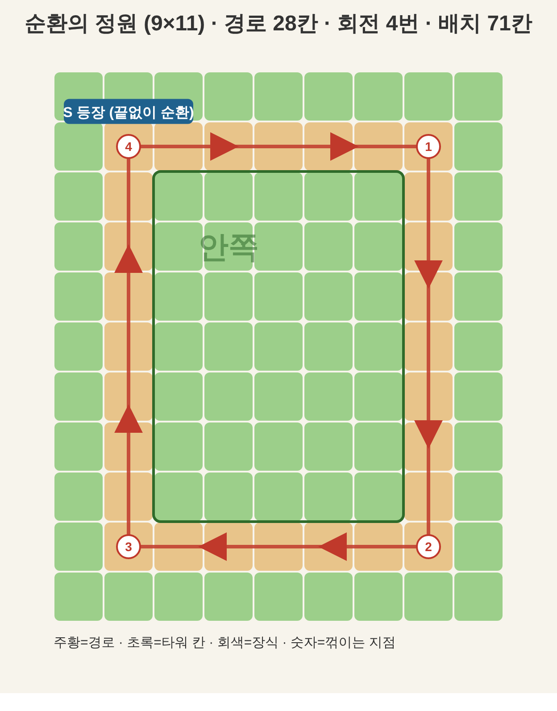

# 운빨 디펜스 — 맵 상세

> 버전: v0.7 (T-3: 2×2 블록) · 데이터: `src/data/maps/*.json` · 관련: [GDD.md](GDD.md) 2장

---

## 0. 공통 규칙

| 항목 | 규칙 |
|------|------|
| 좌표 | (x, y) = (열, 행), 왼쪽 위가 (0, 0). 1칸 = 거리 1.0 |
| 칸 종류 | `P` 몹 경로 · `B` 타워 배치 칸 · `X` 빈 땅(배치 불가 — 블록 사이 틈, 나무·바위 장식 자리) |
| **블록 문법 (v0.7, T-3)** | **배치 칸은 모두 2×2 블록** — 블록 칸은 모두 `B`, 블록끼리 겹치거나 맞닿지 않음(길·빈 땅으로 떨어짐), 블록 밖 `B` 없음. 사용자 요청 "칸 갯수 다 줄이자. 지금 3x3인데 2x2로" (예전 3×3 블록 + 가장자리 땅) |
| 몹 이동 | 웨이포인트를 순서대로 직선 이동. 기본 속도 1.5칸/초 |
| 몹 겹침 | 몹끼리 충돌 없음 (같은 칸에 여러 마리 가능) |
| 스테이지 맵 규칙 | 직각 회전 **최소 5번**, 블록 6개 이상 |
| 화면 배치 | 맵은 HUD와 아래 띠 사이 영역에 들어가는 가장 큰 크기로 (가로·세로 모두 여백 없이 꽉, 남는 축은 가운데 — 시험판 4 맵 B안 + A-1 '위아래 여백도 없애줘'. 알림·아래 띠와의 틈은 영역의 MAP_TOP_GAP_PX·MAP_BOTTOM_GAP_PX). 화면은 휴대폰 비율대로 꽉 참 (가로 1080, 세로 1920~2600) |
| 칸 보이기 (T-3) | 평소에는 칸 네모·격자선·블록 상자를 그리지 않는다 (땅은 이어진 배경 그림). 길은 늘 또렷하게(테두리 + 흙 + 진행 방향 화살표). 배치 칸은 타워를 끄는 동안·배치할 수 없는 곳을 눌렀을 때 잠깐·판 시작 때만 옅게 |

자동 검사: `src/data/load.ts` `checkMap`/`checkMapBlocks`(게임 시작 때) + `python3 tools/gen_tables.py --check` (같은 2×2 블록 문법). 아래 표·그림·커버리지는 `gen_tables.py`가 맵 JSON에서 만든다.

<!-- GEN:MAPLIST -->
| 맵 | 모드 | 크기 | 2×2 블록 | 배치 칸 | 경로 길이 | 회전 | 교차 |
|------|------|------|------|------|------|------|------|
| 순환의 정원 (`circle`) | 무한 (순환) | 7×11 | 8개 | **32칸** | 24칸 | 4번 | 0곳 |
| 사거리 미로 (`crossroads`) | 스테이지 | 10×10 | 9개 | **36칸** | 59칸 | 10번 | 4곳 |
<!-- /GEN:MAPLIST -->

---

## 1. 사거리 미로 — 캠페인 테마 1 「국경 평원」 맵


- 원본: 사용자 스케치 [`images/crossroads_sketch.jpg`](images/crossroads_sketch.jpg) — 정사각형 블록 3×3 배열 사이를 몹이 직각으로 돌며 지나감
- 데이터: [`src/data/maps/crossroads.json`](../src/data/maps/crossroads.json) (v3, T-3: 블록 1개 = 2×2 배치 칸, 13×13·96칸 → 10×10·36칸. 위 그림은 예전 v2)

### 1.1 제원

| 항목 | 값 |
|------|-----|
| 크기 | 10 × 10 |
| 블록 | 9개 (A~I), 블록 1개 = **2×2 배치 칸** |
| 배치 칸 | **36칸** (예전 96칸의 38%) |
| 경로 길이 | 59칸 (화면 밖 등장·퇴장 포함) |
| 직각 회전 | **10번** |
| 교차점 | **4곳** — (3,3), (6,3), (6,6), (3,6) |
| 목숨 | 20 |
| 통과 시간 | 일반 몹 39초 · 빠른 몹 25초 · 보스 66초 (보스는 60초 제한이 먼저 옴) |

### 1.2 타일 배치 (`·` = 빈 땅)

<!-- GEN:TILES_CROSSROADS -->
```
     x: 0 1 2 3 4 5 6 7 8 9
y= 0    P · · P · · P P P P
y= 1    P B B P B B P B B P
y= 2    P B B P B B P B B P
y= 3    P P P P P P P P P P
y= 4    · B B P B B P B B ·
y= 5    · B B P B B P B B ·
y= 6    P P P P P P P P P P
y= 7    P B B P B B P B B P
y= 8    P B B P B B P B B P
y= 9    P P P P · · P P P P
```
<!-- /GEN:TILES_CROSSROADS -->

- 등장 S = (0,-1) → (0,0)으로 들어옴, 출구 E = (3,0)에서 위로 빠져나감 → (3,-1)
- 블록 이름: 위 줄 A B C, 가운데 줄 D E F, 아래 줄 G H I

### 1.3 이동 순서 (웨이포인트)

| 순서 | 구간 | 방향 | 길이 | 지나가는 블록 옆면 |
|------|------|------|------|-----------------|
| 등장 | (0,-1) → (0,3) | ↓ | 4 | A 왼쪽 |
| ① | (0,3) → (9,3) | → | 9 | A·B·C 아래, D·E·F 위 (교차 2곳) |
| ② | (9,3) → (9,0) | ↑ | 3 | C 오른쪽 |
| ③ | (9,0) → (6,0) | ← | 3 | C 위 |
| ④ | (6,0) → (6,9) | ↓ | 9 | B·E·H 오른쪽, C·F·I 왼쪽 (교차 2곳) |
| ⑤ | (6,9) → (9,9) | → | 3 | I 아래 |
| ⑥ | (9,9) → (9,6) | ↑ | 3 | I 오른쪽 |
| ⑦ | (9,6) → (0,6) | ← | 9 | D·E·F 아래, G·H·I 위 (교차 2곳) |
| ⑧ | (0,6) → (0,9) | ↓ | 3 | G 왼쪽 |
| ⑨ | (0,9) → (3,9) | → | 3 | G 아래 |
| ⑩ | (3,9) → (3,-1) | ↑ | 10 | G·D·A 오른쪽, H·E·B 왼쪽 (교차 2곳) → 출구 |

- 몹은 교차점을 그대로 통과한다 (서로 막지 않음)
- 같은 몹이 교차점을 **두 번** 지나가므로 교차점 근처 타워는 한 몹을 두 번 공격할 기회가 있다

### 1.4 블록 분석 (명당)

<!-- GEN:BLOCKS_CROSSROADS -->
| 블록 | 칸 | 경로가 닿는 면 | 사거리 2.5 평균 커버리지 | 사거리 1.5 평균 |
|------|------|------|------|------|
| A | (1,1)~(2,2) | 3면 | 10.2 | 4.2 |
| B | (4,1)~(5,2) | 3면 | 11.8 | 4.5 |
| C | (7,1)~(8,2) | 4면 | 12.2 | 5.2 |
| D | (1,4)~(2,5) | 3면 | 12.0 | 4.5 |
| E | (4,4)~(5,5) | 4면 | 16.0 | 6.0 |
| F | (7,4)~(8,5) | 3면 | 12.0 | 4.5 |
| G | (1,7)~(2,8) | 4면 | 12.2 | 5.2 |
| H | (4,7)~(5,8) | 3면 | 12.0 | 4.5 |
| I | (7,7)~(8,8) | 4면 | 12.2 | 5.2 |
<!-- /GEN:BLOCKS_CROSSROADS -->

2×2 블록은 모든 칸이 블록 가장자리라 **가운데 칸(사거리 1.5로 경로에 닿지 않는 칸)이 없다** — 예전 3×3 블록의 '근접 타워 쓸모없는 가운데 칸'이 사라졌다.

**칸별 커버리지 — 사거리 2.5 (사거리 안에 들어오는 경로 칸 수, 교차점은 2번 셈)**

<!-- GEN:COVER25_CROSSROADS -->
```
 ·  ·  ·  ·  ·  ·  ·  ·  ·  ·
 ·  9 10  · 10 11  · 12 11  ·
 · 10 12  · 13 13  · 14 12  ·
 ·  ·  ·  ·  ·  ·  ·  ·  ·  ·
 · 11 13  · 16 16  · 13 11  ·
 · 11 13  · 16 16  · 13 11  ·
 ·  ·  ·  ·  ·  ·  ·  ·  ·  ·
 · 12 14  · 13 13  · 14 12  ·
 · 11 12  · 11 11  · 12 11  ·
 ·  ·  ·  ·  ·  ·  ·  ·  ·  ·
```
<!-- /GEN:COVER25_CROSSROADS -->

**칸별 커버리지 — 사거리 1.5 (근접 타워 기준)**

<!-- GEN:COVER15_CROSSROADS -->
```
 ·  ·  ·  ·  ·  ·  ·  ·  ·  ·
 ·  3  3  ·  3  3  ·  5  5  ·
 ·  5  6  ·  6  6  ·  6  5  ·
 ·  ·  ·  ·  ·  ·  ·  ·  ·  ·
 ·  3  6  ·  6  6  ·  6  3  ·
 ·  3  6  ·  6  6  ·  6  3  ·
 ·  ·  ·  ·  ·  ·  ·  ·  ·  ·
 ·  5  6  ·  6  6  ·  6  5  ·
 ·  5  5  ·  3  3  ·  5  5  ·
 ·  ·  ·  ·  ·  ·  ·  ·  ·  ·
```
<!-- /GEN:COVER15_CROSSROADS -->

### 1.5 배치 공략 (튜토리얼·도움말에 사용)

- **블록 E(가운데)**: 네 면이 모두 길이고 교차점 4곳에 붙어 있다 → 핵심 딜러·광역 타워 자리
- **오라 자리**: 2×2 블록에서는 한 칸의 '주변 8칸'에 같은 블록 3칸 + 길 건너 이웃 블록 칸이 들어간다 → 대장장이·북치기·음유시인은 블록 모서리(교차점 쪽)에
- **교차점 옆 칸**(예: (2,2)·(4,2)·(2,4)·(4,4) — 교차점 (3,3)을 둘러싼 네 칸) = 광역 타워 명당
- 블록 A는 몹이 처음 지나가고 마지막에도 지나가는 곳 → 제어 타워(진흙 주술사·얼음 마법사)
- **감지 오라 명당**: 블록 E의 감지 오라 r4(예언자)는 교차점 4곳을 모두 덮는다
- 칸이 36칸뿐이라 판 후반에는 칸이 모자란다 → 승급(3개 합성)으로 칸을 비우며 강해지는 것이 기본

---

## 2. 순환의 정원 — 무한 모드 기본 맵



- 데이터: [`src/data/maps/circle.json`](../src/data/maps/circle.json) (v2, T-3: 9×11·71칸 → 7×11·2×2 블록 8개 32칸. 위 그림은 예전 v1)

### 2.1 제원

| 항목 | 값 |
|------|-----|
| 크기 | 7 × 11 |
| 경로 | 사각 고리 (열 0~6, 행 2~8), 시계 방향 |
| 고리 길이 | 24칸 → 일반 몹 한 바퀴 16초 |
| 배치 칸 | **32칸** = 2×2 블록 8개 (고리 안쪽 4개 + 고리 위 바깥 2개 + 아래 바깥 2개). 예전 71칸의 45% |
| 몹 등장 | (0,2) 왼쪽 위 모서리 |
| 패배 | 맵 위 몹 150마리 초과 (계정 상점으로 최대 180) |

### 2.2 타일 배치 (`·` = 빈 땅)

<!-- GEN:TILES_CIRCLE -->
```
     x: 0 1 2 3 4 5 6
y= 0    · B B · B B ·
y= 1    · B B · B B ·
y= 2    P P P P P P P
y= 3    P B B · B B P
y= 4    P B B · B B P
y= 5    P · · · · · P
y= 6    P B B · B B P
y= 7    P B B · B B P
y= 8    P P P P P P P
y= 9    · B B · B B ·
y=10    · B B · B B ·
```
<!-- /GEN:TILES_CIRCLE -->

### 2.3 블록 분석과 칸별 커버리지 (사거리 2.5)

<!-- GEN:BLOCKS_CIRCLE -->
| 블록 | 칸 | 경로가 닿는 면 | 사거리 2.5 평균 커버리지 | 사거리 1.5 평균 |
|------|------|------|------|------|
| 위1 | (1,0)~(2,1) | 1면 | 4.0 | 1.5 |
| 위2 | (4,0)~(5,1) | 1면 | 4.0 | 1.5 |
| 안1 | (1,3)~(2,4) | 2면 | 6.8 | 2.8 |
| 안2 | (4,3)~(5,4) | 2면 | 6.8 | 2.8 |
| 안3 | (1,6)~(2,7) | 2면 | 6.8 | 2.8 |
| 안4 | (4,6)~(5,7) | 2면 | 6.8 | 2.8 |
| 아래1 | (1,9)~(2,10) | 1면 | 4.0 | 1.5 |
| 아래2 | (4,9)~(5,10) | 1면 | 4.0 | 1.5 |
<!-- /GEN:BLOCKS_CIRCLE -->

<!-- GEN:COVER25_CIRCLE -->
```
 ·  3  3  ·  3  3  ·
 ·  5  5  ·  5  5  ·
 ·  ·  ·  ·  ·  ·  ·
 ·  7  7  ·  7  7  ·
 ·  7  6  ·  6  7  ·
 ·  ·  ·  ·  ·  ·  ·
 ·  7  6  ·  6  7  ·
 ·  7  7  ·  7  7  ·
 ·  ·  ·  ·  ·  ·  ·
 ·  5  5  ·  5  5  ·
 ·  3  3  ·  3  3  ·
```
<!-- /GEN:COVER25_CIRCLE -->

- 고리 안쪽 블록 4개는 두 면이 길에 닿는다 (모서리 칸 (1,3)·(5,3)·(1,7)·(5,7)이 명당)
- 고리 바깥 위·아래 블록은 한 면만 닿지만 고리의 긴 변을 따라 몹이 지나간다 → 사거리 긴 타워·경제형(은행가·연금술사) 자리
- 가운데 십자(빈 땅)는 배치 불가 — 예전 v1의 '사거리 2.5로 경로에 닿지 않는 가운데 세로줄'이 사라졌다

<!-- GEN:COVER15_CIRCLE -->
```
 ·  0  0  ·  0  0  ·
 ·  3  3  ·  3  3  ·
 ·  ·  ·  ·  ·  ·  ·
 ·  5  3  ·  3  5  ·
 ·  3  0  ·  0  3  ·
 ·  ·  ·  ·  ·  ·  ·
 ·  3  0  ·  0  3  ·
 ·  5  3  ·  3  5  ·
 ·  ·  ·  ·  ·  ·  ·
 ·  3  3  ·  3  3  ·
 ·  0  0  ·  0  0  ·
```
<!-- /GEN:COVER15_CIRCLE -->

---

## 3. 캠페인 테마 2~10 맵과 추가 무한 맵

| 맵 | 모드 | 해금 | 크기 | 특징 |
|----|------|------|------|------|
| 십자 순환 | 무한 | 계정 Lv30 | 11×11 | 고리 2개가 가운데에서 십자로 겹침. 몹이 8자 모양으로 순환, 교차점 1곳에 몹이 몰림. 2×2 블록 (배치 칸 약 32~40) |

- 캠페인 테마 2~10 맵 9개(나선 갱도, 쌍둥이 숲길, 협곡 지그재그, 섬 다리, 미궁 회랑, 도시 격자, 빙하 고리, 용암 계단, 차원 소용돌이)는 [CAMPAIGN.md](CAMPAIGN.md) 2.1 참고
- 추가 맵은 업데이트로 계속 늘릴 수 있도록 맵 파일 하나 = 맵 하나 구조
- 새 맵의 경로 데이터는 자동 검사: 2×2 블록 문법(0장), 스테이지 맵은 회전 5번 이상, 등장→출구 연결, 블록 6개 이상
