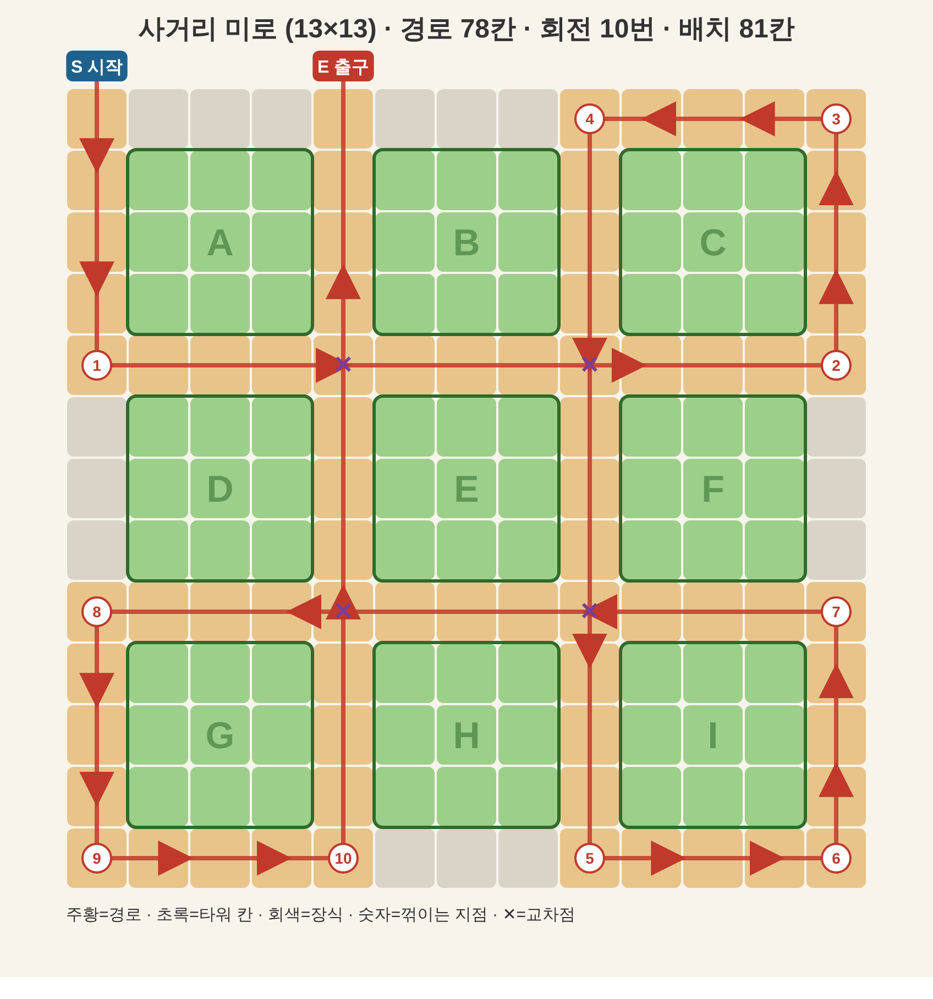

# 운빨 디펜스 — 맵 상세

> 버전: v0.4 · 데이터: `src/data/maps/*.json` · 관련: [GDD.md](GDD.md) 2장

---

## 0. 공통 규칙

| 항목 | 규칙 |
|------|------|
| 좌표 | (x, y) = (열, 행), 왼쪽 위가 (0, 0). 1칸 = 거리 1.0 |
| 칸 종류 | `P` 몹 경로 · `B` 타워 배치 칸 · `X` 장식(나무·바위, 배치 불가) |
| 몹 이동 | 웨이포인트를 순서대로 직선 이동. 기본 속도 1.5칸/초 |
| 몹 겹침 | 몹끼리 충돌 없음 (같은 칸에 여러 마리 가능) |
| 스테이지 맵 규칙 | 직각 회전 **최소 5번** |
| 화면 배치 | 맵은 화면 가로폭에 맞춰 확대. 13칸 기준 1칸 ≈ 화면 폭의 1/13.5 |

---

## 1. 사거리 미로 — 스테이지 모드 기본 맵



- 원본: 사용자 스케치 [`images/crossroads_sketch.jpg`](images/crossroads_sketch.jpg) — 정사각형 블록 3×3 배열 사이를 몹이 직각으로 돌며 지나감
- 데이터: [`src/data/maps/crossroads.json`](../src/data/maps/crossroads.json)

### 1.1 제원

| 항목 | 값 |
|------|-----|
| 크기 | 13 × 13 |
| 블록 | 9개 (A~I), 블록 1개 = 3×3 배치 칸 |
| 배치 칸 | **81칸** |
| 경로 길이 | 78칸 (화면 밖 등장·퇴장 포함) |
| 직각 회전 | **10번** |
| 교차점 | **4곳** — (4,4), (8,4), (8,8), (4,8) |
| 목숨 | 20 |
| 통과 시간 | 일반 몹 52초 · 빠른 몹 33초 · 보스 87초 (보스는 60초 제한이 먼저 옴) |

### 1.2 타일 배치

```
     x: 0 1 2 3 4 5 6 7 8 9 0 1 2
y= 0    P X X X P X X X P P P P P      S = (0,-1)에서 등장 → (0,0)으로 들어옴
y= 1    P B B B P B B B P B B B P      E = (4,0)에서 위로 빠져나감 → (4,-1)
y= 2    P B A B P B B B P B C B P
y= 3    P B B B P B B B P B B B P      블록 이름
y= 4    P P P P P P P P P P P P P        A B C
y= 5    X B B B P B B B P B B B X        D E F
y= 6    X B D B P B E B P B F B X        G H I
y= 7    X B B B P B B B P B B B X
y= 8    P P P P P P P P P P P P P
y= 9    P B B B P B B B P B B B P
y=10    P B G B P B H B P B I B P
y=11    P B B B P B B B P B B B P
y=12    P P P P P X X X P P P P P
```

### 1.3 이동 순서 (웨이포인트)

| 순서 | 구간 | 방향 | 길이 | 지나가는 블록 옆면 |
|------|------|------|------|-----------------|
| 등장 | (0,-1) → (0,4) | ↓ | 5 | A 왼쪽 |
| ① | (0,4) → (12,4) | → | 12 | A·B·C 아래, D·E·F 위 (교차 2곳) |
| ② | (12,4) → (12,0) | ↑ | 4 | C 오른쪽 |
| ③ | (12,0) → (8,0) | ← | 4 | C 위 |
| ④ | (8,0) → (8,12) | ↓ | 12 | B·E·H 오른쪽, C·F·I 왼쪽 (교차 2곳) |
| ⑤ | (8,12) → (12,12) | → | 4 | I 아래 |
| ⑥ | (12,12) → (12,8) | ↑ | 4 | I 오른쪽 |
| ⑦ | (12,8) → (0,8) | ← | 12 | D·E·F 아래, G·H·I 위 (교차 2곳) |
| ⑧ | (0,8) → (0,12) | ↓ | 4 | G 왼쪽 |
| ⑨ | (0,12) → (4,12) | → | 4 | G 아래 |
| ⑩ | (4,12) → (4,-1) | ↑ | 13 | G·D·A 오른쪽, H·E·B 왼쪽 (교차 2곳) → 출구 |

- 몹은 교차점을 그대로 통과한다 (서로 막지 않음)
- 같은 몹이 교차점을 **두 번** 지나가므로 교차점 근처 타워는 한 몹을 두 번 공격할 기회가 있다

### 1.4 블록 분석 (명당)

| 블록 | 경로가 닿는 면 | 사거리 2.5 기준 평균 커버리지 | 특징 |
|------|--------------|----------------------------|------|
| **E (가운데)** | 4면 (교차점 4곳에 모두 인접) | **10.7** (최고) | 최고 명당. 핵심 딜러 자리 |
| C · G · I | 4면 | 9.0 | 블록을 경로가 한 바퀴 감쌈 |
| D · F · H | 3면 | 8.0 | 교차점 2곳에 인접 |
| B | 3면 | 7.9 | |
| A | 3면 (등장 직후·출구 직전) | 7.2 | 첫 타격·마지막 방어선 |

**칸별 커버리지 (사거리 2.5 안에 들어오는 경로 칸 수, 교차점은 2번 셈)**

```
 ·  ·  ·  ·  ·  ·  ·  ·  ·  ·  ·  ·  ·
 ·  4  6  4  ·  4  6  5  ·  7  9  7  ·
 ·  7  9  8  ·  8  9  8  · 10 12  9  ·
 ·  7 10 10  · 10 11 10  · 10 10  7  ·
 ·  ·  ·  ·  ·  ·  ·  ·  ·  ·  ·  ·  ·
 ·  5  8 10  · 10 11 10  · 10  8  5  ·
 ·  6  9 11  · 11 12 11  · 11  9  6  ·
 ·  5  8 10  · 10 11 10  · 10  8  5  ·
 ·  ·  ·  ·  ·  ·  ·  ·  ·  ·  ·  ·  ·
 ·  7 10 10  · 10 11 10  · 10 10  7  ·
 ·  9 12 10  ·  8  9  8  · 10 12  9  ·
 ·  7  9  7  ·  5  6  5  ·  7  9  7  ·
 ·  ·  ·  ·  ·  ·  ·  ·  ·  ·  ·  ·  ·
```

### 1.5 배치 공략 (튜토리얼·도움말에 사용)

- **블록 가운데 칸은 근접 타워 금지**: 블록 중앙 칸에서 사거리 1.5 안에는 경로가 없다 → 근접 타워(광부·전사·대장장이 등)는 블록 **가장자리 8칸**에
- **블록 가운데 칸 = 오라 자리**: 대장장이·북치기·음유시인·수호 기사를 가운데에 두면 주변 8칸 전부에 버프
- **교차점 옆 칸**(예: (3,3), (5,5), (7,7) 등 블록 모서리) = 광역 타워 명당
- 블록 A는 몹이 처음 지나가고 마지막에도 지나가는 곳 → 제어 타워(덫 사냥꾼·얼음 마법사)
- 장식 칸 15곳: 위쪽 (1~3,0)·(5~7,0), 좌우 (0,5~7)·(12,5~7), 아래 (5~7,12)

---

## 2. 순환의 정원 — 무한 모드 기본 맵


- 데이터: [`src/data/maps/circle.json`](../src/data/maps/circle.json)

### 2.1 제원

| 항목 | 값 |
|------|-----|
| 크기 | 9 × 11 |
| 경로 | 사각 고리 (열 1~7, 행 1~9), 시계 방향 |
| 고리 길이 | 28칸 → 일반 몹 한 바퀴 18.7초 |
| 배치 칸 | **71칸** (고리 안쪽 5×7 = 35, 바깥 테두리 36) |
| 몹 등장 | (1,1) 왼쪽 위 모서리 |
| 패배 | 맵 위 몹 150마리 초과 (계정 상점으로 최대 180) |

### 2.2 타일 배치

```
     x: 0 1 2 3 4 5 6 7 8
y= 0    B B B B B B B B B
y= 1    B P P P P P P P B      S = (1,1) 등장, 시계 방향 순환
y= 2    B P B B B B B P B
y= 3    B P B B B B B P B
y= 4    B P B B B B B P B
y= 5    B P B B B B B P B
y= 6    B P B B B B B P B
y= 7    B P B B B B B P B
y= 8    B P B B B B B P B
y= 9    B P P P P P P P B
y=10    B B B B B B B B B
```

### 2.3 칸별 커버리지 (사거리 2.5)

```
 3  4  5  5  5  5  5  4  3
 4  ·  ·  ·  ·  ·  ·  ·  4
 5  ·  7  7  5  7  7  ·  5
 5  ·  7  6  3  6  7  ·  5
 5  ·  5  3  0  3  5  ·  5
 5  ·  5  3  0  3  5  ·  5
 5  ·  5  3  0  3  5  ·  5
 5  ·  7  6  3  6  7  ·  5
 5  ·  7  7  5  7  7  ·  5
 4  ·  ·  ·  ·  ·  ·  ·  4
 3  4  5  5  5  5  5  4  3
```

- 고리 안쪽 네 모서리 주변 (2,2)·(6,2)·(2,8)·(6,8) = 명당
- **가운데 세로줄 (4,4)~(4,6)은 사거리 2.5로 경로에 닿지 않음** → 학자·전쟁 군주처럼 '전체' 효과 타워나 사거리 4 이상 타워 자리
- 바깥 테두리 모서리 4칸은 커버리지가 낮음 → 경제형 타워(은행가·연금술사) 자리

---

## 3. 추가 맵 (계정 레벨 해금)

| 맵 | 모드 | 해금 | 크기 | 특징 |
|----|------|------|------|------|
| 나선 미로 | 스테이지 | 계정 Lv25 | 13×13 | 바깥에서 안쪽으로 감겨 들어가는 사각 나선, 직각 회전 12번, 출구가 맵 중앙. 배치 칸 64 |
| 십자 순환 | 무한 | 계정 Lv30 | 11×11 | 고리 2개가 가운데에서 십자로 겹침. 몹이 8자 모양으로 순환, 교차점 1곳에 몹이 몰림. 배치 칸 72 |
| 쌍둥이 길 | 스테이지 | 계정 Lv40 | 13×15 | 등장 지점 2곳 (몹이 번갈아 등장), 출구 1곳으로 합류. 회전 각 6번 |

- 추가 맵은 업데이트로 계속 늘릴 수 있도록 맵 파일 하나 = 맵 하나 구조
- 새 맵의 경로 데이터는 자동 검사: 스테이지 맵은 회전 5번 이상, 등장→출구 연결, 배치 칸 40개 이상
