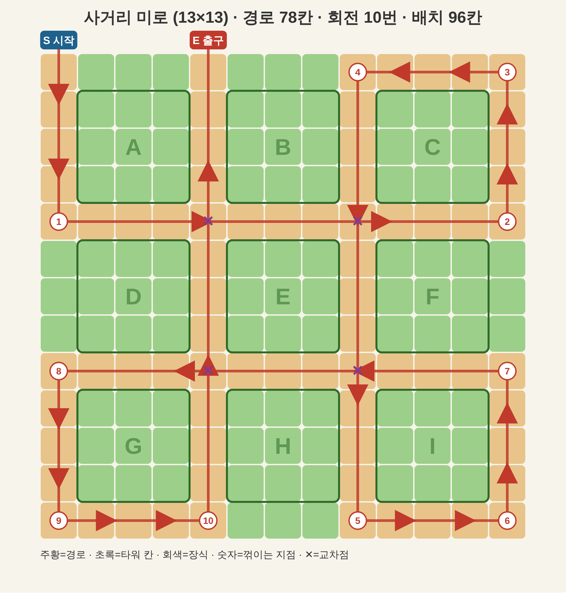

# 운빨 디펜스 — 멀티 모드 설계 (안드로이드 + 아이폰)

> 버전: v0.5 · 관련: [ARCHITECTURE.md](ARCHITECTURE.md), [DEV_PLAN.md](DEV_PLAN.md) M0·M12·M13
> 목표: 지금은 **안드로이드 1인용**으로 쓰고, 나중에 **아이폰 사용자와 2인 협동·대결**을 붙일 수 있게 처음부터 구조를 맞춰 둔다.

---

## 0. 결론 요약

| 결정 | 내용 |
|------|------|
| 아이폰 지원 방식 | **웹앱(PWA)**: 사파리에서 열고 '홈 화면에 추가'. 같은 코드 그대로, 앱스토어·맥 불필요 |
| 안드로이드 | 지금 계획대로 앱(APK) |
| 동기화 방식 | **결정적 시뮬레이션 + 입력만 주고받기 (락스텝)**. 두 기기가 같은 규칙·같은 난수로 같은 게임을 각자 계산하고, 서로의 조작만 전송 |
| 연결 1단계 | **같은 Wi-Fi**: 서버 없이 기기끼리 직접 연결 (QR 코드로 연결 정보 교환) |
| 연결 2단계 | **온라인**: 6자리 방 코드 + 무료 서버리스 연결 중계 |
| 지금 해야 할 일 | 1인용을 만들 때부터 ① 고정 틱 시뮬레이션 ② 모든 조작을 '명령'으로 ③ 난수 시드 ④ 상태 해시 — 이 4가지를 지킨다 (M0) |

---

## 1. 크로스 플랫폼 전략

### 1.1 배포 방식 비교 (아이폰)

| 방식 | 비용 | 필요한 것 | 장점 | 단점 |
|------|------|----------|------|------|
| **PWA (채택)** | 무료 | 공개 웹 주소 1개 | 같은 코드, 설치 간단, 업데이트 자동 | 진동 없음 등 일부 제약 (1.2) |
| TestFlight | 연 $99 (Apple 개발자 등록) | 맥 + Xcode | 진짜 앱 | 비용, 90일마다 재배포 |
| 무료 개발자 서명 | 무료 | 맥 + Xcode + 케이블 | 진짜 앱 | **7일마다 다시 설치** |

- PWA 호스팅: 자동 업데이트용 공개 저장소 `Random-TD-updates`의 **GitHub Pages**에 웹 빌드를 함께 올린다 ([ARCHITECTURE.md](ARCHITECTURE.md) 3.8)
  - 주소 예: `https://<계정>.github.io/Random-TD-updates/play/`
  - 소스 코드는 비공개 저장소에 그대로, 공개되는 것은 빌드 결과물뿐
- 안드로이드도 원하면 같은 주소로 웹앱 실행 가능 (테스트용)

### 1.2 아이폰 웹앱 제약과 대응

| 제약 | 대응 |
|------|------|
| 진동 API 없음 | 진동 대신 화면 흔들림·소리로 대체 (설정에 '진동' 항목 숨김) |
| 소리는 첫 터치 후에만 재생 | 타이틀 화면 첫 터치에서 오디오 잠금 해제 |
| 화면 꺼짐 | 화면 꺼짐 방지(Wake Lock) 지원 버전이면 사용, 아니면 안내 문구 |
| 노치·홈 바 | 안전 영역(safe area) 여백 적용 |
| 저장 공간 | 홈 화면에 추가한 웹앱은 브라우저의 장기 미사용 삭제 대상에서 빠지지만, 그래도 **저장 파일 내보내기** 안내 |
| 백그라운드 | 앱을 내리면 즉시 일시정지 + 저장 (멀티 중에는 상대에게 '자리 비움' 표시) |
| 설치 안내 | 사파리로 처음 열면 "공유 → 홈 화면에 추가" 그림 안내 1회 |

---

## 2. 멀티 모드 종류

### 2.1 협동 A — 「둘이서 사거리 미로」 (스테이지 2인)



| 항목 | 규칙 |
|------|------|
| 맵 | 사거리 미로 1개를 함께 씀 |
| 칸 나눔 | **P1 = 왼쪽 열** (블록 A·D·G + 왼쪽 가장자리 땅) / **P2 = 오른쪽 열** (블록 C·F·I + 오른쪽 가장자리 땅) / **가운데 열 (블록 B·E·H + 위아래 가장자리 땅) = 공용**: 먼저 놓는 사람이 임자 |
| 칸 표시 | 내 칸 = 파란 테두리, 친구 칸 = 분홍 테두리, 공용 = 노란 테두리 |
| 공유 | 목숨 30개, 단계 타이머, 보스, 도전 |
| 각자 | 돈, 일꾼, 덱, 판 내 강화, 판 안 미션 |
| 난이도 | 몹 체력 ×1.7, 단계당 몹 30마리 |
| 승급 | 자기 타워끼리만 |
| **우정 조합** | 히든 조합은 **두 사람의 타워를 섞어서** 가능 (조합 결과는 버튼을 누른 사람 소유) |
| 송금 | 단계당 최대 1,000원까지 친구에게 보내기 |
| 선물 | 단계당 1번, 내 타워 1개를 친구에게 넘기기 (친구 칸이나 공용 칸으로 이동) |
| 이모티콘 | 👍 😂 😱 ❤ 🙏 🎉 (6종, 상대 화면에 2초) |
| 핑 | 맵을 두 손가락으로 길게 누르면 그 자리에 느낌표 핑 |

### 2.2 협동 B — 「두 개의 정원」 (무한 2인)

| 항목 | 규칙 |
|------|------|
| 맵 | 각자 자기 순환의 정원. 화면 위쪽에 친구 정원 미니맵 (몹 수·위험 표시) |
| 패배 | **두 정원의 몹 합계 300마리 초과** 시 둘 다 패배 |
| 보스 | 두 정원에 동시에 나타나고 **체력을 공유** (둘이 같이 깎음) |
| 구조 요청 | 몹이 120마리를 넘으면 친구 화면에 "구조 요청!" → 송금·선물로 돕기 |
| 지원 사격 | 판당 3회, 내 타워 1개를 10초 동안 친구 정원에 보내 공격 (내 정원에서는 그동안 빠짐) |

### 2.3 대결 — 「운빨 배틀」

| 항목 | 규칙 |
|------|------|
| 맵 | 각자 순환의 정원 (같은 맵) |
| 같은 운 | 두 사람의 몹 등장은 같은 시드. 소환·승급 운은 각자 다름 (설정으로 '완전히 같은 운' 선택 가능) |
| 방해 몹 | 내가 몹 10마리를 잡을 때마다 상대 정원에 '방해 몹' 1마리 (그 단계 체력 ×3) |
| 방해 스킬 | 500원: 상대 몹 이동속도 +20% 10초 / 1,000원: 상대 도박 1회 강제 ×0 (판당 1회) — 가볍게 |
| 승리 | 상대가 먼저 패배하면 승리. 30분이 지나면 도달 단계가 높은 쪽 승리 |
| 공정 모드 (기본 켬) | 타워 레벨·계정 상점·특성·도감 보너스를 끄고 같은 조건으로 |

### 2.4 보상

| 항목 | 내용 |
|------|------|
| 경험치 | 협동 +30% 보너스, 대결은 승리 +200 |
| 업적 | 「함께라서 다행이야」 협동 10판, 「찰떡궁합」 우정 조합 1회, 「사랑과 전쟁」 대결 10판 등 |
| 기록 | 함께한 판 수, 협동 최고 단계, 대결 전적 (서로의 기기에 각각 저장) |
| 계정 | 두 사람 모두 **자기 계정**으로 성장. 상대 계정 데이터는 저장하지 않음 (닉네임·칭호만 표시) |

---

## 3. 연결

### 3.1 1단계: 같은 Wi-Fi (서버 없음)

```
① P1(방장): [함께하기] → [방 만들기] → [같은 Wi-Fi] → 화면에 QR 코드 A (연결 제안)
② P2: [참가하기] → 카메라로 QR A 스캔 → 화면에 QR 코드 B (연결 응답)
③ P1: 카메라로 QR B 스캔 → 직접 연결 완료 (WebRTC 데이터 채널)
④ 대기실 → 모드 선택 → 둘 다 [준비] → 시작
```

- 기기끼리 직접 통신 (WebRTC). 인터넷이 없어도 같은 공유기 안에서 동작
- QR에 담는 연결 정보는 압축해서 1~2KB 이내
- 실패하면 '온라인 연결'로 안내

### 3.2 2단계: 온라인 (떨어져 있을 때)

```
① P1: [방 만들기] → [온라인] → 6자리 방 코드 (예: 482 913)
② P2: [참가하기] → 코드 입력
③ 중계 서버가 두 기기의 연결 정보만 전달 → 직접 연결 (안 되면 중계 서버로 우회)
```

| 구성 | 선택지 | 비고 |
|------|--------|------|
| 연결 정보 중계 | Cloudflare Workers 또는 Firebase 무료 요금제 | 방 코드와 연결 정보만 잠깐 저장, 10분 뒤 삭제 |
| 직접 연결 실패 시 | 같은 서버를 통한 우회 전송 | 게임 데이터는 아주 작아서 무료 한도로 충분 |
| 개인정보 | 기기마다 무작위 ID, 닉네임만 전송. 계정·이메일 없음 | |

- 네트워크 정책 변경: "인터넷은 업데이트할 때만" + **"사용자가 멀티 모드를 직접 켰을 때만"** 추가

---

## 4. 동기화 설계 (락스텝)

### 4.1 원리

```
두 기기가 같은 규칙 + 같은 시드로 같은 게임을 각자 계산한다.
주고받는 것은 "몇 번째 틱에 누가 무엇을 했다"는 명령뿐이다.

P1 화면 터치 → 명령 {틱 1203, P1, 소환, 칸 (2,3)} → 내 큐 + 상대에게 전송
                                                   ↓
두 기기 모두 틱 1203이 되면 그 명령을 같은 순서로 실행 → 같은 결과
```

| 항목 | 값 |
|------|-----|
| 로직 틱 | **초당 20틱** (50ms). 화면은 60fps로 틱 사이를 보간해서 부드럽게 |
| 입력 지연 | 명령은 '현재 틱 + 3' (150ms 뒤)에 실행 → 네트워크 지연을 숨김 |
| 틱 진행 조건 | 두 사람의 해당 틱 명령(없으면 '빈 명령')이 모두 도착해야 진행 |
| 명령 크기 | 대부분 20바이트 이하, 초당 20개 |
| 실행 순서 | 같은 틱 안에서는 (플레이어 번호, 명령 번호) 순 |

### 4.2 결정성 규칙 (1인용 개발 때부터 지킬 것)

| 규칙 | 이유 |
|------|------|
| 게임 로직에 `Math.random()` 금지 → 시드 난수만 | 두 기기가 같은 난수를 내야 함 |
| 난수 흐름 분리: 세계(몹 등장) / P1 소환·승급 / P2 소환·승급 / 도박 | 한 사람의 조작이 다른 흐름에 영향 주지 않게 |
| 게임 로직에 시계(`Date`, `performance.now()`) 금지 → 틱 번호만 | 기기마다 시간이 다름 |
| 위치·체력은 **정수** (1칸 = 1000단위, 체력 정수) | 기기·브라우저마다 소수 계산 오차 방지 |
| `Math.pow`·`sin`·`exp` 등 로직에서 금지 → 체력 곡선 등은 **미리 계산한 표**를 데이터로 | 안드로이드 크롬과 아이폰 사파리의 계산 결과가 미세하게 다를 수 있음 |
| 거리 비교는 **제곱 거리**(정수)로 | 제곱근 없이 정확하게 |
| 반복 순서는 항상 ID 순 | 순서가 다르면 결과가 갈림 |
| 화면(렌더)은 로직 상태를 읽기만 | 그래픽 처리가 로직을 바꾸지 않게 |

### 4.3 어긋남(디싱크) 감지와 복구

| 단계 | 처리 |
|------|------|
| 감지 | 1초(20틱)마다 게임 상태 해시를 교환 |
| 불일치 | 방장 기기가 전체 상태 스냅샷(압축 JSON)을 보내고, 상대는 그 상태로 덮어씀 (화면에 0.5초 '동기화 중') |
| 기록 | 불일치가 나면 직전 명령 기록과 두 상태를 파일로 저장 → 버그 재현용 |

### 4.4 연결 끊김

| 상황 | 처리 |
|------|------|
| 3초 동안 응답 없음 | 양쪽 일시정지 + "친구 연결 대기 중…" |
| 60초 안에 재연결 | 마지막 확정 틱부터 이어서 진행 |
| 60초 초과 | 판 종료, 두 사람 모두 그 시점까지의 정산 |
| 앱 내림 (아이폰 홈 버튼 등) | 상대 화면에 '자리 비움', 30초 뒤 위와 같은 처리 |

### 4.5 버전 맞추기

- 연결할 때 앱 버전 + 데이터 파일 해시를 비교. 다르면 "업데이트가 필요해요" → 자동 업데이트로 맞춘 뒤 재시도

---

## 5. 멀티 화면

| 화면 | 구성 |
|------|------|
| 함께하기 | [방 만들기] [참가하기] [기록] |
| 연결 방식 | [같은 Wi-Fi (QR)] [온라인 (방 코드)] |
| 대기실 | 두 사람 닉네임·칭호·계정 레벨, 모드 선택(방장), 각자 덱 확인·변경, [준비] |
| 게임 (협동 A) | 상단 HUD에 공용 목숨, 내 돈 / 친구 돈(작게), 하단에 [송금] [선물] [😀] 버튼 추가 |
| 게임 (협동 B·대결) | 상단에 친구 정원 미니맵 (몹 수 막대) |
| 결과 | 두 사람 기록 나란히, 함께한 판 수 +1 |

---

## 6. 지금(1인용 개발 단계)에 미리 할 것

| 할 일 | 언제 | 확인 방법 |
|------|------|----------|
| 고정 틱(20Hz) 시뮬레이션 코어, 렌더와 분리 | M0 | 렌더 없이 시뮬레이션만 돌리는 테스트 통과 |
| 모든 조작을 명령 객체로 (소환·승급·이동·강화·도박·도전·미션 받기·카드 선택) | M0~M5 | UI는 명령만 만들고 직접 상태를 바꾸지 않음 |
| 시드 난수 + 흐름 분리 | M0 | 같은 시드·같은 명령 → 같은 결과 테스트 |
| 정수 위치·체력, 미리 계산한 곡선 표 | M0~M1 | 로직 폴더에서 `Math.random`·`Math.pow`·`Date` 사용 시 검사 실패 |
| 상태 해시 함수 | M0 | 매 판 끝에 해시 기록 |
| **리플레이**: 시드 + 명령 기록으로 판 전체 재생 | M3 | 저장한 리플레이를 다시 돌리면 같은 해시 → 결정성 자동 검사 |

- 리플레이는 멀티를 위한 준비이면서 동시에 **버그 재현 도구**이자 **밸런스 시뮬레이터의 기반**이 된다

---

## 7. 위험과 대책

| 위험 | 대책 |
|------|------|
| 기기 간 계산 차이로 어긋남 | 4.2 규칙 + 리플레이 자동 검사를 안드로이드 크롬·아이폰 사파리 양쪽에서 실행 |
| 같은 Wi-Fi인데 직접 연결 실패 (공유기 설정) | 온라인 연결로 우회 안내 |
| 느린 기기가 전체를 늦춤 | 로직은 가벼운 20Hz, 렌더만 기기 성능에 맞춰 낮춤 |
| 아이폰 사파리 정책 변경 | PWA 대신 TestFlight로 옮길 수 있게, 앱 껍데기(Capacitor)는 아이폰 빌드도 가능한 구조 유지 |
