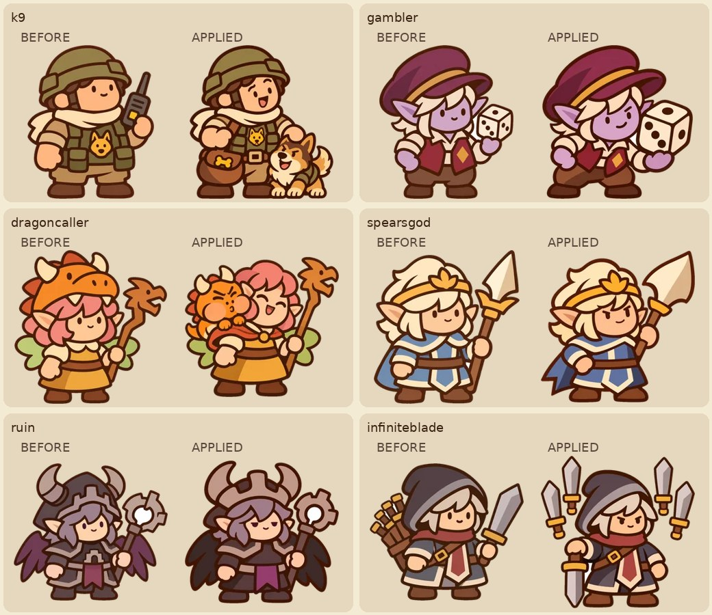

# 영웅65종 기본 모습 리디자인 — 생성·비교·교체 완료

> 2026-11-22 (Pacific/Honolulu). 기준 main `c13d9b27de7cc46f4afd51b2fc2b326d19d56d23`, v0.1.22.
> 사용자 지시: 기존 후보6종을 포함해 **모든 영웅의 기본 모습1안씩 생성하고 기존 그림과 비교 후 변경**.
> **생성65·완료65·비교65·교체65·기존 유지0·유료 재생성0. 총65크레딧 사용.**
> 이 변경은 작업 브랜치/PR의 에셋 교체다. main 병합·APK 릴리스·사용자 기기 업데이트를 의미하지 않는다.

## 결과

- `src/data/towers.json`의65개 영웅ID와 동일한 `public/assets/characters/{id}.webp`만 교체했다. 같은 파일명으로 기존 로비·상세·전투의 이미지 연결을 사용한다.
- 각성53종, 적32종, 인물9종, 캐릭터 manifest, 능력치·조합·저장·SIM_VERSION·앱 버전은 변경하지 않았다.
- 기존 통통한 비율·갈색 외곽선·복장 팔레트·종족·머리색을 유지하면서 표정·자세·대표 소품을 강조했다. 외부 게임 캐릭터를 직접 참조하거나 옮기지 않았다.
- 65개의 원본은 모두1024×1024 PNG. 가장자리 흰 배경 제거·내용 경계 자르기·긴 변256px·WebP quality82/method6으로 처리했다. 최종65개 합계 **1,075,622바이트**(약1.03MiB).
- 큰 윤곽·대표 소품·표정 등 벤치마크의 매력 구조를 사용했다. 생성 원본에는 일부 미세한 색조 변화가 있어 모든 픽셀이 엄격한 단색이라고 주장하지 않는다. 게임 크기에서 형태와 기존 팔레트의 일관성을 검토했다.

## 후보6종의 전후 비교

| 영웅 | 실제 적용에서 확인한 변화 |
| --- | --- |
| 군견병 | 병사 곁의 통통한 군견·간식 주머니, 두 얼굴이 읽히는 한 유닛 |
| 도박꾼 | 커진 주사위·기울어진 자세·능청스러운 표정 |
| 용 소환사 | 용 모자 대신 어깨에 앉아 요정과 교감하는 실제 아기 용 |
| 창술의 신 | 큰 창날·한 손 허리·자신감 있는 표정, 금발 엘프와 파란 복장 유지 |
| 파멸의 신 | 넓은 검은 날개·나른한 표정, 기존 뿔·갑옷·보라 포인트 유지 |
| 무한의 검 | 손의1자루와 떠 있는4자루, 정확히5개의 검이 분리되어 보임 |

## 전체65종 비교

모든 페이지를 직접 열어 검토했다. 각 항목은 **기존 / 새 후보 / 기존 각성 / 새64px·기존64px** 순서다. 페이지의 CANDIDATE는 비교 당시 표기이며, 모두 채택·적용했다. 리미티드12종은 기존 각성 그림이 없어 none으로 표시한다.

| 범위 | 비교표 |
| --- | --- |
| 1~10 · 노말 | [비교01](compare-01.jpg) |
| 11~20 · 레어 | [비교02](compare-02.jpg) |
| 21~30 · 유니크 | [비교03](compare-03.jpg) |
| 31~40 · 히어로 | [비교04](compare-04.jpg) |
| 41~50 · 레전드 | [비교05](compare-05.jpg) |
| 51~60 · 신·리미티드 | [비교06](compare-06.jpg) |
| 61~65 · 리미티드 | [비교07](compare-07.jpg) |

### 검토와 후처리

- 실제 생성 결과를 기존 그림 및 각성 외형과 나란히 보고 얼굴·색·역할 소품·종족이 이어지는지 확인했다.64px 어두운 배경에서도 비교했다. 기존 각성 그림 자체의 표현은 이번에 새로 생성하지 않았다.
- 표정과 비대칭 자세가 더 읽히고, 일부 영웅은 원본보다 변화가 작지만 대표 소품과 얼굴이 잘 유지돼65종 모두 채택했다. '모든 취향에서 객관적으로 더 좋다'는 평가가 아니라 이번 디자인 기준의 채택 결정이다.
- 원본 내용 경계가 캔버스에 닿는 이미지는 없었다.14개 원본의 여백이16px 미만(최소5px)이라 비교표에서 별도 확인했으며, 머리·발·날개·무기 끝이 잘리지 않았음을 확인했다. 최종 WebP는 기존 방식대로 내용 경계에 맞춰 자른다.
- 차원술사는 고리 구멍과 팔 사이의 닫힌 흰 배경2곳을 추가 투명 처리했다. 원본 씨앗좌표(799,198)/(610,321), RGB최솟값250 이상·색차3 이하·4방향 연결 영역36,579픽셀. 외곽 배경과 연결되지 않는 영역임을 확인하고, 기존1px 필터·0.8 blur로 경계를 처리했다. 얼굴·상아색 외투·고글 내부는 보존했다.
- 정적 비교와 실제 게임 렌더/휴대폰 실기기 확인을 구분한다. 이번 비교표를 모바일 E2E 통과로 기록하지 않는다.

## 생성·비용 기록

- 모델 GPT Image2.6 (`gpt_image_2_6`), medium,1k,1:1, opaque 흰 배경 PNG, 영웅별count1·batch_size1.
- 각 영웅의 기존 생성 결과와 기존 스타일 참조, 총2개 참조를 사용했다. 광부 자신은 얼음술사를 스타일 참조로 사용해 같은 이미지를 중복 참조하지 않았다.
- 먼저 같은 설정의24개 요청을 개별 견적했고 모두1크레딧이었다. 나머지41개는 같은 모델·품질·해상도·출력 수·참조 수의 단가를 적용했다.65개 모두 개별 견적했다고 기록하지 않는다.
- 6개 이하 묶음11회로 **서로 다른65개 작업ID**를 받았고, 모든 작업의 completed 상태를 확인했다. 계정 차감도65크레딧으로 확인했다. 모델 변경·추가 안·각성 생성·유료 재시도는 없었다.
- [requests.json](requests.json)에65개 프롬프트·정규화된 참조·원본 체크섬·가격 근거, [jobs.json](jobs.json)에 작업ID·기존 작업ID·교체 결과·치수·체크섬·정적 검토 기록을 남겼다.
- 현재 활성 기본 그림의 작업ID를 `docs/art/higgsfield/chunky/jobs.json`에 갱신했다. 초기 chunky 생성167/채택159 통계는 역사적 원본 묶음이며, 이번65종 통계는 `generation-config.json`의 `latest_base_refresh`에 별도로 기록했다.
- 원본 PNG는 각 Higgsfield 작업 결과에 남는다. 계정 잔액·계정 경로가 든 CDN URL·견적 실행 핸들은 공개 저장소에 넣지 않았다. 기존 그림은 기준 커밋으로 복원할 수 있다.

## 검증

- PNG65개 다운로드/디코딩, WebP65개 재디코딩·긴 변256px·알파0/255·해시 확인.
- 변경된 게임 그림의 집합이 towers.json의65개 기본 ID와 정확히 일치한다. 각성·몬스터·인물·manifest·게임 데이터 변경 없음 확인.
- `npm test`: **123파일·1,753통과·5건너뜀**.
- `npm run check`: 타입·결정성79파일·곡선·데이터 검사 통과.
- `npm run build`: 통과. 빌드된 에셋의 바이트 일치도 확인한다.
- 관련 E2E(`art.spec.ts`, `characters.spec.ts`, `smoke.spec.ts`,16개) 실행은 Chromium이 `socket() failed: Operation not permitted`로 화면 진입 전에 종료했다. 첫1개 실패·15개 미실행, 로컬 환경 제한으로 미완료다.
- main 병합 전 실제 Chromium이 실행되는 환경에서 관련 E2E와 게임 화면을 다시 확인한다. 새 유료 이미지 생성은 필요하지 않다.
