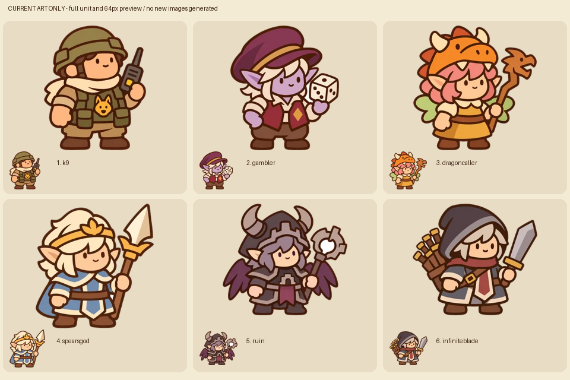

# 기존 영웅6종 리디자인 방향·실제 생성 견적

> 상태: **기획·견적만 완료. 새 이미지 생성0건, 기존 이미지 교체0건, 크레딧 지출0.**
> 조회일: 2026-11-22 (Pacific/Honolulu).
> 기준: main `c13d9b27de7cc46f4afd51b2fc2b326d19d56d23`, v0.1.22.
> 영웅65종의 실제 WebP·towers.json 소개/역할·chunky 생성 기록을 비교해 선정했다. '매력이 부족하다'는 객관적 품질 판정이 아니라 **역할 인지와 수집 개성을 높일 여지**에 대한 디자인 판단이다.

## 선정 기준

벤치마크에서 가져올 것은 큰 실루엣, 단순하고 기억되는 소품, 표정과 자세, 능력을 암시하는 외형이다. 현재 통통한2등신·점 눈·갈색 외곽선·평면색은 유지하고, 다른 게임 캐릭터·의상·이름·스크린샷은 직접 옮기지 않는다. 그림에 장식·발광을 계속 더해 등급을 표현하는 대신 **각 영웅의 주제와 외곽 형태**를 뚜렷하게 한다. 등급 테두리·별·받침대는 기존 코드가 담당한다.

아래 그림은 **현재 게임에 있는 이미지**다. 신규 리디자인 시안이 아니다.

## 6종과 변경 방향

| 대상·현재 등급 | 현재 그림에서 관찰한 아쉬움 | 리디자인 방향 | 확인할 매력 요소 | 실제 견적 |
| --- | --- | --- | --- | ---: |
| 군견병 `k9` · 노말 | 병사는 잘 보이지만 소개·능력의 중심인 군견이 안 보여 일반 보병과 비슷하게 읽힘 | 올리브색 병사 옆에 귀 큰 통통한 셰퍼드를 붙여 **하나의 유닛**으로 구성. 병사는 간식 주머니를 지키는 놀란 표정, 개는 앞으로 달려드는 장난스러운 자세 | '병사+개' 관계가 기억되고64px에서도 둘의 머리가 구분됨 | 1크레딧 |
| 도박꾼 `gambler` · 유니크 | 보라 모자·조끼와 주사위는 이미 보임. 다만 작은 주사위와 얌전한 정면 자세로 장난스러운 성격이 약하게 전달됨 | 기존 다크 엘프·보라 모자 유지. 몸에서 떨어져 읽히는 **큰 주사위1개**, 비스듬한 모자·올라간 한쪽 눈썹·자신만만한 미소 | 표정과 주사위만 보고 도박꾼을 알아봄. 숫자·카드 문양을 빽빽하게 넣지 않음 | 1크레딧 |
| 용 소환사 `dragoncaller` · 레전드 | 귀여운 주황 용 머리가 실제 아기 용보다 후드 모자로 읽히기 쉬움 | 후드는 접어 내리고 **어깨에 앉은 실제 아기 용**의 큰 머리·뭉툭한 뿔을 요정 얼굴 옆에 배치. 용은 재채기 직전 볼을 부풀리고 요정은 웃으며 몸을 기울임 | 두 얼굴의 상호작용·같은 실루엣 안의 작은 용. 용 모자와 구분 | 1크레딧 |
| 창술의 신 `spearsgod` · 레전드 | 파란 옷·금발·작은 창은 다른 엘프 전투원과 비슷하고 이름의 압도적인 창이 약함 | 금발 엘프와 파랑/상아색 유지. **넓은 나뭇잎형 창날**을 대각선으로 세우고 한 손은 허리, 여유 있는 표정. 방패·투구는 추가하지 않음 | 평범한 창병과 다른 무기 외곽선·자신감. 긴 창의 끝도 화면 안에 포함 | 1크레딧 |
| 파멸의 신 `ruin` · 신 | 뿔·갑옷·작은 어두운 날개가 한 덩어리로 겹쳐, 검은 날개를 편 고대신보다 일반 마족처럼 읽힐 수 있음 | 잿빛 갑옷·보라 포인트·뿔을 보존. **넓고 둥근 검은 날개**를 몸에 붙은 망토처럼 두르고, 얼굴은 가리지 않음. 나른하고 무심한 작은 표정 | 강한 외곽선과 의외로 귀여운 표정의 대비. 검은 배경에서도 윤곽선 구분 | 1크레딧 |
| 무한의 검 `infiniteblade` · 리미티드 | 손의 검1개·등 뒤 손잡이4개는 이미 있음. 등 뒤에 몰린 칼집 형태라 '다섯 검이 곁을 맴돈다'는 소개가 충분히 읽히지 않음 | 은빛 머리·어두운 후드·붉은 넥타이 포인트를 유지. 검1자루를 손에 들고 **나머지4자루는 어깨 뒤에2개씩 부채꼴**로 배치. 정확히5자루가 떨어져 읽히게 하고 자신만만한 작은 미소 | 다섯 검을 셀 수 있는 독특한 실루엣. 얼굴·검이 겹치거나64px에서 금속 덩어리로 뭉치지 않음 | 1크레딧 |
| **합계** | | **각 영웅 기본 모습1안씩, 총6장** | | **6크레딧** |

추천 우선순위는 **무한의 검 → 용 소환사 → 도박꾼 → 군견병 → 파멸의 신 → 창술의 신**이다. 상위2종은 이미 있는 용/검 모티프를 실제 어깨 용과 공중의 다섯 검으로 명료하게 바꿨을 때의 효과를 먼저 확인하기 좋다. 표의 순서는 현재 이미지 번호와 맞췄으며 생성 우선순위와 다르다.

## 실제 견적 조건

- Higgsfield `estimate_image_cost`로 서로 다른 프롬프트6개를 각각 조회했다. 전부 `credits_exact: 1`이며 합계6이다. 과거 견적을 그대로 재사용한 추정값이 아니다.
- 모델: `gpt_image_2_6` / medium /1k /1:1 / opaque 흰 배경 / PNG / 각count1·batch_size1.
- 참조2개: **해당 영웅의 기존 생성 결과1개** + 기존 광부 스타일 참조1개. 첫 참조는 정체성, 두 번째는 선·비율·색만 참고한다.
- 견적 시 `image` 참조 역할은 모델 요구에 맞춰 `image_references`로 정규화됐다. [requests.json](requests.json)에 사용 파라미터·프롬프트·원본 체크섬·기존 작업ID·정규화된 역할·비용을 기록했다.
- 견적은 생성 실행이나 참조의 최종 가용성 검증이 아니다. 실제 생성 전 참조를 사용할 수 있는지 확인하고, 조건·요금이 달라지면 다시 견적한다.
- 기본 모습6장만 포함한다. **각성 모습·공격 모션·영상·추가 후보·재생성은 제외**한다. 기존 유물/정령 시범6장과는 별도 묶음이며 이번 견적에서는 지출하지 않았다.
- 군견과 아기 용은 각각 병사/요정에 붙은 한 유닛 그림으로 요청한다. 동물 그림을 별도로 추가 생성하는 견적이 아니다.
- 계정 잔액·요금제 화면·만료될 수 있는 견적 핸들은 공개 문서에 싣지 않는다.

## 생성 후 채택 기준

1. 먼저6개의 PNG를 비교해 요청한 소품·표정·생물 수가 맞는지 확인한다. 정확한 검5자루, 군견과 병사, 실제 어깨 용 등 핵심 수량·관계가 틀리면 채택하지 않는다.
2. 기존 `tools/chunky_build.py` 방식으로 가장자리 연결 흰 배경 제거·알파 확인·긴 변256px WebP 처리. 밝은 얼굴·군견 털·검 하이라이트를 배경과 함께 지우지 않는다.
3. 밝은/어두운 배경64px에서 역할 구분과 얼굴 가림을 확인한다.48px는 작은 도감 예외 크기 검토로 사용한다. 단순 축소표 검토와 게임 실기기 검증은 구분한다.
4. 군견병·도박꾼·용 소환사·창술의 신·파멸의 신은 기존 `_awaken.webp`도 있다. 기본 모습만 승인돼도 각성 이미지와 같은 인물로 읽히는지 비교한다. 기본과 각성의 정체성이 어긋나면 해당 쌍은 일괄 적용을 보류하고 각성 파생안을 따로 준비한다. 이번 견적을 각성5장까지 포함한 것으로 해석하지 않는다.
5. 채택된 경우에만 같은 파일명으로 교체한다. 영웅ID·등급·능력치·스킬·저장 데이터·조합·manifest 목록은 바꾸지 않는다. 새 유닛/장비/펫 기능을 추가하지 않는다.
6. 이미 완료된 V3 유물·정령 시범 및 P0~P3 구현 흐름과 별도 아트 변경으로 다룬다. main 병합·앱 릴리스는 저장소의 기존 검증 흐름을 따른다.

근거 파일: `src/data/towers.json`, `public/assets/characters/{id}.webp`, `docs/art/higgsfield/chunky/jobs.json`, `docs/art/higgsfield/chunky/generation-config.json`.
