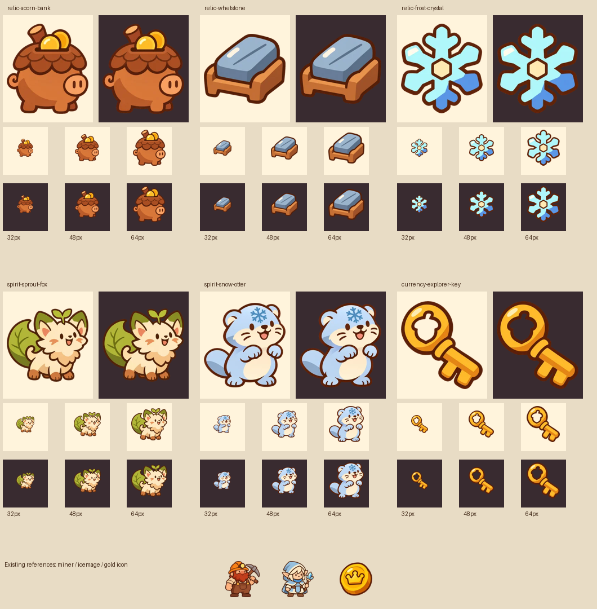

# V3 시범6장 생성·검토 완료

2026-11-22 (Pacific/Honolulu). 사용자가 시범 구성·견적 확인 후 후속 진행을 지시했다. 같은6개 요청을 다시 견적한 뒤 제출했고 **6건 모두 completed**, 각1크레딧·총6크레딧이다. 재생성·업스케일·영상·추가 본제작은0건.

- 요청과 기존 참조: [image-pilot-requests.json](../../../v3/image-pilot-requests.json).
- 결과·작업ID·치수·체크섬: [jobs.json](jobs.json).
- 화면 적용 규칙: [ui-contract.md](../../../v3/ui-contract.md).
- 실제 파일: `public/assets/v3/pilot/`의 투명 WebP6개, 합계76,390바이트(약74.6KiB).
- 원본1024×1024 PNG는 각 작업의 Higgsfield 결과에 남는다. 계정 경로를 포함한 CDN URL·계정 잔액·견적 실행 핸들은 공개 저장소에 복사하지 않는다.

## 검토 결과

실제 생성 결과와 투명 WebP를 직접 열어 확인했다. 아래 비교는 밝은/어두운 배경,32/48/64px 정적 래스터 미리보기다. **런타임 게임 UI·휴대폰 실기기 검증은 아직 아니다.** 상태는 시범 채택이며, 출시 화면 반영은 P1~P3 구현 뒤 확인한다.

| 대상 | 관찰·처리 | 판정 |
| --- | --- | --- |
| 도토리 저금통 | 도토리 모자·갈색 돼지 저금통·금화 실루엣.32px에서도 다른 유물과 구분. 눈·입 없이 코 형태를 가진 물체 | 시범 채택 |
| 대장장이 숫돌 | 파란 숫돌과 나무 받침 구분.32px에서도 기울어진 돌 형태 유지 | 시범 채택 |
| 서리 결정 | 6방향 외곽선·청색 유지.32px에서는 작은 하이라이트가 단순해지므로 효과는 이름·설명으로 전달 | 시범 채택 |
| 새싹 여우 | 잎 꼬리·귀·크림색 몸통이 분리됨. 작은32px에서는 얼굴 정보가 줄어드므로 후속 정령 화면64px 이상 권장 | 후속 외형 시범 채택 |
| 눈송이 수달 | 밝은 털·배·얼굴이 배경 제거 뒤 보존됨.64px에서 수달의 발·꼬리·표정 식별 | 후속 외형 시범 채택 |
| 탐험 열쇠 | 고리·짧은 축·두 이가32px에서 구분. 고리 안 도토리 구멍은 투명 처리해 어두운 배경의 흰 덩어리 제거 | 시범 채택 |

기존 광부·얼음술사·골드 아이콘과 통통한 비율·갈색 외곽선·평면색을 나란히 비교했다. 새 유물은 단순한 기하학 형태이며 기존 아이콘보다 선이 굵게 느껴질 수 있으므로 같은 표시 크기에서 정렬한다. 외부 게임 그림은 사용하지 않았다.

## 후처리·연결 주의

- `tools/chunky_build.py`의 `knock_out_white`와 `crop_fit` 함수를 재사용했다. 가장자리 연결 밝은 무채색만 제거하고, 긴 변256px로 줄인 뒤 WebP quality82/method6으로 저장했다.
- 닫힌 고리의 구멍은 가장자리 flood fill이 닿지 않는다. 열쇠 원본의 내부 배경 영역만 추가로 제거했다(씨앗좌표353,173; RGB최솟값225 이상·색차24 이하·4방향 연결). 영역이 캔버스 테두리에 닿지 않는지 확인했고 경계 처리는 기존 함수와 같은1px 필터/0.8 blur를 사용했다.
- 원본 정사각형을 잘랐으므로 최종 파일은232×256~256×219 등 직사각형이다. `object-fit: contain`으로 비율을 유지한다.
- 숫돌의 견적 요청ID는 `relic-smith-whetstone`, 기획·최종 파일ID는 **`relic-whetstone`**이다. jobs.json에 대응을 명시했다. 두 개의 유물로 중복 등록하지 않는다.
- 정령2장은 P4 외형 자료이며 P0~P3의 뽑기 풀·재화·메뉴·배지에 등록하지 않는다.
- 게임의 기존 캐릭터159장·아이콘39장과 관련 manifest는 바꾸지 않았다. 신규 에셋6개는 아직 런타임에서 참조하지 않는다.
- 시범의 유물3장·열쇠1장은 채택 시 P0~P3 본제작18장 안에 포함한다. 정령2장은 후속12종 안에 포함한다. 추가 생성 예산을 사용하지 않았다.

검증: PNG6개 정상 열림, WebP6개 재디코딩, 긴 변256px·알파0/255·모서리 투명 확인, SHA-256 기록, 정적 비교표 직접 확인. 런타임 코드·밸런스·저장 형식·SIM_VERSION·앱 버전은 변경하지 않았다.
