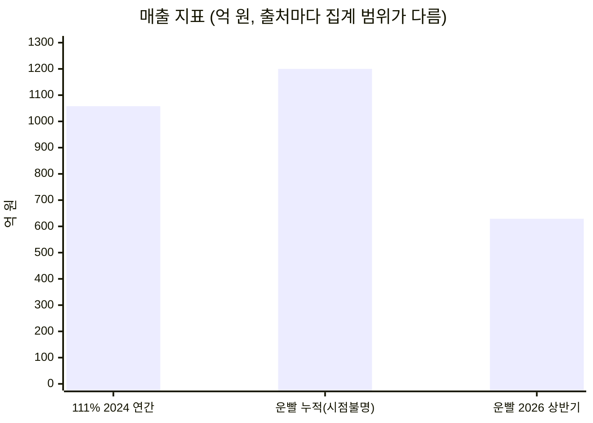
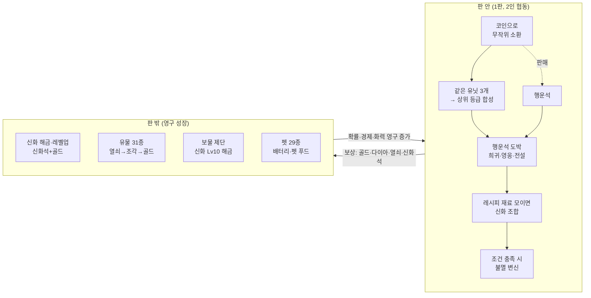
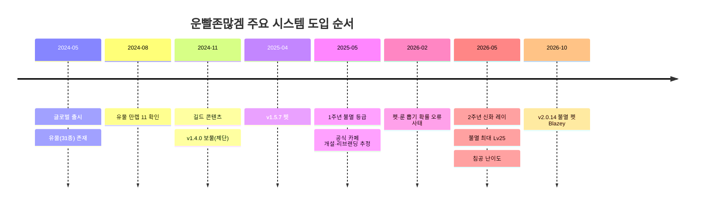

# 01. 게임 개요

> 출처 표기: `나무위키(검색요약)` = 나무위키를 직접 열지 못하고 검색 결과에 인용된 조각만 확인한 값. 전체 출처는 [`sources.md`](sources.md).

## 1.1 기본 정보

| 항목 | 내용 | 출처 |
|------|------|------|
| 게임명 | 운빨존많겜 (영문 Lucky Defense → **OMFG Lucky Me!**, 별칭 What the Luck?) | PocketGamer, App Store, Sensor Tower |
| 개발·서비스 | 111퍼센트 (지주사 슈퍼패스트) | 바이라인네트워크 |
| 장르 | 랜덤 타워 디펜스, **2인 협동 중심** | ZDNet Korea(2024-06-30) |
| 글로벌 출시 | **2024-05-23** | Sensor Tower KR |
| 플랫폼 | iOS(id6482291732), Android(`com.percent.aos.luckydefense`) | App Store, Google Play |
| 리브랜딩 | 공식 날짜는 **미확인**. 새 이름이 처음 확인되는 기록은 2025-05 말(v1.6.2 무렵)로, 1주년 업데이트 전후로 추정 | AppFollow, apk.watch |
| 공식 카페 | `cafe.naver.com/omfgluckyme` (카페 ID 31478558), **2025-05-15 개설**, 회원 **160,837명**, 운영자 '111퍼센트', 파워카페 | 네이버 카페 정보 API(2026-11-23 조회) |
| 평점 | App Store KR 4.5 / 5 (평가 약 7.3만 개) | App Store(검색요약) |

> 카페 개설일(2025-05-15)이 1주년 업데이트(2025-05-20)와 리브랜딩 추정 시점에 겹칩니다. 카페 주소에 새 영문명(omfgluckyme)을 쓴 것도 같은 시기에 이름을 바꿨다는 정황입니다.

## 1.2 성과 지표

| 시점 | 지표 | 값 | 출처 |
|------|------|----|------|
| 2024-05 말 | 구글플레이 인기 순위 | 출시 나흘 만에 **1위** | 다나와 DPG, 네이트뉴스 |
| 2024-06~07 | 구글플레이 매출 순위 | Top 10 유지, 최고 **7위** | 시사포커스 |
| 2024 중반 | 글로벌 누적 | 다운로드 약 300만, 매출 약 2,000만 달러(추정) | Sensor Tower KR |
| 2024 연간 | 111퍼센트 매출 | **1,058억 원** (전년 대비 3배 이상, 흑자 전환) | 바이라인네트워크(2025-04-15) |
| 시점 불명 | 누적 | 다운로드 750만, 매출 1,200억 원 | 톱데일리 |
| 2026 상반기 | 운빨존많겜 매출 | **629억 원** (슈퍼패스트 연결 1,065억 원 중) | MTN(2026-08-06), Inven Global |
| 2026-11-17 | 구글플레이 매출 순위 | 24위 | gamerscroll |

> 2026년 상반기에만 629억 원(반기 기준)을 벌었습니다. 출시 2년이 지나도 매출이 줄지 않는 **장기 운영형 BM**이라는 뜻이며, 이 구조는 [7장](07-economy-bm.md)에서 해부합니다.

## 1.3 핵심 루프

| 판 안 단계 | 쓰는 재화 | 판 밖에서 영향을 주는 성장 |
|-----------|-----------|---------------------------|
| 소환 | 코인 | 유물 '빛나는 레버'(희귀 확률), '지갑'(시작 코인) |
| 합성 | — | 유물 '고기'(최대 보유 수) |
| 도박 | 행운석 | 유물 '나팔'·'황금 주사위'(확률), '해골석'(환급), '승부사의 손목'(실패 보상) |
| 경제 | 코인 | 유물 '금고'(복리 이자), '머니건'(보유 코인 → 공격력), '왕의 비둘기', '황금 곡괭이' |
| 신화 조합 | 필드 유닛 | 신화 해금(다이아), 신화 레벨(Lv6·12 고유 강화) |
| 불멸 변신 | — | 신화 Lv15 + 6,000다이아 해금, 불멸석 |
| 전투 | — | 펫(곱연산 공격력), 보물(1슬롯 무작위 옵션) |

## 1.4 모드

| 모드 | 내용 | 출처 |
|------|------|------|
| 협동 | 상시 개방, 에너지 소모, 2인 1조. **재화의 주 수급처**. 난이도: 보통 / 어려움 / 지옥 / 신 / 태초 / 침공(2026-05-01) | 나무위키(검색요약) |
| 대전 | 처음엔 2인 1조 4인전, 이후 1대1 | 나무위키(검색요약) |
| 도전 | 지하동굴, 한계, 무한, 오늘의 던전 | 나무위키(검색요약) |
| 길드전·길드 점령전 | 시즌제 (시즌 34까지 기록) | 나무위키(검색요약) |
| 왕의 시련 | 신규 유저용, 1주년에 개편 | 게임메카 |
| 릴레이 디펜스·클래식 | 공식 카페 게시판 이름으로만 확인 ('릴레이 디펜스 매칭', '클래식 모드 인증') | 네이버 카페 메뉴 |

## 1.5 공식 카페 게시판 구조

카페 운영 방식으로 커뮤니티 운영 전략을 볼 수 있습니다.

| 분류 | 게시판 | 기획 관점 의미 |
|------|--------|---------------|
| 소식 | 공지사항 · 패치노트 · **GM 콘텐츠** · 이벤트 · 당첨자 발표 | 공식 소통 창구 |
| 커뮤니티 | 자유 · 질문 · 아이디어&건의 · 공략&꿀팁 · **공식 인증 공략** | 유저 공략을 공식이 인증해 신규 유저 교육을 맡김 |
| 미디어 | 스크린샷 · 금손(팬아트) | UGC |
| 친구찾기 | **릴레이 디펜스 매칭 · 협동&버스 매칭** · 길드원 모집 | 2인 협동 게임이라 매칭 게시판이 핵심 |
| 운영 정책 | **확률 안내**(링크) · 운영정책 · 고객센터 | 확률 공시 |
| 운빨 좋은날 | 운빨기록 공유 · 로카/아토 레벨 인증 · 낚시 축제 · 포춘 쿠키 운세 · 종합 건강검진 | **'운'을 자랑하는 인증 이벤트**로 바이럴 유도 |

## 1.6 업데이트 연혁

| 버전 | 날짜 | 추가·변경 | 출처 |
|------|------|-----------|------|
| 1.0 | 2024-05-23 | 글로벌 출시 | Sensor Tower |
| — | 하드 출시 직후 | 금고·머니건 대폭 하향 → 며칠 뒤 롤백 | 나무위키(검색요약) |
| — | 2024-11 | 길드 콘텐츠 | 글로벌이코노믹 |
| 1.4.0 | 2024-11-18 | **보물** 시스템 | 나무위키(검색요약) |
| 1.5.7 | 2025-04 | **펫** 시스템 (계정 Lv9 해금) | 나무위키(검색요약), 디시 공지 전재 |
| — | 2025-05-20 | **불멸 등급**, 신화 '헤일리' 무료 지급, 왕의 시련 개편 | 게임메카, 엑스포츠뉴스 |
| 2.0.4 | 미확인 | 불멸 '군체 타르', 전용 불멸석 | 디시 공지 전재 |
| — | 2026-02 | 펫·룬 뽑기 등급 내 편향 오류 인정, 보상 | 인벤, 뉴스웨이 |
| — | 2026-05 | 신화 '레이', 불멸 최대 15 → 25(돌파석), 침공 | 나무위키(검색요약) |
| 2.0.14 | 2026-10-08 | 불멸 펫 Blazey, 불멸 Turtle Indy | Google Play 패치노트 |

> **성장 축을 약 6개월마다 하나씩 추가했습니다** (유물 → 보물 → 펫 → 불멸 → 불멸 Lv25). 기존 축을 갈아엎지 않고 **위에 새 축을 쌓는 방식**이라서 기존 투자가 계속 의미를 가집니다.
