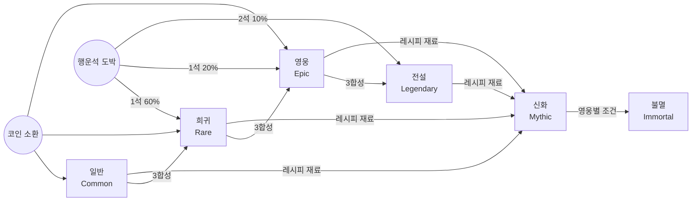
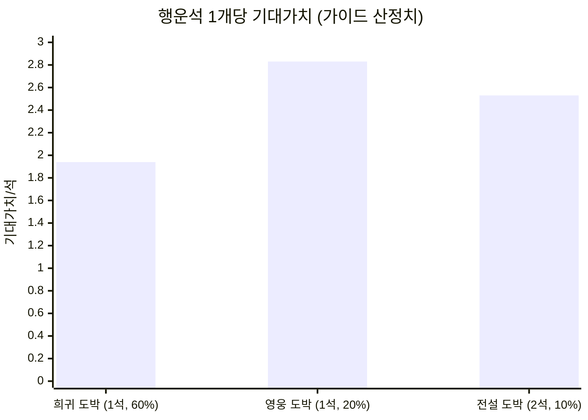
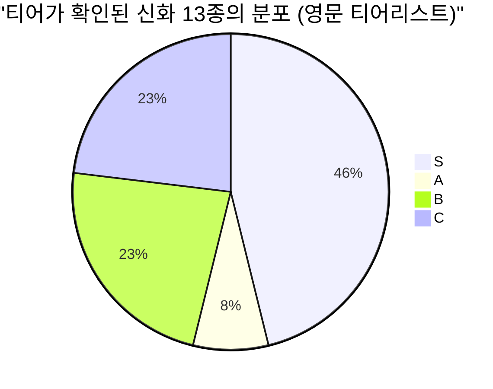

# 02. 캐릭터 (영웅)

> 근거 원본: [`raw/research-heroes.md`](raw/research-heroes.md) B장

## 2.1 등급 체계: 판 안의 확률 사다리

| 등급 | 영문 | 판 안 획득 | 판 밖 조건 | 비고 | 출처 |
|------|------|-----------|-----------|------|------|
| 일반 | Common | 기본 소환 | — | | 나무위키(검색요약) |
| 희귀 | Rare | 소환, 일반 3합성, 도박 | — | 도박 1석 **60%** | luckydefense.net(2024-07) |
| 영웅 | Epic | 소환, 희귀 3합성, 도박 | — | 도박 1석 **20%**, 행운석당 기대가치가 가장 높아 커뮤니티 선호 | luckydefense.net |
| 전설 | Legendary | 영웅 3합성, 도박 | — | 도박 2석 **10%** | luckydefense.net |
| 신화 | Mythic | **레시피 조합만** | 해금 필요 (다이아 3,000) | 판 밖 레벨 Lv1~15 | PocketGamer, 이투데이 |
| 불멸 | Immortal | 신화가 영웅별 조건 충족 시 변신 | 신화 Lv15 + 6,000다이아 | 2025-05-20 도입, Lv25까지(2주년) | 게임메카, 나무위키(검색요약) |

- **기본 소환의 등급별 확률과 등급별 유닛 수: 미확인.** 영문 검색에 나온 '신화 0.5%·전설 4.5%'는 다른 게임의 수치라 제외했습니다.
- 판 안 소환 비용은 소환할수록 오릅니다(나무위키(검색요약)). 곡선 수치는 미확인입니다.

### 도박 기대가치 (luckydefense.net, 2024-07)

> 성공률이 가장 높은 희귀보다 **영웅 도박이 효율 1위**입니다. 확률이 낮은 선택지일수록 보상이 커지도록 설계해, 유저가 "안전 vs 한 방"을 고르는 재미를 만듭니다.

## 2.2 신화 조합 레시피 (확인된 6종)

| 신화 | 재료 1 (전설) | 재료 2 | 재료 3 | 출처 |
|------|--------------|--------|--------|------|
| 랜슬롯 | 보안관 | 사냥꾼(영웅) | 성기사(희귀) | gameitdown, luckydefense.net |
| 냥법사 | 독수리장군(영웅) | 궁수 | 물의정령 ×2 | gameitdown, luckydefense.net |
| 배트맨 | 호랑이사부 | 나무 | 투척병 ×2 | gameitdown |
| 아이언미야옹 | 워머신 | 산적 | 산적 | gameitdown |
| 콜디 | 폭풍거인 | 샌드맨 | 물의정령 | gameitdown |
| 우치 | 폭풍거인 | 레인저(희귀) | 물의정령 | 나무위키(검색요약), luckydefense.net |

> 레시피는 대부분 **전설 1 + 하위 등급 2~3**입니다. 일반 유닛(물의정령, 산적)을 여러 레시피에서 재료로 쓰기 때문에, 판 안에서 "어떤 신화를 노릴지"를 두고 두 플레이어가 재료를 나눠 갖는 협동이 생깁니다.

## 2.3 신화 영웅 목록 (확인된 이름)

| 신화 | 역할·특징 | Lv6 / Lv12 고유 강화 | 영문 티어 | 출처 |
|------|----------|---------------------|-----------|------|
| 닌자 | **기본 지급(무료)** | 미확인 | C | begchi |
| 랜슬롯 | 딜러, MP 회복 중요 | Lv6 궁극기 'Flame Pillar' 해금 | S | grindnstrat |
| 냥법사 | 마나 서포터 | Lv12 MP 회복 스킬 효과 +100% | S | grindnstrat, PocketGamer |
| 배트맨 | 딜러, 수트 수리에 행운석 사용 | Lv6 수리비 15→10, Lv12 스킬 피해 ×1.5 | S | grindnstrat |
| 아이언미야옹 | — | 미확인 | C | luckydefense.net |
| 콜디 | — | 미확인 | B | gameitdown |
| 우치 | '칼바람' 스킬, 전용 보물 '흑요석 부채' | Lv12 발동 확률 ×2 | — | grindnstrat |
| 모노폴리맨 | **경제형** (궁극기로 행운석 생성) | Lv6 궁극기 MP -20% | S | grindnstrat |
| 로켓츄 | 딜러 | Lv12 신규 스킬 | S | grindnstrat |
| 타르 | 1~3단계 무작위 진화, 3단계 '동족 포식' | 미확인 | S | grindnstrat |
| 와트 | 전용 보물로 공속 1→10% | 미확인 | B | luckydefenseguides |
| 밤바 | 'Workout' 발동 | 미확인 | C | luckydefenseguides |
| 개구리 왕자 | 저주(디버프), 패시브 공속 버프 | Lv12 저주 확률 25→35% | B | luckydefenseguides |
| 마마 | 버프 (임프마다 ATK +10%) | Lv6 +25% | — | luckydefenseguides |
| 헤일리 | 1주년 무료 지급, 첫 불멸 대상 | 미확인 | A | 게임메카 |
| 인디, 차드, 레이(2주년), 펭귄악사, 마스터 쿤, 초나, 지지, 에밀리, 드래곤 등 | 개별 정보 부족 | 미확인 | — | 나무위키(검색요약) |

- 신화 이름은 **약 25종**을 확인했습니다. 전체 수와 나머지 레시피는 **미확인**입니다.
- 영문 티어는 2025년 PocketGamer·grindnstrat 자료이며, 버전에 따라 바뀝니다.

## 2.4 신화 획득 경로

| 경로 | 비용 | 비고 | 출처 |
|------|------|------|------|
| 기본 지급 | 무료 | 닌자 | begchi |
| 다이아 직접 구매 | **3,000다이아** (모든 신화 통일, "첫 과금 14,000원 기준") | 고급 신화는 80웨이브 클리어 등 해금 조건 | 이투데이(2024-07-16), begchi |
| 초대장(모집) | 무작위 | 중복 시 신화석으로 전환(1회 30, 10연 300) | grindnstrat, summerfallwinter |
| 이벤트 지급 | 무료 | 1주년 헤일리 무료 + 미션으로 Lv12까지 무상 성장 | 게임메카 |

> 다이아 3,000개는 다이아 단가(약 7원)로 **약 2.1만 원**입니다. 가장 작은 다이아 상품(1,800개, 14,000원) 하나로는 부족하게 가격을 맞춰서 **두 번째 결제를 유도**합니다 (계산: [7장](07-economy-bm.md)).

## 2.5 불멸 등급 (2025-05~)

| 항목 | 내용 | 출처 |
|------|------|------|
| 판 밖 해금 | 해당 신화 **Lv15** + **6,000다이아** | 나무위키(검색요약), luckydefenseguides |
| 판 안 변신 | 영웅별 조건 (예: 군체 타르 = 3단계 타르의 동족 포식 공격력 증가 90% 이상) | 디시 2.0.4 공지 전재 |
| 성장 재화 | 불멸석 (1개 = 100다이아 가치), 전용 불멸석을 공용보다 먼저 소모 | 나무위키(검색요약), 2.0.4 공지 |
| 레벨 비용 | 신화와 같은 스톤 수, **골드 2배** | luckydefenseguides |
| 최대 레벨 | 15 → **25** (2주년, Lv16 이상은 돌파석+코인, Lv16·19·22·25에 강화) | 나무위키(검색요약) |
| 확인된 불멸 | 헤일리·개구리 왕자·마마(1차), 랜슬롯, 악마 모노폴리, 군체 타르, 골라조, Turtle Indy(2.0.14) | 게임메카, PocketGamer, 스토어 노트 |

## 2.6 기획 포인트

| 관찰 | 의미 |
|------|------|
| 판 안 등급(일반~전설)과 판 밖 등급(신화·불멸)이 **분리** | 일반~전설은 판마다 새로 뽑는 '소모품'이고, 신화·불멸만 계정에 쌓이는 '자산'입니다. 판 안 운과 판 밖 성장을 분리하는 장치입니다. |
| 신화는 **판 밖 해금 + 판 안 조합**이 모두 필요 | 돈으로 해금해도 판에서 재료를 모아야 쓸 수 있어, 과금이 판 안 운을 대신하지 못합니다. |
| 불멸은 **신화 Lv15를 조건으로** 거는 상위 등급 | 기존 신화 투자를 버리지 않고 그 위에 새 목표를 얹습니다. 레벨 상한도 25까지 늘렸습니다. |
| 무료 신화(닌자, 헤일리)를 **약하거나 이벤트용**으로 배치 | 첫 신화의 맛을 보여준 뒤, 강한 신화(S티어)는 다이아로 사게 합니다. |
