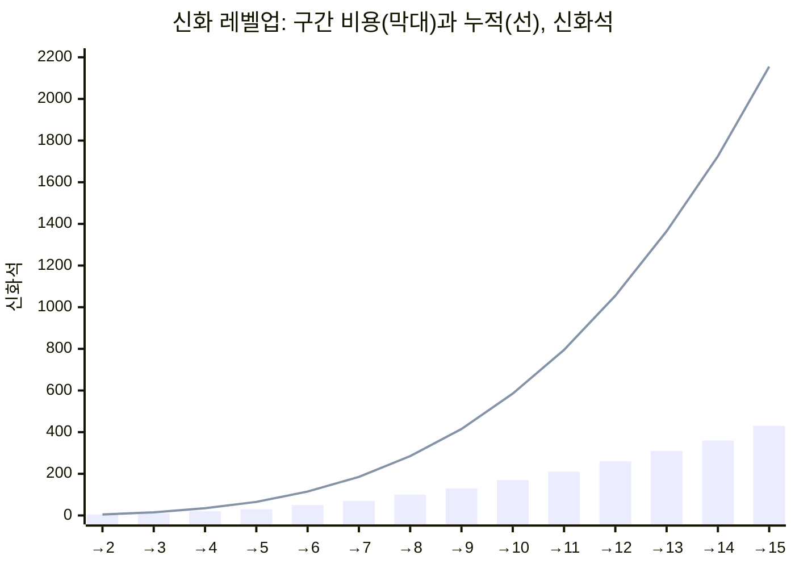
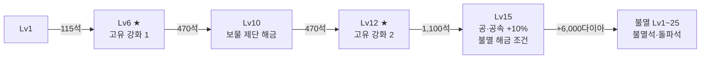
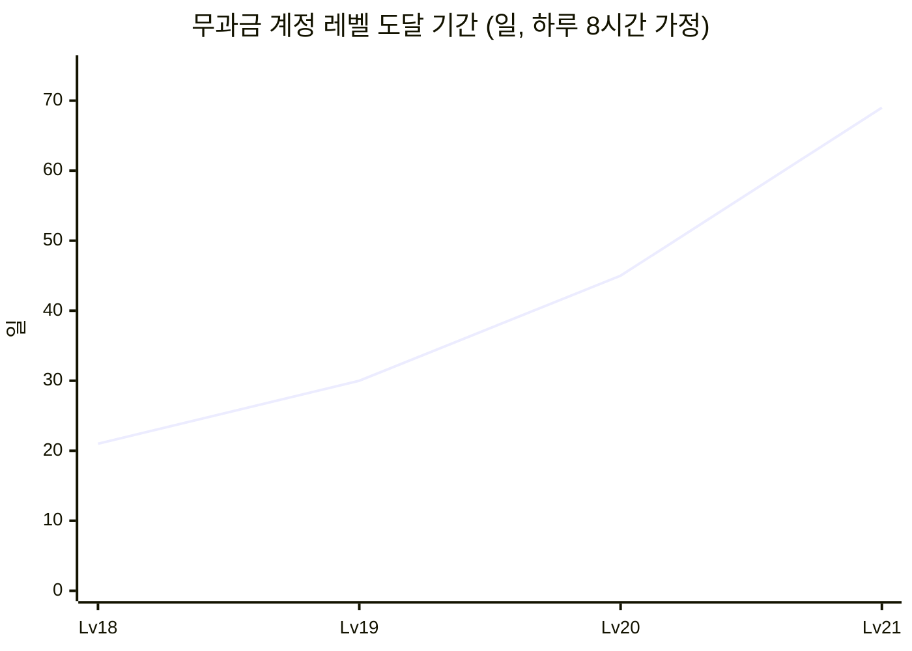

# 03. 레벨업

> 근거 원본: [`raw/research-heroes.md`](raw/research-heroes.md) C장

운빨존많겜의 '레벨'은 네 종류입니다. 서로 다른 재화를 씁니다.

| 레벨 종류 | 대상 | 재화 | 상한 |
|-----------|------|------|------|
| 신화 레벨 | 신화 영웅 개별 | 신화석 + 골드 | 15 |
| 불멸 레벨 | 불멸 영웅 개별 | 불멸석 + 골드(2배), Lv16+ 돌파석 + 코인 | 25 |
| 비신화 영구 레벨 | 일반~전설 유닛 | 중복 카드 + 골드 | 15 (추정) |
| 계정 레벨 / 펫 종합 레벨 | 계정 / 보유 펫 레벨 합 | 경험치 / 펫 푸드 | 펫 종합 500 구간 |

## 3.1 신화 레벨업 비용 (Lv1 → 15, 전 구간)

모든 구간에서 **골드 = 신화석 × 200**입니다. 출처: luckydefenseguides upgrade-costs. grindnstrat, summerfallwinter(2024-10), 디시 22468에서 구간 합계가 일치합니다.

| 구간 | 신화석 | 골드 | 누적 신화석 | 누적 골드 | 누적 다이아 가치 (계산값, 1석=50다이아) |
|------|-------:|-----:|-----------:|---------:|------------------------------:|
| 1→2 | 5 | 1,000 | 5 | 1,000 | 250 |
| 2→3 | 10 | 2,000 | 15 | 3,000 | 750 |
| 3→4 | 20 | 4,000 | 35 | 7,000 | 1,750 |
| 4→5 | 30 | 6,000 | 65 | 13,000 | 3,250 |
| 5→6 | 50 | 10,000 | **115** | **23,000** | 5,750 |
| 6→7 | 70 | 14,000 | 185 | 37,000 | 9,250 |
| 7→8 | 100 | 20,000 | 285 | 57,000 | 14,250 |
| 8→9 | 130 | 26,000 | 415 | 83,000 | 20,750 |
| 9→10 | 170 | 34,000 | 585 | 117,000 | 29,250 |
| 10→11 | 210 | 42,000 | 795 | 159,000 | 39,750 |
| 11→12 | 260 | 52,000 | **1,055** | **211,000** | 52,750 |
| 12→13 | 310 | 62,000 | 1,365 | 273,000 | 68,250 |
| 13→14 | 360 | 72,000 | 1,725 | 345,000 | 86,250 |
| 14→15 | 430 | 86,000 | **2,155** | **431,000** | **107,750** |

| 구간 | 신화석 | 전체 대비 | 해석 |
|------|-------:|---------:|------|
| Lv1→6 | 115 | 5% | 싸게 Lv6 고유 강화까지 → **첫 체감** |
| Lv6→12 | 940 | 44% | 본격 육성 구간, Lv12 고유 강화가 목표 |
| Lv12→15 | 1,100 | 51% | **마지막 3레벨이 전체의 절반** — 불멸 해금 조건이라 핵과금 구간 |

> 신화 1기를 Lv15까지 올리는 데 다이아 약 10.8만 개 가치(계산값, 1석 = 50다이아 기준), 약 76만 원 상당입니다. 다이아 직구로 신화석을 사는 경우는 드물고, 실제로는 패스·모집·주간 보상으로 모읍니다 ([7장](07-economy-bm.md)).

## 3.2 레벨 마일스톤 (공통)

| 레벨 | 효과 | 출처 |
|------|------|------|
| 3 | 공격력 +10% | 나무위키(검색요약) |
| **6** | **영웅별 고유 강화** (궁극기 해금, 수치 강화) | 나무위키(검색요약) |
| 9 | 공격속도 +10% | 나무위키(검색요약), luckydefenseguides |
| 10 | (신화) **보물 제단 해금** → [4장](04-traits.md) | luckydefenseguides |
| **12** | **영웅별 고유 강화** | 나무위키(검색요약) |
| 15 | 공격력 +10%, 공격속도 +10%, (신화) **불멸 해금 조건** | 나무위키(검색요약) |
| 16·19·22·25 | (불멸, 2주년~) 강화 단계 | 나무위키(검색요약) |

> **3레벨마다 보상**이 있습니다(3·6·9·12·15). 그중 6과 12에 **영웅마다 다른 강화**를 둬서, "이 신화는 Lv12부터 진짜"라는 목표를 만듭니다. 커뮤니티 권장도 "거의 모든 신화 Lv12 이상, 주력 딜러 Lv15"입니다(나무위키(검색요약)).

## 3.3 불멸 레벨업 비용

같은 스톤 수(불멸석)에 **골드 2배**입니다(luckydefenseguides). 아래 골드는 신화 표 × 2로 계산한 값입니다.

| 구간 | 불멸석 | 골드 (계산값) | 누적 불멸석 | 누적 다이아 가치 (계산값, 1석=100다이아) |
|------|------:|-------------:|-----------:|------------------------------:|
| 1→6 | 115 | 46,000 | 115 | 11,500 |
| 6→12 | 940 | 376,000 | 1,055 | 105,500 |
| 12→15 | 1,100 | 440,000 | 2,155 | 215,500 |
| 15→25 | 돌파석 + 코인 | 미확인 | — | 미확인 |

> 불멸 1기 Lv15 = 다이아 약 21.5만 개 가치로, **신화의 2배**입니다. 2주년에 상한을 25로 늘려 **과금 흡수처를 다시 열었습니다**.

## 3.4 비신화 유닛 영구 강화 (판 밖)

| 항목 | 내용 | 출처 |
|------|------|------|
| 방식 | 같은 유닛 **중복 카드 + 골드** | luckydefenseguides |
| 표 A | 1→2 카드 2장 + 1,000골드 … 14→15 카드 130장 + 86,000골드 | luckydefenseguides |
| 표 B | 1→2 카드 3장 + 1,000골드 … 14→15 카드 170장 + 86,000골드 | luckydefenseguides |
| 등급 대응 | **미확인** (어느 표가 어느 등급인지 원문 확인 필요) | — |
| 마일스톤 | 신화와 같은 구조로 보임 (예: 호랑이사부 Lv6 궁극기 해금 · Lv12 광역화, 늑대전사 Lv12 방깎 10→15) | grindnstrat |

> 골드 스케일(1,000 → 86,000)이 신화와 같습니다. **골드는 모든 성장 축이 공유하는 재화**라서 축끼리 우선순위 경쟁이 생깁니다.

## 3.5 계정 레벨과 펫 종합 레벨

| 항목 | 내용 | 출처 |
|------|------|------|
| 계정 레벨 | 존재. **Lv9에 펫 해금**. 경험치 원천과 다른 마일스톤은 미확인 | 나무위키(검색요약) |
| 무과금 성장 속도 | 계정 Lv18 = 21일차, Lv19 = 1개월, Lv20 = 1.5개월, Lv21 = 2.3개월 (하루 8시간 가정) | 디시 790348 |
| 펫 종합 레벨 | **보유 펫 레벨의 합**. 20마다 버프, 100·200에 펫 슬롯 +1 | 나무위키(검색요약), begchi |
| 종합 Lv200 비용 | 펫 푸드 약 2,758개 (최소비용 루트) | 디시 1019022 → [6장](06-pets.md) |

> 레벨이 오를수록 걸리는 기간이 빠르게 늘어납니다(21일 → 69일). 계정 레벨은 **진행도 표시와 콘텐츠 해금 장치**이고, 전투력 성장은 신화·유물·펫이 맡습니다.
