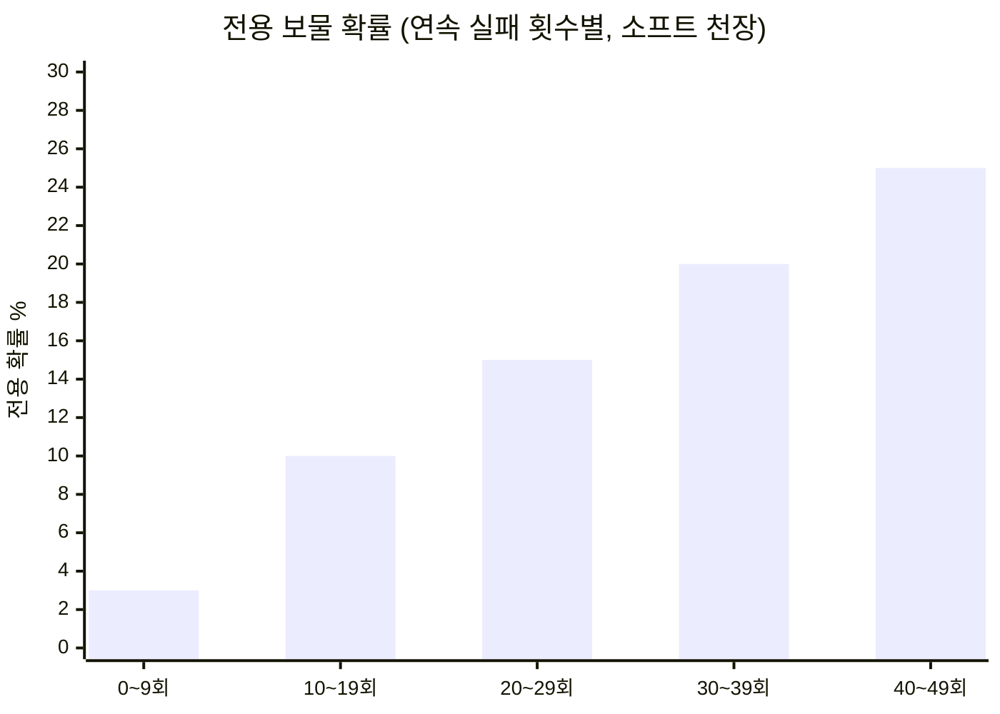
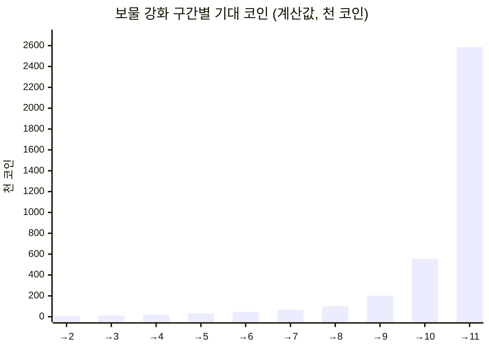

# 04. 특성 → 패시브 성장 (보물 제단 중심)

> 근거 원본: [`raw/research-heroes.md`](raw/research-heroes.md) D장, [`raw/research-economy.md`](raw/research-economy.md) 4.2장

## 4.1 '특성' 시스템 유무

- 조사한 출처 어디에서도 **'특성'이라는 이름의 시스템(포인트를 찍는 패시브 트리)은 확인되지 않았습니다.**
- 기획안의 결정(①-b)에 따라, 그 역할을 하는 **계정 단위 영구 패시브**를 이 장에서 다룹니다.

| 특성 트리가 하는 일 | 운빨존많겜에서 맡는 시스템 | 선택형인가 | 자세한 장 |
|--------------------|--------------------------|-----------|----------|
| 전체 공격력·공속 상승 | 유물(힘의 물약·요정활), 펫 기본능력 | 아니오(수집·레벨) | [5장](05-relics.md), [6장](06-pets.md) |
| 경제 특화 | 유물(금고·머니건·지갑·비둘기) | 아니오 | [5장](05-relics.md) |
| 확률 특화 | 유물(레버·나팔·주사위·해골석·손목) | 아니오 | [5장](05-relics.md) |
| 빌드 방향 선택 | **보물 제단** (1슬롯, 무작위 옵션) | **부분적**(무엇을 남길지 선택) | 이 장 |
| 단계형 보너스 | 펫 종합 레벨(20마다), 신화 마일스톤(3마다) | 아니오 | [3장](03-levelup.md), [6장](06-pets.md) |

> **선택형 트리를 두지 않고 모든 패시브를 '수집·레벨형'으로 만든 것**이 특징입니다. 빌드 선택의 재미는 판 안(어떤 신화를 조합할지)에 맡기고, 판 밖은 "더 모으면 더 세진다"는 단순한 구조로 통일했습니다. 유일한 예외가 보물(1슬롯 무작위)입니다.

## 4.2 보물 (Treasure, 제단)

| 항목 | 내용 | 출처 |
|------|------|------|
| 도입 | v1.4.0, 2024-11-18 | 나무위키(검색요약) |
| 해금 | 아무 신화나 **Lv10** 달성 → 제단 해금 | luckydefenseguides |
| 획득 | 제단에서 **츄르**(영문 Kitty Treats) 3개로 무작위 보물 소환 (1회 = 다이아 900개 가치) | luckydefenseguides, 나무위키(검색요약) |
| 보유 | 동시에 **1개만** | luckydefenseguides |
| 등급 | 있음. 발굴 시간이 길수록 고등급 확률이 높음. 영웅 등급 이상부터 쓸 만함 | 나무위키(검색요약) |
| 전용 보물 | 신화마다 고유 보물. 가장 희귀하지만 항상 최고 성능 | luckydefenseguides |

### 소환 확률과 소프트 천장 (나무위키(검색요약))

| 결과 | 확률 |
|------|------|
| 일반 보물 19종 | 각 4.85% (합 92.15%) |
| 전용 보물 | 3% |
| 확률 상승 | 일반이 10회 연속 나오면 전용 확률 10%로 상승, 이후 10회마다 +5%p (20회 15%, 30회 20%) |

> 19 × 4.85% + 3% = 95.15%로 100%가 되지 않습니다. 전용 보물이 여러 종이거나 표기 차이일 수 있어 **원문 확인이 필요합니다**.

### 효과 상한 (나무위키(검색요약), 디시 983372)

| 효과 | 상한 |
|------|------|
| 공격력 증가 | 40% |
| 공격속도 증가 | 40% |
| 마나 회복 | 85 |
| 방어력 감소 | 85 |
| 웨이브당 골드 | 240 |
| 웨이브당 행운석 | 3 |

> 기획안 예비 조사에서 본 "보물 등급별 공속(희귀 20~30%, 영웅 30~40%, 전설 40~50%)"은 **확인되지 않았고 상한 40%와도 맞지 않아** 쓰지 않았습니다.

### 전용 보물 예시 (Lv1 → MAX)

| 신화 | Lv1 | MAX | 출처 |
|------|-----|-----|------|
| 우치 '흑요석 부채' | 칼바람 지속 +0.1초, 공속 +1% | +0.5초, 공속 +10% | luckydefenseguides |
| 와트 | 공속 +1% | 공속 +10% | luckydefenseguides |
| 차드 | 미확인 | 공속 +7% | luckydefenseguides |
| 밤바 | Workout 확률 +0.5% | +2.0% | luckydefenseguides |

## 4.3 보물 강화 (Lv1 → 11, 전 구간)

출처: luckydefenseguides treasure-upgrade-costs (단일 팬 사이트). 실패할 때마다 기본 성공률의 1/10씩 성공률이 오르고, **최대 10회까지 누적**됩니다.

**기대 시도 횟수와 기대 비용은 계산값**입니다. 실패 누적 규칙을 그대로 적용했습니다. 2→3·3→4의 증가분은 원문에서 확인하지 못해 같은 규칙(기본의 1/10)으로 추정했습니다.

| 구간 | 기본 성공률 | 실패당 증가 | 1회 코인 | 1회 레드 티켓 | 기대 시도 | 기대 코인 | 누적 기대 코인 | 누적 기대 티켓 |
|------|-----------:|-----------:|--------:|-------------:|---------:|---------:|--------------:|--------------:|
| 1→2 | 90% | +9% | 5,000 | – | 1.10 | 5,505 | 5,505 | 0 |
| 2→3 | 80% | +8% (추정) | 10,000 | – | 1.22 | 12,250 | 17,755 | 0 |
| 3→4 | 70% | +7% (추정) | 15,000 | – | 1.38 | 20,716 | 38,470 | 0 |
| 4→5 | 60% | +6% | 20,000 | – | 1.58 | 31,679 | 70,149 | 0 |
| 5→6 | 50% | +5% | 25,000 | – | 1.86 | 46,472 | 116,621 | 0 |
| 6→7 | 40% | +4% | 30,000 | 1 | 2.25 | 67,616 | 184,237 | 2.3 |
| 7→8 | 30% | +3% | 35,000 | 1 | 2.87 | 100,585 | 284,823 | 5.1 |
| 8→9 | 15% | +1.5% | 40,000 | 1 | 5.05 | 201,950 | 486,773 | 10.2 |
| 9→10 | 5% | +0.5% | 45,000 | 1 | 12.31 | 554,161 | 1,040,933 | 22.5 |
| 10→11 | 1% | +0.1% | 50,000 | 1 | **51.72** | **2,586,180** | **3,627,113** | **74.2** |

> **Lv10→11 한 구간이 전체 기대 비용의 71%**입니다(258.6만 / 362.7만). 커뮤니티가 "Lv10이 가장 효율적"이라고 하는 이유입니다(kr.ldplayer, gameorixion). 성공률 1%의 마지막 구간은 **실패 누적 보정을 넣어도 기대 52회**라서, 극소수만 도전하는 과시용 목표로 기능합니다.

## 4.4 기획 포인트

| 관찰 | 의미 |
|------|------|
| 보물은 **신화 Lv10이 열쇠** | 신화 육성을 다음 시스템의 입장권으로 써서 축끼리 연결합니다. |
| 보유 1개 + 무작위 옵션 | 판 밖 성장에서 유일하게 **'무엇을 남길지' 고민하는 지점**입니다. |
| 전용 보물에 소프트 천장 | 연속 실패 시 확률이 오르게 해서 박탈감을 줄입니다. 반면 유물·신화 모집에는 천장이 없습니다([7장](07-economy-bm.md)). |
| 강화 성공률 90% → 1% + 실패 누적 | 앞은 빠르게, 뒤는 극단적으로 느리게 — **상한 직전 구간을 과금·장기 목표로** 남깁니다. |
