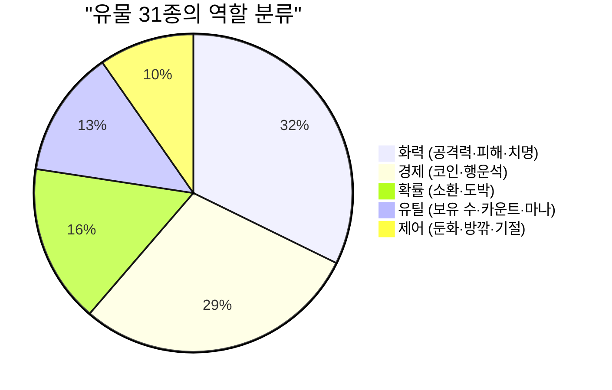
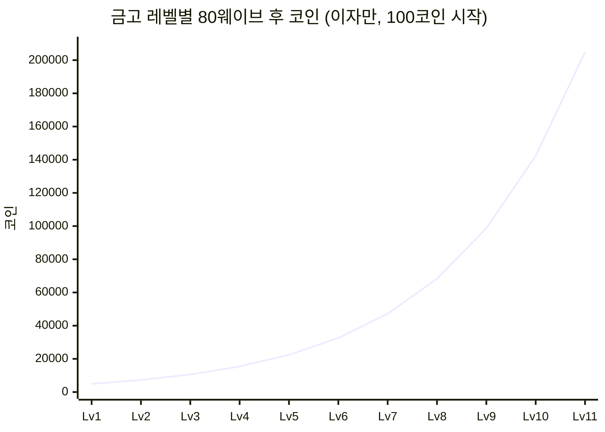
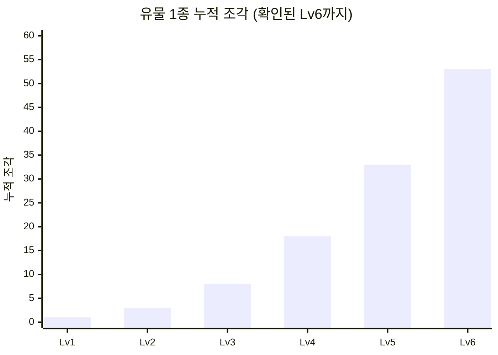
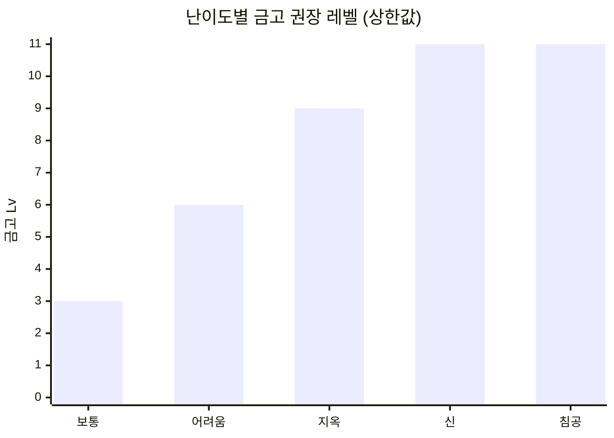

# 05. 유물 (Relic / Artifact)

> 근거 원본: [`raw/research-relics.md`](raw/research-relics.md). 수치 검산에 쓴 원문은 luckydefenseguides 구버전 공개 저장소(`GhidBase/lucky-defense-guides-legacy`, 마지막 커밋 2025-11-07)입니다.

## 5.1 시스템 개요

| 항목 | 내용 | 출처 |
|------|------|------|
| 위치 | 로비 하단 4번째 탭 | 게임오릭션(2025-03) |
| 구조 | **열쇠** → 무작위 **유물 조각** → 필요 수량 + **골드**로 레벨업 | 나무위키(검색요약), 디시 983372 |
| 종류 | **31종** (레벨 총합 최대 341) | 나무위키(검색요약) |
| 최대 레벨 | **11** (2024-08 확인) | 디시 773200 |
| 성장 폭 | 대부분 **Lv11 = Lv1의 2배**, 행운석만 3배 | 나무위키(검색요약) |
| 핵심 | 금고·머니건 필수, 행운석 반필수. "난이도는 금고·머니건·행운석 레벨에 좌우" | 나무위키(검색요약) |

> 화력 유물보다 **경제·확률 유물이 더 많습니다(14종).** 판 안 '운'을 판 밖 성장으로 보정하는 게임 정체성이 유물 구성에 그대로 드러납니다.

## 5.2 유물 31종 목록

| # | 유물 | 분류 | 효과: Lv1(+레벨당) | 영문명 |
|---|------|------|-------------------|--------|
| 1 | 힘의 물약 | 화력 | 전체 공격력 10%(+1%) | Power Potion |
| 2 | 요정활 | 화력 | 전체 공격속도 8%(+0.8%) | Fairy Bow |
| 3 | 대검 | 화력 | 보스 피해 10%(+1%) | Greatsword |
| 4 | 달팽이 | 제어 | 모든 적 이동속도 둔화 5(+1) | 미확인 |
| 5 | 탕후루 | 제어 | 모든 적 방어력 감소 5(+1) | 미확인 |
| 6 | 지갑 | 경제 | 시작 코인 50(+10) | 미확인 |
| 7 | 성벽 | 유틸 | 몬스터 카운트 여유 5(+0.5) | 미확인 |
| 8 | 영수증 | 경제 | 판매 시 3%(+0.3%) 확률로 행운석 +1 | Receipt |
| 9 | 오래된 책 | 화력 | 스킬 발동 확률 1%(+0.1%) | Old Book |
| 10 | 말발굽 | 유틸 | 이동속도 20%(+2%) (대상 미확인) | 미확인 |
| 11 | 밤바 인형 | 화력 | 치명타 확률 2%(+0.2%) | 미확인 |
| 12 | 램프 | 경제 | 10웨이브마다 행운석 1(+0.1) | Lamp |
| 13 | 행운석 | 경제 | 미션 클리어 시 행운석 1(+0.2) | Lucky Stone |
| 14 | 매직 건틀렛 | 화력 | 마법 피해 치명타 적용, 추가 치명 피해 20%(+2%) | Magic Gauntlet |
| 15 | **금고** | 경제 | **웨이브마다 보유 코인의 5%(+0.5%) 지급** | Safe Box |
| 16 | **머니건** | 경제 | **보유 코인의 0.7%(+0.07%)만큼 공격력 증가** | Money Gun |
| 17 | 해골석 | 확률 | 도박 실패 시 10%(+1%) 확률로 비용 환급 | Skull Stone |
| 18 | 현자의 요거트 | 유틸 | 궁극기 사용 시 마나 10%(+1%) 환급 | Sage's Yogurt |
| 19 | 황금 망치 | 경제 | 치명타 시 3%(+0.3%) 확률로 +1 코인 | 미확인 |
| 20 | 승부사의 손목 | 확률 | 도박 실패 시 10%(+1%) 확률로 하위 등급 영웅 | Gambler's Wrist |
| 21 | 고기 | 유틸 | 최대 보유 영웅 수 5(+0.5) | Meat |
| 22 | 황금 주사위 | 확률 | 도박 전설 확률 3%(+0.3%) | Golden Dice |
| 23 | 방망이 | 화력 | 물리 피해 5%(+1%) | 미확인 |
| 24 | 마법사의 모자 | 화력 | 마법 피해 5%(+1%) | 미확인 |
| 25 | 폭탄 | 화력 | 기절한 적 대상 피해 10%(+1%) | 미확인 |
| 26 | 나팔 | 확률 | 도박 영웅 확률 5%(+0.5%) | Horn |
| 27 | 황금 곡괭이 | 경제 | 처치 시 코인 0.2(+0.02) | Golden Pickaxe |
| 28 | 비전서 | 화력 | 스킬 피해 10%(+1%) (신뢰도 중) | 미확인 |
| 29 | 펀치 글러브 | 제어 | 기절 지속시간 10%(+1%) | Punching Glove |
| 30 | 왕의 비둘기 | 경제 | 웨이브 지급 코인 5(+0.5) | 미확인 |
| 31 | 빛나는 레버 | 확률 | 일반 소환 희귀 확률 2%(+0.2%) | Shiny Lever |

- 출처: 나무위키 여러 판본(검색요약)을 합친 목록 + grindnstrat·luckydefenseguides의 영문명.
- 해금: 모든 유물은 **조각 1개를 얻으면 Lv1**이 됩니다. 금고·머니건은 신규 가이드 퀘스트 보상으로도 줍니다.

## 5.3 레벨 1~11 효과 수치표 (31종 × 전 레벨)

**모든 셀은 계산값**입니다. 공식은 `Lv값 = 기본 + 증가 × (Lv−1)`입니다. 이 공식은 출처 값으로 검산했습니다.
- 금고: 80웨이브 복리표가 Lv1~11 전 구간 ±1코인 이내로 일치
- 머니건: Lv4 = 0.91% 일치
- Lv6 값 4개(해골석·손목·나팔·영수증) 일치

| # | 유물 | 지표 | Lv1 | Lv2 | Lv3 | Lv4 | Lv5 | Lv6 | Lv7 | Lv8 | Lv9 | Lv10 | Lv11 |
|---|------|------|---:|---:|---:|---:|---:|---:|---:|---:|---:|---:|---:|
| 1 | 힘의 물약 | 공격력 % | 10 | 11 | 12 | 13 | 14 | 15 | 16 | 17 | 18 | 19 | 20 |
| 2 | 요정활 | 공격속도 % | 8 | 8.8 | 9.6 | 10.4 | 11.2 | 12 | 12.8 | 13.6 | 14.4 | 15.2 | 16 |
| 3 | 대검 | 보스 피해 % | 10 | 11 | 12 | 13 | 14 | 15 | 16 | 17 | 18 | 19 | 20 |
| 4 | 달팽이 | 이동속도 둔화 | 5 | 6 | 7 | 8 | 9 | 10 | 11 | 12 | 13 | 14 | 15 |
| 5 | 탕후루 | 방어력 감소 | 5 | 6 | 7 | 8 | 9 | 10 | 11 | 12 | 13 | 14 | 15 |
| 6 | 지갑 | 시작 코인 | 50 | 60 | 70 | 80 | 90 | 100 | 110 | 120 | 130 | 140 | 150 |
| 7 | 성벽 | 카운트 여유 | 5 | 5.5 | 6 | 6.5 | 7 | 7.5 | 8 | 8.5 | 9 | 9.5 | 10 |
| 8 | 영수증 | 판매 행운석 확률 % | 3 | 3.3 | 3.6 | 3.9 | 4.2 | 4.5 | 4.8 | 5.1 | 5.4 | 5.7 | 6 |
| 9 | 오래된 책 | 스킬 발동 확률 % | 1 | 1.1 | 1.2 | 1.3 | 1.4 | 1.5 | 1.6 | 1.7 | 1.8 | 1.9 | 2 |
| 10 | 말발굽 | 이동속도 % | 20 | 22 | 24 | 26 | 28 | 30 | 32 | 34 | 36 | 38 | 40 |
| 11 | 밤바 인형 | 치명타 확률 % | 2 | 2.2 | 2.4 | 2.6 | 2.8 | 3 | 3.2 | 3.4 | 3.6 | 3.8 | 4 |
| 12 | 램프 | 10웨이브당 행운석 | 1 | 1.1 | 1.2 | 1.3 | 1.4 | 1.5 | 1.6 | 1.7 | 1.8 | 1.9 | 2 |
| 13 | 행운석 | 미션당 행운석 | 1 | 1.2 | 1.4 | 1.6 | 1.8 | 2 | 2.2 | 2.4 | 2.6 | 2.8 | 3 |
| 14 | 매직 건틀렛 | 추가 치명 피해 % | 20 | 22 | 24 | 26 | 28 | 30 | 32 | 34 | 36 | 38 | 40 |
| 15 | 금고 | 웨이브당 이자 % | 5 | 5.5 | 6 | 6.5 | 7 | 7.5 | 8 | 8.5 | 9 | 9.5 | 10 |
| 16 | 머니건 | 보유 코인 대비 공격력 % | 0.7 | 0.77 | 0.84 | 0.91 | 0.98 | 1.05 | 1.12 | 1.19 | 1.26 | 1.33 | 1.4 |
| 17 | 해골석 | 비용 환급 확률 % | 10 | 11 | 12 | 13 | 14 | 15 | 16 | 17 | 18 | 19 | 20 |
| 18 | 현자의 요거트 | 마나 환급 % | 10 | 11 | 12 | 13 | 14 | 15 | 16 | 17 | 18 | 19 | 20 |
| 19 | 황금 망치 | 치명 시 +1코인 확률 % | 3 | 3.3 | 3.6 | 3.9 | 4.2 | 4.5 | 4.8 | 5.1 | 5.4 | 5.7 | 6 |
| 20 | 승부사의 손목 | 하위 영웅 확률 % | 10 | 11 | 12 | 13 | 14 | 15 | 16 | 17 | 18 | 19 | 20 |
| 21 | 고기 | 최대 보유 +n | 5 | 5.5 | 6 | 6.5 | 7 | 7.5 | 8 | 8.5 | 9 | 9.5 | 10 |
| 22 | 황금 주사위 | 도박 전설 +% | 3 | 3.3 | 3.6 | 3.9 | 4.2 | 4.5¹ | 4.8 | 5.1 | 5.4 | 5.7 | 6 |
| 23 | 방망이 | 물리 피해 % | 5 | 6 | 7 | 8 | 9 | 10 | 11 | 12 | 13 | 14 | 15 |
| 24 | 마법사의 모자 | 마법 피해 % | 5 | 6 | 7 | 8 | 9 | 10 | 11 | 12 | 13 | 14 | 15 |
| 25 | 폭탄 | 기절 적 피해 % | 10 | 11 | 12 | 13 | 14 | 15 | 16 | 17 | 18 | 19 | 20 |
| 26 | 나팔 | 도박 영웅 +% | 5 | 5.5 | 6 | 6.5 | 7 | 7.5 | 8 | 8.5 | 9 | 9.5 | 10 |
| 27 | 황금 곡괭이 | 처치 코인 + | 0.2 | 0.22 | 0.24 | 0.26 | 0.28 | 0.3 | 0.32 | 0.34 | 0.36 | 0.38 | 0.4 |
| 28 | 비전서 | 스킬 피해 % | 10 | 11 | 12 | 13 | 14 | 15 | 16 | 17 | 18 | 19 | 20 |
| 29 | 펀치 글러브 | 기절 지속 % | 10 | 11 | 12 | 13 | 14 | 15 | 16 | 17 | 18 | 19 | 20 |
| 30 | 왕의 비둘기 | 웨이브 코인 + | 5 | 5.5 | 6 | 6.5 | 7 | 7.5 | 8 | 8.5 | 9 | 9.5 | 10 |
| 31 | 빛나는 레버 | 일반 소환 희귀 +% | 2 | 2.2 | 2.4 | 2.6 | 2.8 | 3 | 3.2 | 3.4 | 3.6 | 3.8 | 4 |

¹ 황금 주사위 Lv6: 출처(LDG 룰렛 시뮬레이터)는 **4.2%**로 적어 계산값 4.5%와 다릅니다. 표기 오류인지 실제 차이인지는 미확인입니다.

### 정수형 효과의 '사실상 만렙'

정수로만 의미 있는 효과는 반올림이나 버림 때문에 계단식으로 오릅니다.

| 유물 | 실효값 | 사실상 만렙 | 출처 |
|------|-------|-----------|------|
| 행운석 | Lv1~5: 1개, Lv6~10: 2개, Lv11: 3개 (버림) | 6 → 11 단계형 | LDG(원문) |
| 램프 | Lv6 = 1.5 → 2 (반올림) | **6** | 게임오릭션 |
| 고기 | Lv10 = 9.5 → 10 | **10** | 게임오릭션 |
| 성벽 | 고기와 같음 | **10** | 게임오릭션 |

> 레벨을 올려도 체감이 없는 구간이 생깁니다. 유저가 "어디까지만 올리면 되는지" 계산하게 만드는 장치이기도 하고, 반대로 **헛투자 불만**의 원인이기도 합니다.

## 5.4 핵심 유물의 경제 효과

### 금고: 80웨이브 복리 (100코인 시작, 이자만 받는 가정)

| 금고 Lv | 1 | 2 | 3 | 4 | 5 | 6 | 7 | 8 | 9 | 10 | 11 |
|---|---|---|---|---|---|---|---|---|---|---|---|
| 80웨이브 후 코인 | 4,956 | 7,247 | 10,579 | 15,415 | 22,423 | 32,559 | 47,195 | 68,293 | 98,655 | 142,275 | 204,840 |

출처: LDG(원문) safe-box-earnings

> 금고 Lv1과 Lv11의 차이는 **약 41배**입니다. 이자율은 5% → 10%로 2배지만 80번 복리가 쌓이면서 격차가 폭발합니다. "효과 2배"라는 겉보기 규칙과 달리 **실제 체감은 지수적**이라 유물 중 압도적 1순위가 됩니다.

### 머니건: 불멸 헤일리의 공격력 버프와 같아지는 보유 코인

| 머니건 Lv | 1 | 2 | 3 | 4 | 5 | 6 | 7 | 8 | 9 | 10 | 11 |
|---|---|---|---|---|---|---|---|---|---|---|---|
| 필요 코인 | 285k | 259k | 238k | 219k | 204k | 190k | 178k | 168k | 158k | 150k | 140k |

출처: LDG(원문) immortal-guardians

> **금고(코인을 불림) × 머니건(코인을 공격력으로)**이 한 쌍입니다. "코인을 쓰지 말고 쌓아라"는 판 안 전략과 "소환해서 합성하라"는 기본 루프가 충돌하면서, 매 판 **언제 쓰고 언제 모을지**를 결정하는 재미가 생깁니다.

## 5.5 강화 비용 (조각·골드)

| 구간 | 필요 조각 | 누적 조각 | 필요 골드 | 출처 |
|------|--------:|---------:|---------:|------|
| 0→1 (획득) | 1 | 1 | 미확인 | 디시 790348(2024-09) |
| 1→2 | 2 | 3 | 미확인 | 〃 |
| 2→3 | 5 | 8 | 미확인 | 〃 |
| 3→4 | 10 | 18 | 미확인 | 〃 |
| 4→5 | 15 | 33 | 미확인 | 〃 |
| 5→6 | 20 | 53 | 미확인 | 〃 |
| 6→7 ~ 10→11 | **미확인** | **미확인** | **미확인** | 조사한 출처 어디에도 수치 없음 |

| 목표 | 열쇠 (31종 × 누적 조각, 균등 가정 최소치) | 다이아 가치 (계산값) |
|------|----------------------------------------:|--------------------:|
| 전 유물 Lv4 | 558 | 23.4만 ~ 33.5만 |
| 전 유물 Lv5 | 1,023 | 43.0만 ~ 61.4만 |
| 전 유물 Lv6 | 1,643 | 69.0만 ~ 98.6만 |

- 열쇠 1개 = 420다이아(상점가, grindnstrat) ~ 600다이아(커뮤니티 환산, 디시 1082000).
- 31종 균등 1/31 확률이라 실제로는 중복 때문에 더 많이 듭니다.

> 커뮤니티 권장치인 "**모든 유물 Lv10~11**"(나무위키(검색요약), 침공 난이도)은 Lv6 이후 비용을 모르는 상태에서도 **Lv6 기준의 수 배**가 될 것으로 보입니다. 유물이 **가장 깊은 과금 흡수처**인 이유입니다 ([7장](07-economy-bm.md)).

## 5.6 획득 경로와 확률

| 획득처 | 내용 | 출처 |
|--------|------|------|
| 유물 광산 (무료) | **12시간마다 열쇠 1개** | grindnstrat, 게임오릭션 |
| 광고 | 상점 "유물 찾기" 광고 | 게임오릭션 |
| 인게임 드롭 | 어려움·지옥·신 10웨이브마다 보스 처치 시 무작위 | 게임오릭션 |
| 콘텐츠 보상 | 오늘의 던전, 신 모드 누적, 이벤트 모드, 마일스톤 | 게임오릭션, grindnstrat |
| 신규 가이드 퀘스트 | 열쇠 5개(3단계), 열쇠 10개(12단계), **금고 본체(8단계), 머니건 본체(10단계)** | LDG(원문) |
| 오늘의 운세 | 광산 열쇠 +1 | LDG(원문) |
| 상점 (다이아) | **열쇠 1개 = 420다이아** (일일 상점 한정 수량으로 추정) | grindnstrat |
| 상점 (지정) | 미보유 유물 지정 구매 = **800다이아** | grindnstrat |
| 유료 | 사냥패스(열쇠 37개), 돌파 패키지 | summerfallwinter, 게임오릭션 |

| 확률 항목 | 값 | 출처 |
|----------|----|------|
| 열쇠 1개 → 특정 유물 조각 | **1/31 ≈ 3.23%** (균등) | 디시 694953 (커뮤니티 계산, 공식 아님) |
| 특정 유물 1개 이상을 50% 확률로 | 열쇠 21개 | 〃 |
| 2개 이상 / 3개 이상 | 52개 / 83개 (이후 1개당 약 +31개) | 〃 |
| 천장 | **확인되지 않음** | — |

## 5.7 난이도별 권장 레벨

| 난이도 | 금고 권장 | 기타 | 출처 |
|--------|----------|------|------|
| 보통 | 0~3 | 금고·머니건·행운석 Lv1 이상이면 캐리 가능 | 게임오릭션, LDG |
| 어려움 | 4~6 | 금고 3 미만이면 서포터 역할 | 게임오릭션, 나무위키(검색요약) |
| 지옥 | 7~9 | 금고/머니건 최소 5/5, 권장 6/6, 통념 7/7 | 게임오릭션, LDG |
| 신 | 10~11 | 금고·머니건·성벽·고기 7~8 이상, Lv5 이하 유물이 있으면 비추천 | 게임오릭션, 나무위키(검색요약) |
| 침공 (2026-05~) | 11 | **모든 유물 11** | 나무위키(검색요약) |

> **난이도 진입 기준이 사실상 '금고 레벨'**입니다. 새 난이도(침공)를 추가할 때마다 권장 유물 레벨이 올라가 **유물 투자 수요가 다시 생깁니다**.

## 5.8 티어 평가 (출처별)

| 출처 (시점) | 상위 | 중위 | 하위 |
|------------|------|------|------|
| 디시 73026 (2024-06) | 0티어: 금고, 머니건 | 1티어: 지갑, 나팔, 성벽, 고기 / 2티어: 힘의 물약, 요정활, 건틀렛 | 3티어: 곡괭이, 주사위, 영수증, 램프, 망치, 손목, 행운석, 해골석 |
| 디시 761717 (2024) | 금고 S+, 머니건 S | 행운석·요정활 A+, 손목·해골석 A | 나팔·고기 B |
| grindnstrat (2025-02) | S: 금고, 머니건, 고기 | A: 곡괭이, 나팔, 요거트, 레버, 요정활, 손목 | B: 행운석, 램프, 대검, 책, 물약, 글러브, 건틀렛 |

> 금고·머니건은 모든 출처에서 최상위입니다. 행운석은 2024년 초 3티어에서 이후 반필수·A+로 올라갔습니다.

## 5.9 연혁

| 시점 | 내용 |
|------|------|
| 2024-06 이전 | 유물 시스템 존재 |
| 하드 출시 직후 | 금고·머니건 **예고 없이 대폭 하향 → 며칠 뒤 롤백** (핵심 유물 너프에 반발) |
| 2024-08 | 만렙 11 확인 |
| 2024-11 | 보물 추가 (유물과 별개) |
| 2026-05 | 침공 난이도 (권장 유물 올11) |
| 미확인 | 유물 추가, 상한 확장, 수치 조정 패치 |

> **핵심 유물 너프 → 롤백** 사례는 교훈입니다. 유저가 큰 투자를 한 영구 성장 수치는 사실상 **내릴 수 없는 값**이 됩니다.
