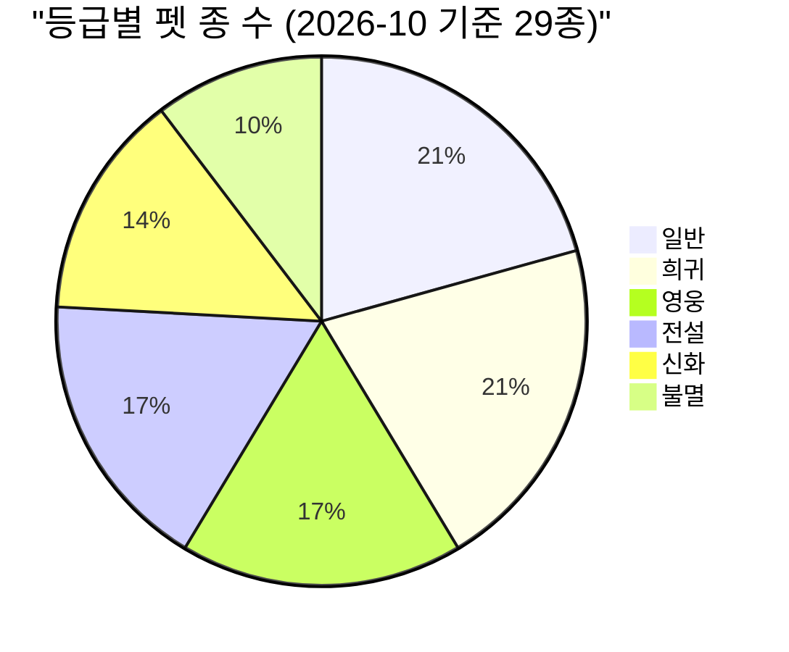
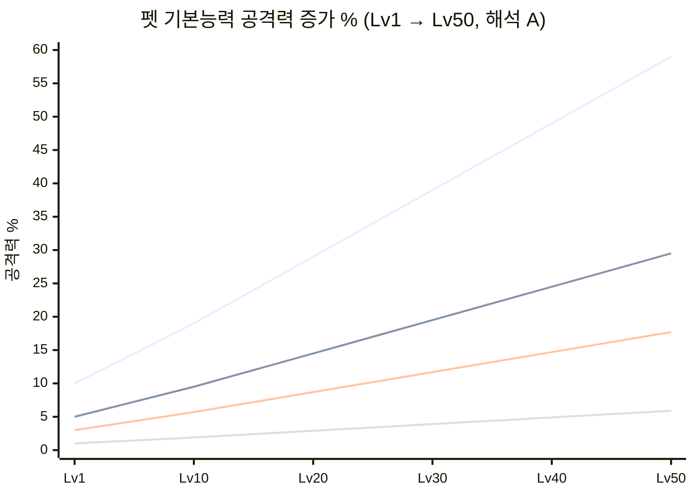
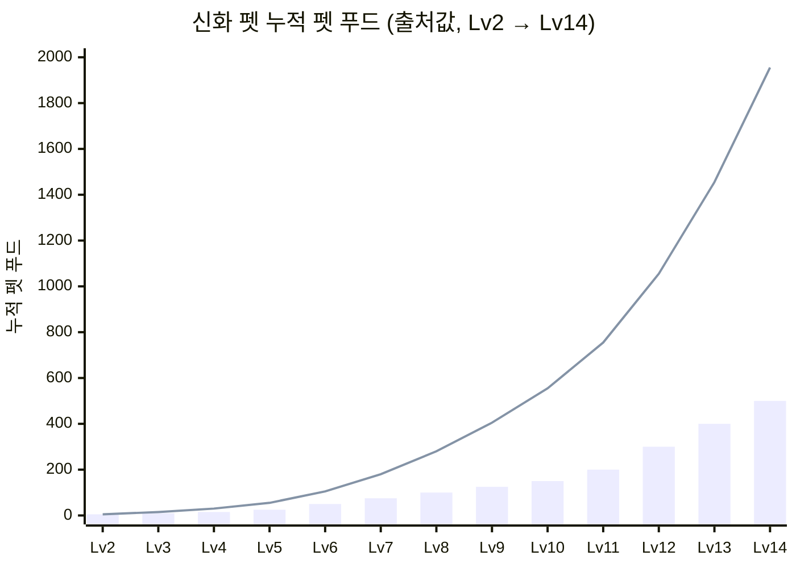
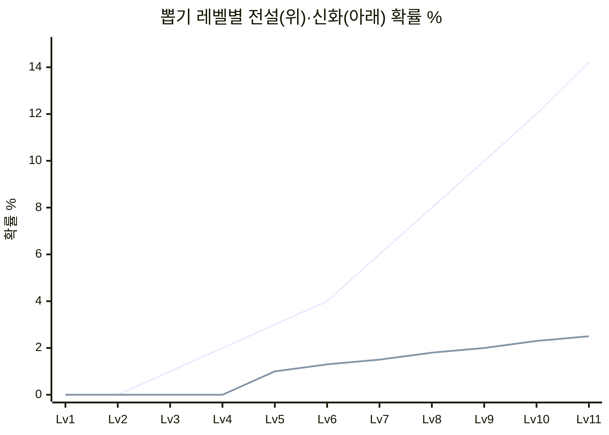
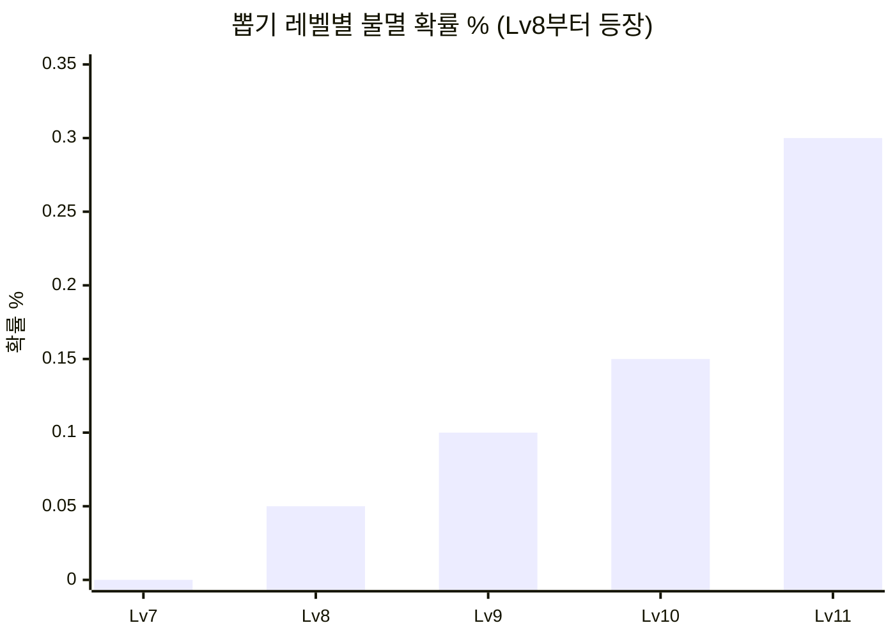

# 06. 펫

> 근거 원본: [`raw/research-pets.md`](raw/research-pets.md)

## 6.1 시스템 개요

| 항목 | 내용 | 출처 |
|------|------|------|
| 도입 | 2025-04, v1.5.7 | 나무위키(검색요약), 디시 공지 전재 |
| 해금 | **계정 Lv9** (해금 시 배터리 10개 지급) | 나무위키(검색요약) |
| 등급 | 일반 → 희귀 → 영웅 → 전설 → 신화 → **불멸** (불멸 등급은 펫에 처음 등장, 영웅보다 1개월 먼저) | 나무위키(검색요약) |
| 능력 | **기본능력**(공격력 증가 %) 1개 + **특수능력** 1개 (불멸은 2개) | 디시 1038496 |
| 공격력 적용 | **곱연산** (유물 '머니건'과 같은 방식) | 나무위키(검색요약) |
| 장착 | 장착한 펫만 효과. 슬롯 1 → 종합 Lv100에 2 → Lv200에 3 | 나무위키(검색요약), begchi |
| 뽑기 재화 | **배터리** (10회 연속 = 배터리 100개) | 나무위키(검색요약) |
| 레벨업 재화 | **펫 푸드** (+일정 레벨부터 펫 조각) | 나무위키(검색요약) |
| 초기화 | 언제든 가능, 쓴 조각과 펫 푸드 **전부 반환** | 디시 1038496 |

> 기획안 예비 조사의 "같은 펫 3마리로 진화하면 +20%"는 출처(gazet.ai)가 실재하지 않는 펫 이름과 근거 없는 천장 규칙을 함께 싣고 있어 **신뢰도가 낮아 제외**했습니다. 실제 구조는 **중복 펫 → 조각 → 펫 푸드로 레벨업**입니다.

## 6.2 펫 목록 (29종)

| 등급 | 펫 | 특수능력 (Lv1 → Lv50) |
|------|-----|----------------------|
| 일반 | 단세포 | 마나 회복 속도 2 → 7% |
| 일반 | 칠리 | 기본 공격 피해 2 → 7% |
| 일반 | 싹고기 | 궁극기 피해 2 → 7% |
| 일반 | 집게 | 보스 대상 피해 2 → 7% |
| 일반 | 쭈꾸 | 이동속도 3 → 13% |
| 일반 | 조랭이 | 효과 미확인 (3 → 13%) |
| 희귀 | 젤리 | 마나 회복 속도 2.5 → 10% |
| 희귀 | 튜브 | 기본 공격 피해 2.5 → 10% |
| 희귀 | 단단 | 적 방어력 2.5 → 10 감소 |
| 희귀 | 핸섬 | 보스 대상 피해 2.5 → 10% |
| 희귀 | 쿨랭이 | 몬스터 이동속도 5 → 20% 감소 |
| 희귀 | 잎고기 | 미확인 |
| 영웅 | 스티키 | 궁극기 피해 5 → 15% |
| 영웅 | 투구 | 적 방어력 5 → 15 감소 |
| 영웅 | 풀고기 | 게임 시작 시 10 → 25% 확률로 일반~희귀 영웅 소환 |
| 영웅 | 앤소니 | 쿨타임 2.5 → 10% 감소 |
| 영웅 | 볼피쉬 | 30초마다 주변 적에게 현재 체력의 2 → 7% 피해 |
| 전설 | 샐러맨더 | 무료 소환 1 → 3회 (Lv10/20/30에서만 상승) |
| 전설 | 늠름 | 물리 피해 5 → 20% |
| 전설 | 밍숭숭 | 마법 피해 5 → 20% |
| 전설 | 새우쿤 | 치명타 피해 5 → 20% |
| 전설 | 산고기 | 게임 시작 시 20 → 70 코인 |
| 신화 | **고래킹** | 공격 속도 2.5 → 10% |
| 신화 | **드라고** | 치명타 확률 2.5 → 10% |
| 신화 | **우루루** | 웨이브 시작 시 5 → 20% 확률로 행운석 1개 |
| 신화 | 유령부기 | 판매 시 5 → 30% 확률로 5~20 코인 추가 |
| 불멸 | **포세이돈** | ① 카운트 최대치 5마리 전, 일반 몬스터를 15 → 30% 확률로 처치(판당 1회) ② 보스 피해 10 → 20% |
| 불멸 | **파티캣** | ① 60초마다 20초간 영웅 최종 피해 10 → 30% ② 치명타 피해 10 → 20% |
| 불멸 | Blazey (2026-10, v2.0.14) | 효과 미확인 |

- 출처: 나무위키(검색요약), begchi(2025-04-29), Google Play 패치노트.
- 특수능력은 **Lv10·20·30·40·50에서만** 오르며(샐러맨더는 10·20·30), 중간값은 미확인입니다.

> 특수능력 종류가 **유물 효과와 거의 겹칩니다**(마나, 보스 피해, 방깎, 치명, 코인, 행운석). 펫은 새 효과를 만들기보다 **유물 축의 수치를 곱연산으로 한 번 더 키우는** 역할입니다.

## 6.3 기본능력 (공격력 증가 %) — Lv1 ~ 50 전 구간

| 등급 | 기본값(Lv1) | 레벨당 증가 | 출처 |
|------|----------:|----------:|------|
| 일반 | 1% | +0.1%p | 디시 1038496, 나무위키(검색요약) |
| 희귀 | 1.5% | +0.15%p | 〃 |
| 영웅 | 2% | +0.2%p | 〃 |
| 전설 | 3% | +0.3%p | 〃 |
| 신화 | 5% | +0.5%p | 〃 |
| 불멸 | 10% | +1.0%p | 〃 |

**해석 차이**: 레벨당 기본값의 10%씩 오른다는 점은 모든 출처가 같습니다. Lv1 값을 어떻게 보느냐에 따라 두 해석이 나뉩니다.
- 해석 A: Lv1 = 기본값. 디시 예시 "드라고 Lv20 = 14.5%"와 일치합니다.
- 해석 B: Lv1 = 기본값 × 1.1. 나무위키의 "Lv50 = 6배"와 일치합니다.

아래 표는 **해석 A로 계산한 값**이고, 해석 B 값은 표 값에 일반 +0.1 / 희귀 +0.15 / 영웅 +0.2 / 전설 +0.3 / 신화 +0.5 / 불멸 +1.0%p를 더하면 됩니다. 최대 레벨은 미확인이라 Lv50까지만 적었습니다.

| Lv | 일반 | 희귀 | 영웅 | 전설 | 신화 | 불멸 |
|---:|---:|---:|---:|---:|---:|---:|
| 1 | 1.0 | 1.50 | 2.0 | 3.0 | 5.0 | 10 |
| 2 | 1.1 | 1.65 | 2.2 | 3.3 | 5.5 | 11 |
| 3 | 1.2 | 1.80 | 2.4 | 3.6 | 6.0 | 12 |
| 4 | 1.3 | 1.95 | 2.6 | 3.9 | 6.5 | 13 |
| 5 | 1.4 | 2.10 | 2.8 | 4.2 | 7.0 | 14 |
| 6 | 1.5 | 2.25 | 3.0 | 4.5 | 7.5 | 15 |
| 7 | 1.6 | 2.40 | 3.2 | 4.8 | 8.0 | 16 |
| 8 | 1.7 | 2.55 | 3.4 | 5.1 | 8.5 | 17 |
| 9 | 1.8 | 2.70 | 3.6 | 5.4 | 9.0 | 18 |
| 10 | 1.9 | 2.85 | 3.8 | 5.7 | 9.5 | 19 |
| 11 | 2.0 | 3.00 | 4.0 | 6.0 | 10.0 | 20 |
| 12 | 2.1 | 3.15 | 4.2 | 6.3 | 10.5 | 21 |
| 13 | 2.2 | 3.30 | 4.4 | 6.6 | 11.0 | 22 |
| 14 | 2.3 | 3.45 | 4.6 | 6.9 | 11.5 | 23 |
| 15 | 2.4 | 3.60 | 4.8 | 7.2 | 12.0 | 24 |
| 16 | 2.5 | 3.75 | 5.0 | 7.5 | 12.5 | 25 |
| 17 | 2.6 | 3.90 | 5.2 | 7.8 | 13.0 | 26 |
| 18 | 2.7 | 4.05 | 5.4 | 8.1 | 13.5 | 27 |
| 19 | 2.8 | 4.20 | 5.6 | 8.4 | 14.0 | 28 |
| 20 | 2.9 | 4.35 | 5.8 | 8.7 | 14.5 | 29 |
| 21 | 3.0 | 4.50 | 6.0 | 9.0 | 15.0 | 30 |
| 22 | 3.1 | 4.65 | 6.2 | 9.3 | 15.5 | 31 |
| 23 | 3.2 | 4.80 | 6.4 | 9.6 | 16.0 | 32 |
| 24 | 3.3 | 4.95 | 6.6 | 9.9 | 16.5 | 33 |
| 25 | 3.4 | 5.10 | 6.8 | 10.2 | 17.0 | 34 |
| 26 | 3.5 | 5.25 | 7.0 | 10.5 | 17.5 | 35 |
| 27 | 3.6 | 5.40 | 7.2 | 10.8 | 18.0 | 36 |
| 28 | 3.7 | 5.55 | 7.4 | 11.1 | 18.5 | 37 |
| 29 | 3.8 | 5.70 | 7.6 | 11.4 | 19.0 | 38 |
| 30 | 3.9 | 5.85 | 7.8 | 11.7 | 19.5 | 39 |
| 31 | 4.0 | 6.00 | 8.0 | 12.0 | 20.0 | 40 |
| 32 | 4.1 | 6.15 | 8.2 | 12.3 | 20.5 | 41 |
| 33 | 4.2 | 6.30 | 8.4 | 12.6 | 21.0 | 42 |
| 34 | 4.3 | 6.45 | 8.6 | 12.9 | 21.5 | 43 |
| 35 | 4.4 | 6.60 | 8.8 | 13.2 | 22.0 | 44 |
| 36 | 4.5 | 6.75 | 9.0 | 13.5 | 22.5 | 45 |
| 37 | 4.6 | 6.90 | 9.2 | 13.8 | 23.0 | 46 |
| 38 | 4.7 | 7.05 | 9.4 | 14.1 | 23.5 | 47 |
| 39 | 4.8 | 7.20 | 9.6 | 14.4 | 24.0 | 48 |
| 40 | 4.9 | 7.35 | 9.8 | 14.7 | 24.5 | 49 |
| 41 | 5.0 | 7.50 | 10.0 | 15.0 | 25.0 | 50 |
| 42 | 5.1 | 7.65 | 10.2 | 15.3 | 25.5 | 51 |
| 43 | 5.2 | 7.80 | 10.4 | 15.6 | 26.0 | 52 |
| 44 | 5.3 | 7.95 | 10.6 | 15.9 | 26.5 | 53 |
| 45 | 5.4 | 8.10 | 10.8 | 16.2 | 27.0 | 54 |
| 46 | 5.5 | 8.25 | 11.0 | 16.5 | 27.5 | 55 |
| 47 | 5.6 | 8.40 | 11.2 | 16.8 | 28.0 | 56 |
| 48 | 5.7 | 8.55 | 11.4 | 17.1 | 28.5 | 57 |
| 49 | 5.8 | 8.70 | 11.6 | 17.4 | 29.0 | 58 |
| 50 | 5.9 | 8.85 | 11.8 | 17.7 | 29.5 | 59 |

(단위: %, 전부 계산값)

위에서부터 불멸 / 신화 / 전설 / 일반 순입니다.

> **불멸 Lv1(10%)이 신화 Lv11(10%)과 같고, 일반 Lv50(5.9%)보다 높습니다.** 레벨보다 **등급이 압도적**이어서 "특수능력보다 높은 등급 우선"(디시)이 정석입니다. 이 격차가 불멸 펫 뽑기(배터리)의 과금 동기가 됩니다.

## 6.4 펫 푸드 필요량

출처: 디시 1019022 '소과금 펫 종합 레벨 200 찍기 팁'(2025). 등급 비율은 **일반:희귀:영웅:전설:신화 = 1:2:3:4:5**이고, 기본 수열은 1, 2, 3, 5, 10, 15, 20, 25, 30, 40, 60, 80, 100입니다.

**검산**: 같은 글의 "신화 5, 전설 6, 영웅 7, 희귀 8, 일반 11 → 종합 199, 펫 푸드 2,758개"를 아래 표와 일반 6·희귀 6·영웅 5·전설 5·신화 4종 구성으로 계산하면 **정확히 2,758**이 나옵니다.

| 구간 | 일반 (단계/누적) | 희귀 | 영웅 | 전설 | 신화 | 근거 |
|------|---------------|------|------|------|------|------|
| 1→2 | 1 / 1 | 2 / 2 | 3 / 3 | 4 / 4 | 5 / 5 | 출처값 |
| 2→3 | 2 / 3 | 4 / 6 | 6 / 9 | 8 / 12 | 10 / 15 | 출처값 |
| 3→4 | 3 / 6 | 6 / 12 | 9 / 18 | 12 / 24 | 15 / 30 | 출처값 |
| 4→5 | 5 / 11 | 10 / 22 | 15 / 33 | 20 / 44 | 25 / 55 | 출처값 |
| 5→6 | 10 / 21 | 20 / 42 | 30 / 63 | 40 / 84 | 50 / 105 | 출처값 |
| 6→7 | 15 / 36 | 30 / 72 | 45 / 108 | 60 / 144 | 75 / 180 | 출처값 |
| 7→8 | 20 / 56 | 40 / 112 | 60 / 168 | 80 / 224 | 100 / 280 | 출처값 |
| 8→9 | 25 / 81 | 50 / 162 | 75 / 243 | 100 / 324 | 125 / 405 | 출처값 |
| 9→10 | 30 / 111 | 60 / 222 | 90 / 333 | 120 / 444 | 150 / 555 | 출처값 |
| 10→11 | 40 / 151 | 80* / 302 | 120* / 453 | 160* / 604 | 200 / 755 | 신화·일반 확인, *비례 추정 |
| 11→12 | 60* / 211 | 120* / 422 | 180* / 633 | 240* / 844 | 300 / 1,055 | 신화만 출처값 |
| 12→13 | 80* / 291 | 160* / 582 | 240* / 873 | 320* / 1,164 | 400 / 1,455 | 신화만 출처값 |
| 13→14 | 100* / 391 | 200* / 782 | 300* / 1,173 | 400* / 1,564 | 500 / 1,955 | 신화만 출처값 |
| 14→15 이상 | 미확인 | 미확인 | 미확인 | 미확인 | 미확인 (원문 '?') | — |

`*` = 비례 추정(검증되지 않음). 불멸 펫의 펫 푸드는 **미확인**입니다.

| 목표 | 필요 펫 푸드 | 무과금 일수 (하루 20개) | 출처 |
|------|----------:|---------------------:|------|
| 종합 Lv199 (최소비용 루트) | 2,758 | 약 138일 | 디시 1019022, 일수는 계산값 |
| 신화 3마리 Lv6 | 2,818 (원문, 위 표로 재현 안 됨) | 약 141일 | 디시 1019022 |
| 종합 Lv300 | 최소 11,328 | 약 566일 | 디시 1019022, 일수는 계산값 |

> 무과금으로 하루 펫 푸드 20개(무료 10 + 광고 10)라면 **종합 200(슬롯 3칸)까지 약 4.5개월**이 걸립니다. 펫 푸드는 보석 500 = 50개(일일 상점 30% 할인)로 살 수 있어 **시간을 돈으로 바꾸는 구간**이 됩니다.

## 6.5 펫 종합 레벨 보너스 (보유 펫 레벨 합)

출처: begchi(2025-04-29). 80·460·480 구간은 미확인입니다.

| 종합 Lv | 효과 | 종합 Lv | 효과 |
|-------:|------|-------:|------|
| 20 | 기본 공격 피해 +2% | 260 | 물리 피해 +5% |
| 40 | 마나 회복 속도 +3% | 280 | 마법 피해 +5% |
| 60 | 공격력 +2% | 300 | 공격력 +2% |
| 80 | 미확인 | 320 | 기본 공격 피해 +2% |
| **100** | **펫 슬롯 2칸** | 340 | 단일 피해 +3% |
| 120 | 기본 공격 피해 +2% | 360 | 범위 피해 +3% |
| 140 | 쿨타임 -5% | 380 | 궁극기 피해 +3% |
| 160 | 공격력 +2% | 400 | 공격력 +2% |
| 180 | 이동속도 +5% | 420 | 기본 공격 피해 +2% |
| **200** | **펫 슬롯 3칸** | 440 | 치명타 피해 +5% |
| 220 | 기본 공격 피해 +2% | 460·480 | 미확인 |
| 240 | 보스 대상 피해 +2% | 500 | 공격력 +2% |

> **종합 레벨은 '보유 펫 전체'의 레벨 합**이라, 장착하지 않는 하위 등급 펫도 키울 이유가 생깁니다. 낮은 등급 펫은 레벨업 비용이 싸서(일반 = 신화의 1/5) 종합 레벨을 채우는 **가성비 재료**가 됩니다(디시 최소비용 루트: 일반을 11까지).

## 6.6 뽑기 (배터리)

### 비용

| 항목 | 값 | 출처 |
|------|----|------|
| 10회 연속 | 배터리 100개 (= 펫 조각 100개) | 나무위키(검색요약) |
| 배터리 가격 | 보석 500 = 배터리 10개 → 10연 1회 = **보석 5,000** (약 3.5만 원, 계산값) | 디시 1038496 |
| 무료 수급 | 하루 10개 (무료 5 + 광고 5) | 나무위키(검색요약), 디시 1038496 |

### 뽑기 레벨 (배터리 누적 사용량)

| 뽑기 Lv | 다음 레벨까지 배터리 | 출처 |
|-------:|------------------:|------|
| 1 | 50 | 나무위키(검색요약) |
| 2 | 100 | 〃 |
| 3 | 200 | 〃 |
| 4 | 500 | 〃 |
| 5 | 1,000 | 〃 |
| 6~8 | 미확인 (3구간 합 6,500, 계산값) | — |
| 9 | 4,000 | 〃 |
| 10 | 5,000 | 〃 |
| 11 | 최대 | 〃 |
| **합계** | **17,350** | 〃 |

> 뽑기 Lv11까지 배터리 17,350개 = 무과금 **약 4.8년**(하루 10개), 보석으로는 **약 86.8만 개** (약 610만 원, 계산값)입니다.

### 뽑기 레벨별 등급 확률 (나무위키(검색요약))

| 뽑기 Lv | 일반 | 희귀 | 영웅 | 전설 | 신화 | 불멸 |
|-------:|---:|---:|---:|---:|---:|---:|
| 1 | 50% | 45% | 5% | – | – | – |
| 2 | 47% | 42.5% | 10.5% | – | – | – |
| 3 | 45% | 41% | 13% | 1% | – | – |
| 4 | 43% | 40% | 15% | 2% | – | – |
| 5 | 39% | 38% | 19% | 3% | 1% | – |
| 6 | 38% | 36.7% | 20% | 4% | 1.3% | – |
| 7 | 36% | 34% | 22.5% | 6% | 1.5% | – |
| 8 | 35% | 32.4% | 22.75% | 8% | 1.8% | **0.05%** |
| 9 | 33% | 31.5% | 23.4% | 10% | 2% | 0.1% |
| 10 | 31% | 30.5% | 24% | 12% | 2.3% | 0.15% |
| 11 | 30% | 29% | 24% | 14.2% | 2.5% | **0.3%** |

- 해금 시점: 전설 Lv3, 신화 Lv5, **불멸 Lv8**.
- gazet.ai의 "일반 45 / 희귀 30 / 영웅 15 / 전설 7 / 신화 2.5 / 불멸 0.5"는 레벨 구분이 없고 다른 출처와 맞지 않아 쓰지 않았습니다.
- 천장: **확인되지 않음**. 뽑기 레벨(누적 사용량에 따른 확률 상승)이 사실상 누적 보상 역할을 합니다.

> **'뽑을수록 확률이 오르는' 뽑기 레벨**은 천장 대신 쓰는 장치입니다. 불멸 확률이 Lv8에야 처음 열리기 때문에, 초기 배터리 투자는 "불멸을 뽑을 자격"을 사는 과정이 됩니다.

## 6.7 2026-02 확률 오류 사태

| 항목 | 내용 | 출처 |
|------|------|------|
| 원인 | 뽑기 2단계(① 등급 결정 → ② 등급 안 펫 선택) 중 ②의 **셔플 로직 오류**로 리스트 위쪽 펫이 더 자주 나옴. 룬 뽑기도 같은 오류 | 인벤 313379 |
| 편차 | 일반·희귀 최대 4.41%, 영웅·전설 최대 5.13%, 신화 최대 6.13%. **불멸은 영향 없음**, 등급 확률 자체는 정상 | 인벤, 다나와, 뉴스웨이(2026-02-05) |
| 사례 | 신화 4종 균등이면 25%인데 고래킹 실측 28.68% | gamerscroll |
| 1차 보상 | 펫 보상 선택 티켓 (회수 + 배터리 환급 / 수량 보정 / 유지) | 경향게임스 |
| 2차 보상 | 육성 유지 + 펫 수량 일괄 상향 + 전체 보석 10,000개 (1차안 반발로 4시간 뒤 변경) | 경향게임스, 인벤 |
| 제도권 | 게임위 조사 준비 보도, 게임이용자협회 신고 보도(철회 보도와 상충) | 인벤 313497, 다음 |

> 등급 확률은 공시했지만 **등급 안 개별 확률을 검증하지 않은 것**이 문제였습니다. 확률형 성장 축을 둘 때는 **2단계 뽑기의 각 단계를 모두 테스트·공시**해야 한다는 교훈입니다.

## 6.8 커뮤니티 권장 세팅

| 보유 상황 | 권장 3칸 | 출처 |
|----------|---------|------|
| 불멸 2종 | 파티캣 + 포세이돈 + 드라고 | 나무위키(검색요약) |
| 불멸 1종 | (파티캣 또는 포세이돈) + 우루루(또는 고래킹) + 드라고 | 〃 |
| 불멸 없음 | 고래킹 + 우루루 + 드라고 (우루루는 Lv10 이상부터) | 〃 |
| 최고 난이도 | 불멸 최소 1종(Lv6 이상), 신화 Lv12~15 필수 | 나무위키(검색요약) |
| 무·소과금 | "불멸은 포기하는 게 정신건강에 이롭다". 초반엔 금고(열쇠)·주력 신화 우선 | 디시 1038496 |
