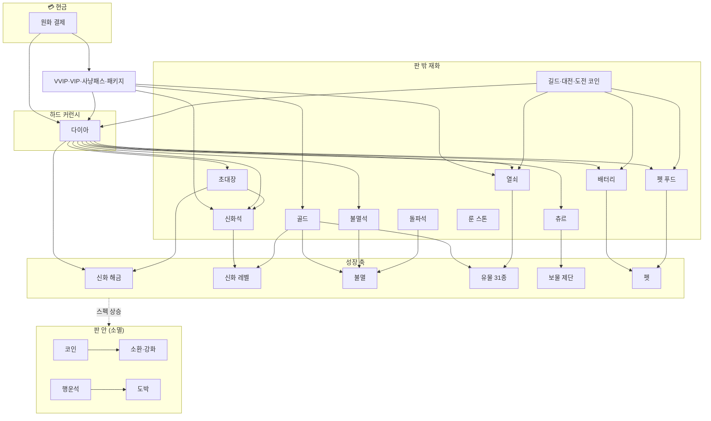
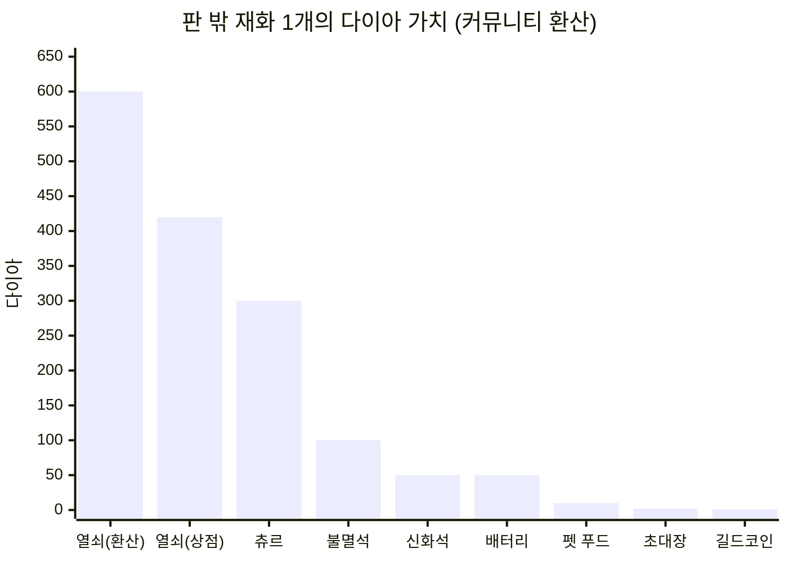
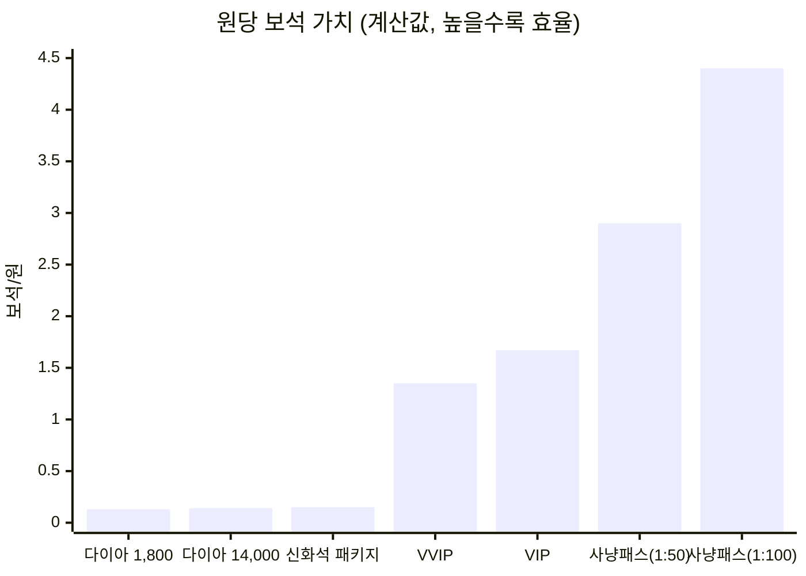
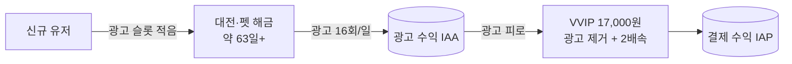
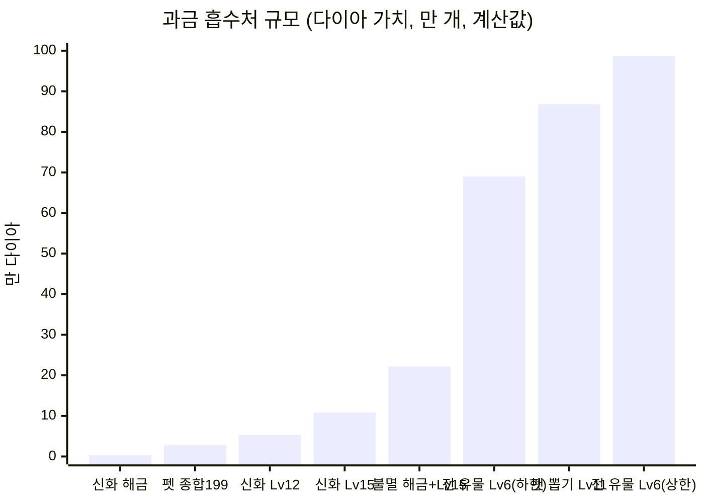
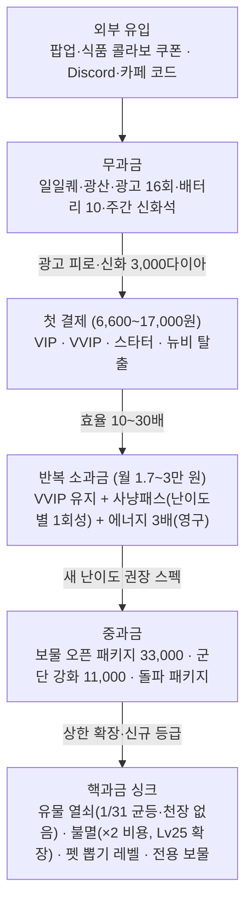
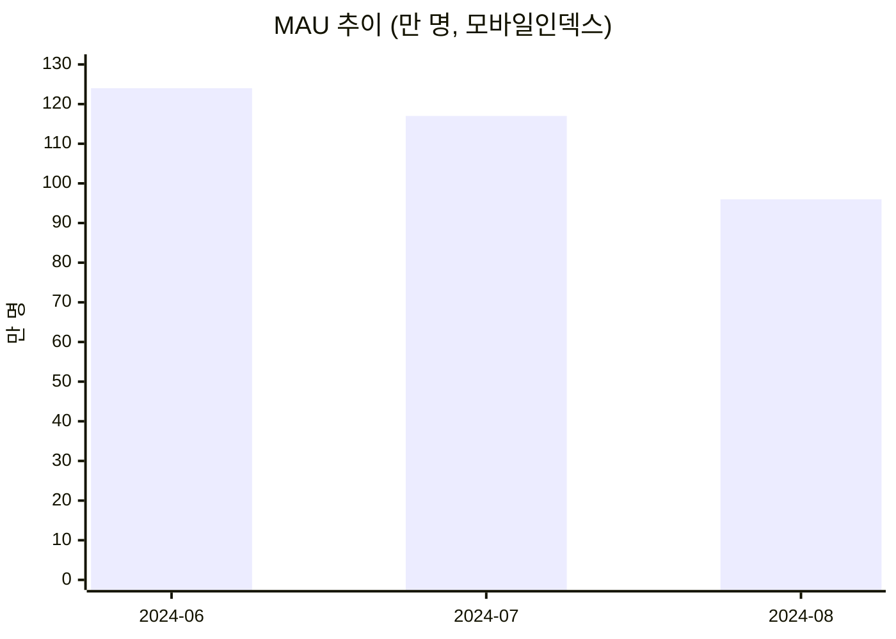

# 07. 재화와 BM 흐름 (핵심 장)

> 근거 원본: [`raw/research-economy.md`](raw/research-economy.md). 가격과 환산치 대부분은 2024-07~2025-11 자료라서 2026-11 현재 값과 다를 수 있습니다.
> 표기: **[계산]** = 이 보고서에서 출처 값으로 계산한 값, **[추정]** = 근거가 있는 추정.

## 7.1 한 장 요약

| 질문 | 답 |
|------|----|
| 판 안에서 돈을 쓸 수 있나? | **아니오.** 판 안 재화(코인·행운석)는 판이 끝나면 사라지고, 과금은 **판 밖 스펙**으로만 영향을 줍니다. |
| 기본 과금 단위는? | 다이아. 1개 ≈ **7원** (1,800개 14,000원 ~ 14,000개 99,000원) |
| 소과금 미끼는? | **VVIP 17,000원/월**(2배속 + 광고 제거 + 다이아), VIP 6,600원, 사냥패스 12,000원. 다이아 직구보다 **10~30배 효율** [계산] |
| 가장 깊은 과금 흡수처는? | **유물** (전 유물 Lv6만 해도 다이아 69만~99만 가치) → 펫 뽑기 레벨 → 불멸 |
| 천장은? | 전용 보물만 소프트 천장. 유물·신화 모집은 **없음**. 펫은 '뽑기 레벨'로 대체 |
| 매출 지속 장치는? | 약 6개월마다 **새 성장 축이나 상한 확장** (보물 → 펫 → 불멸 → 불멸 Lv25) + **새 난이도**(권장 스펙 상승) |
| 외부 유입은? | 오프라인 팝업·식품 콜라보에 **한정 스킨 + 다이아 쿠폰**을 묶음 |

## 7.2 재화 지도

### 7.2.1 판 안 재화 (판이 끝나면 사라짐)

| 재화 | 획득 | 사용 | 판 밖 성장의 영향 | 출처 |
|------|------|------|-----------------|------|
| 코인 | 몬스터 처치, 미션, 판매 | 소환(할수록 비용 상승), 일반~영웅 강화 | 금고(이자), 머니건(공격력), 지갑, 비둘기, 곡괭이, 망치, 산고기·유령부기(펫) | 나무위키(검색요약) |
| 행운석 | **골렘 처치**(유일한 무료 경로), 미션, 유닛 판매 | 도박(희귀 1석 60% / 영웅 1석 20% / 전설 2석 10%), 전설~신화 강화 | 행운석·램프·영수증(유물), 우루루(펫), 모노폴리맨(신화) | 나무위키(검색요약), luckydefense.net |

### 7.2.2 판 밖 재화

| 재화 | 성격 | 주요 사용처 | 다이아 환산 (커뮤니티) | 출처 |
|------|------|-----------|---------------------|------|
| **다이아** | 유료(하드) | 신화 구매(3,000), 상점 전반 | 기준 (≈7원) | 이투데이, 유튜브 가격표 |
| 골드 | 소프트 | 신화·불멸·유물·비신화 레벨업 | 미확인 | 나무위키(검색요약) |
| 열쇠 | 유물 가챠 | 유물 광산 → 조각 | **420**(상점가) ~ **600**(환산) | grindnstrat, 디시 1082000 |
| 초대장(모집권) | 신화 모집 | 무작위 신화 / 중복 시 신화석 | 300장 = 600 (장당 2) | 디시 1082000 |
| 신화석 | 신화 레벨업 | Lv1→15 = 2,155개 | **50** (일부 100) | 디시 1080591, 761101 |
| 불멸석 | 불멸 레벨업 | 신화와 같은 수량 | **100** | 디시 1080591 |
| 돌파석 | 불멸 Lv16~25 | 2주년 추가 | 미확인 | 나무위키(검색요약) |
| 츄르 | 보물 소환·강화 | 소환 1회 = 3개 | **300** | 나무위키(검색요약), 디시 1082000 |
| 배터리 | 펫 소환 | 10연 = 100개 | **50** (보석 500 = 10개) | 디시 1038496 |
| 펫 푸드 | 펫 레벨업 | 신화 Lv14 = 1,955개 | **10** (보석 500 = 50개, 일일 30% 할인) | 나무위키(검색요약) |
| 룬 스톤 | 룬 뽑기 | 2026-02 오류 대상 | 미확인 | 인벤 |
| 길드 코인 | 길드 콘텐츠 | 길드 상점 | **1** (1:1 평가) | 디시 1113840 |
| 대전·도전·증표 코인 | 모드 상점 | 배터리·열쇠 등 | 미확인 | 디시 1113840 |
| 에너지 | 입장 피로도 | 판 입장 | — | 디시 1113840 |

> **열쇠와 츄르가 단위당 가장 비쌉니다.** 둘 다 '무작위 결과를 주는 뽑기 재화'라서 개당 값어치를 높게 매기고, 결과가 정해진 레벨업 재화(신화석·펫 푸드)는 싸게 매겼습니다.

## 7.3 획득처 × 재화 매트릭스

○ = 확인, △ = 일부·단일 출처, 빈칸 = 미확인

| 획득처 | 다이아 | 골드 | 열쇠 | 초대장 | 신화석 | 츄르 | 배터리 | 펫 푸드 | 성격 |
|--------|:---:|:---:|:---:|:---:|:---:|:---:|:---:|:---:|------|
| 일일 퀘스트 | ○ 약 100/일 | | △ | | | | | | 무료 |
| 주간 웨이브 보상 | | | | | △ 10/30/50 | | | | 무료 |
| 유물 광산 (12시간) | | | ○ 2/일 | | | | | | 무료 |
| 보스 처치 (10웨이브마다) | | | ○ 무작위 | | | | | | 무료 |
| 오늘의 던전 | | | ○ | | ○ | ○ | ○ | | 무료 |
| 펫 화면 충전 | | | | | | | ○ 10/일 | ○ 20/일 | 무료 + **광고** |
| 신 모드 누적·이벤트 모드 | | | ○ | | | | △ | | 무료 |
| 길드 콘텐츠 | △ 길드코인 | | | | | | △ | △ | 무료(사회) |
| 대전 / 대전 패스 | △ | | | | | | △ | △ | 무료 + 유료 |
| 영웅 모집 | | | | | ○ 중복 시 | | | | 다이아·초대장 |
| 사냥패스 무료 트랙 | | ○ | ○ 14 | | ○ 57 | | | | 무료 |
| **사냥패스 유료 트랙** | ○ 2,850 | ○ 120,000 | ○ 37 | △ | ○ 190 | | | | **12,000원** |
| **VIP / VVIP** | ○ 11,000 / 23,000 | | | | ○ 110 / 230 | | | | **6,600 / 17,000원** |
| 다이아 상점 | — | | △ 420 | ○ | ○ | | ○ | ○ | 다이아 |
| 골드 상점 | | — | ○ | ○ | | | | | 골드 |
| 쿠폰 (카페·Discord·콜라보) | ○ | | | ○ | | | | | 외부 |

출처: 디시 790348·1038496·1113840, gameorixion, summerfallwinter(2024-10), grindnstrat, 나무위키(검색요약). 출석·우편 보상은 **미확인**입니다.

> **무료 수급은 '매일 접속(일일퀘·광산·광고)'과 '모드 다양화(던전·길드·대전)'로 흩어 놓았습니다.** 한 모드만 하면 특정 재화가 부족해져서 여러 모드를 돌게 만드는 구조입니다.

## 7.4 상품과 가격 (한국)

| 상품 | 가격 | 구성 | 다이아 단가·효율 [계산] | 출처 |
|------|----:|------|---------------------|------|
| 다이아 1,800 | 14,000원 | — | 7.8원/다이아 | 유튜브 가격표(2024-08) |
| 다이아 4,500 | 33,000원 | — | 7.3원/다이아 | 〃 |
| 다이아 14,000 | 99,000원 | — | 7.1원/다이아 | 〃 |
| **VIP** (월) | 6,600원 | 보석 11,000, 신화석 110 | 1.67 보석/원 | App Store KR, 블로그 |
| **VVIP** (월) | 17,000원 | **2배속 + 광고 제거**, 보석 23,000, 신화석 230 | 1.35 보석/원 + 편의 | App Store KR, 나무위키(검색요약) |
| **사냥패스** (= Wave Pass 추정) | 12,000원 | 유료분: 신화석 190, 열쇠 37, 골드 12만, 보석 2,850. 난이도별(일반·어려움·지옥·신) **1회성** | 약 2.9 보석/원 (신화석 1:100이면 4.4) | App Store KR, summerfallwinter |
| Starter Package 1 | 6,600원 | 미확인 | — | App Store KR |
| 뉴비 탈출 패키지 | 6,600원 | 미확인 | — | 유튜브 |
| 군단 강화 패키지 | 11,000원 | 미확인 | — | 유튜브 |
| 보물 오픈 패키지 | 33,000원 | 츄르 중심 (추정) | — | App Store KR |
| 신화석 패키지 | 39,000원 | 신화석 120 ("가성비 나쁨") | 약 0.15 보석/원 | summerfallwinter |
| 에너지 3배수 | 미확인 | **영구** | — | 디시 1113840 |
| 돌파 패키지 | 미확인 | 열쇠 포함 | — | gameorixion |
| 신화 영웅 직접 구매 | 다이아 3,000 | 모든 신화 통일 | ≈ 21,300원 | 이투데이(2024-07-16) |

- 다이아 단가 약 7원은 농심켈로그 콜라보 기사의 "10만 다이아 = 70여만 원 상당"과도 맞습니다.
- 해외 스토어: VVIP $9.99~11.99, Wave Pass $6.99~8.99, Starter 1 $4.99, Treasure Summon Pack $11.99~14.99, Monthly Package 2~8 ($9.99~39.99, 최근 스냅샷에만 보여 개편 가능성) — App Store 지역별 스냅샷.
- VIP/VVIP의 보석 수량이 30일 누적치인지는 원문 미확인이라 효율 계산은 **누적치라는 가정**입니다.

| 비교 | 효율 배수 [계산] |
|------|----------------|
| VIP ÷ 다이아 14,000 상품 | 약 **12배** |
| VVIP ÷ 다이아 14,000 상품 | 약 **10배** (+ 2배속·광고 제거) |
| 사냥패스 ÷ 다이아 14,000 상품 | 약 **21~31배** |

> **정기·1회성 저가 상품의 효율을 일반 다이아의 10~30배로 설계**해 첫 결제와 소과금 전환을 끌어냅니다. 커뮤니티 추천 순서도 "VVIP → 에너지 3배 → 사냥패스"(디시 1113840), "사냥패스 + VVIP + 에너지 3배수"(나무위키)로 같습니다. 반면 **신화석 패키지처럼 직접 성장 재화를 파는 상품은 효율을 일부러 낮춰** 패스·월정액으로 몰아줍니다.

### 첫 결제 설계: 신화 3,000다이아

| 방법 | 결제액 | 남는 다이아 |
|------|------:|----------:|
| 1,800 상품 1개 | 14,000원 | **부족 (−1,200)** |
| 1,800 상품 2개 | 28,000원 | 600 |
| 4,500 상품 1개 | 33,000원 | 1,500 |
| VIP 1개월 (누적 11,000 가정) | 6,600원 | 8,000 (단, 30일에 걸쳐 수령 추정) |

> 가장 작은 상품으로는 신화 하나를 살 수 없게 가격을 맞췄습니다. 즉시 사려면 2만 8천~3만 3천 원, **기다릴 수 있으면 VIP 6,600원이 압도적**이라 자연스럽게 월정액으로 이끕니다 [추정].

## 7.5 광고 보상 (IAA)

| 항목 | 내용 | 출처 |
|------|------|------|
| 일일 시청 상한 | 대전·펫 해금 후 **하루 확정 16회** (해금까지 계정 생성 후 최소 약 63일) | 나무위키(검색요약) |
| 펫 | 배터리 5 + 펫 푸드 10 (광고분) | 나무위키(검색요약), 디시 1038496 |
| 유물 | 상점 "유물 찾기" 광고 (열쇠) | 게임오릭션 |
| 광고 제거 | **VVIP**에 포함 | 나무위키(검색요약) |
| 광고 파트너 | 애피어(Appier) 광고 수익 개선 기사(2024-08) | ZDNet Korea(제목) |
| 16회의 보상별 배분 | **미확인** | — |

> 광고 슬롯이 **콘텐츠 해금과 함께 늘어납니다**. 오래 한 유저일수록 광고를 많이 보고, 광고 피로가 쌓일 즈음 VVIP가 **IAA를 IAP로 바꾸는 장치**가 됩니다. 2배속까지 묶어서, 시간 절약형 과금으로 포장했습니다 (80웨이브 12분 → 6분).

## 7.6 가챠와 확률

| 성장 축 | 뽑기 재화 | 1회 다이아 가치 | 확률 구조 | 천장 | 출처 |
|---------|---------|-------------:|----------|------|------|
| 유물 | 열쇠 | 420~600 | 31종 **균등 1/31** (커뮤니티 계산) | **없음** | 디시 694953 |
| 신화 모집 | 초대장 | 장당 2 | 미확인. 5명 이상 모집 시 무료 재모집(최대 5회), 10배 모집 | **없음** ("천장이 절실" 요구) | 나무위키(검색요약) |
| 보물 | 츄르 3개 | 900 | 일반 19종 각 4.85%, 전용 3% | **소프트 천장** (10회 실패 10%, 이후 10회마다 +5%p) | 나무위키(검색요약) |
| 펫 | 배터리 10개 | 500 | **뽑기 레벨 1~11** (누적 사용으로 확률 상승, 불멸 Lv8부터) | 뽑기 레벨로 대체 | 나무위키(검색요약) |
| 룬 | 룬 스톤 | 미확인 | 미확인 | 미확인 | 인벤 |

- 모집권 기대값 비판: "300개 모집권을 돌려 얻는 신화석+보석 기대값이 보석 200개 남짓"(디시 761101) → 다이아로 모집권을 사면 손해라는 평가.
- 스토어 표기: App Store "Loot Boxes / 확률형 아이템 포함", Google Play "인앱 구매(무작위 아이템 포함)", 일부 지역 USK 16+.

> **천장 정책이 축마다 다릅니다.** 신규 축(보물·펫)에는 천장이나 확률 상승을 넣었고, 출시 초기 축(유물·모집)에는 없습니다. 2026-02 확률 오류 사태 후 게임이용자협회가 "제단, 유물, 피규어 등 의혹 제기가 계속된다"고 언급해, **천장 없는 균등 가챠가 불신의 표적**이 됐습니다(게임뷰, 경향게임스).

## 7.7 무과금 수급 vs 과금 흡수처 규모

### 무과금 일일 수급 (커뮤니티)

| 재화 | 하루 | 근거 |
|------|----:|------|
| 다이아 | 약 100 | 일일 퀘스트 |
| 열쇠 | 약 2~3 | 광산 2 + 일일퀘 1(가정) |
| 배터리 | 10 | 무료 5 + 광고 5 |
| 펫 푸드 | 20 | 무료 10 + 광고 10 |
| 신화석 | 주 10 / 30 / 50 | 주간 웨이브(노말/하드/헬) |

### 목표별 규모 [계산]

| 목표 | 필요량 | 다이아 가치 | 무과금 일수 (위 수급 기준) |
|------|------:|----------:|------------------------:|
| 신화 1기 해금 | 다이아 3,000 | 3,000 | 30일 (다이아만) |
| 신화 1기 Lv12 | 신화석 1,055 | 52,750 | 527일 (다이아→신화석 환산 시) |
| 신화 1기 Lv15 | 신화석 2,155 | 107,750 | 1,078일 (〃) |
| 불멸 1기 해금 + Lv15 | 6,000다이아 + 불멸석 2,155 | 221,500 | — |
| 전 유물 Lv6 | 열쇠 1,643 | 69만 ~ 99만 | 약 548~822일 (열쇠 2~3/일) |
| 펫 종합 Lv199 | 펫 푸드 2,758 | 27,580 | 138일 |
| 펫 뽑기 Lv11 | 배터리 17,350 | 867,500 | 1,735일 |
| 보물 Lv11 (기대값) | 코인 약 363만 + 레드 티켓 약 74 | 미확인 | — |

> 신화 1기 해금(0.3만)과 전 유물 Lv6(최대 98.6만)의 차이는 **300배 이상**입니다. 앞쪽(신화·펫 종합)은 무과금도 몇 달이면 닿고, 뒤쪽(유물 Lv6 이상, 펫 뽑기 Lv11, 불멸)은 사실상 과금이나 수년 단위의 장기 목표입니다. **얕은 목표와 깊은 목표를 같은 화면에 함께 두는 구조**입니다.

## 7.8 과금 퍼널

| 단계 | 대표 상품 | 미끼 | 출처 |
|------|----------|------|------|
| 무과금 | — | 매일 접속 보상, 광고 | 디시, 나무위키(검색요약) |
| 첫 결제 | VIP 6,600 / VVIP 17,000 / 스타터 6,600 | 다이아 효율 10배 이상, 2배속·광고 제거 | App Store KR |
| 반복 소과금 | 사냥패스 12,000 (난이도별 1회성) | 효율 20~30배, 열쇠·신화석 직접 지급 | 디시 1082000 |
| 중과금 | 보물 오픈 33,000, 군단 강화 11,000 | 신규 축 진입 | App Store KR, 유튜브 |
| 핵과금 | 유물 열쇠, 불멸, 펫 배터리 | 상한 확장, 새 난이도 | 디시, 나무위키(검색요약) |

> 커뮤니티 BM 분석은 "**소과금과 핵과금으로 양극화된 BM**"이라고 요약합니다(hondoom 목차). 비즈워치(2024-09)는 "무과금으로 즐길 수 있는 BM인데도 높은 매출"이라고 평가했습니다. **콘텐츠 접근은 무과금도 가능하게 열어두고, 속도와 상위 난이도의 여유를 파는 구조**입니다.

## 7.9 외부 유입: 쿠폰·팝업·콜라보

| 시기 | 이벤트 | 인게임 연계 | 출처 |
|------|--------|-----------|------|
| 2024-10 | 더현대 서울 팝업 '운빨 야구장' (사전예약 30분~3시간 마감) | 참가자 전원 재화 쿠폰, 굿즈 구매 시 한정 스킨 | 게임조선, 아이뉴스24 |
| 연도 미확인 4~6월 | 스타필드 '운빨초등학교' | 굿즈 구매 시 특별 스킨 | 인벤 |
| 연도 미확인 5월~ | 해태제과 콜라보 (맛동산·자유시간 등) | 띠부씰 또는 재화 쿠폰 랜덤 | 루리웹 |
| 미확인 | 농심켈로그 기획팩 | 쿠폰 100% 당첨, 1등 10만 다이아, 기획팩 전용 '로켓츄' 스킨 | 엑스포츠뉴스 |
| 2026-01 | 성수 '운빨가챠샵' | 굿즈 조합 완성 시 '아이돌 우치' 스킨 | 루리웹 |
| 상시 | 카페·SNS(국내), Discord 인증 후 코드(글로벌) | 다이아·초대장 | PocketGamer |

> **실물 상품에 인게임 한정 스킨과 다이아를 묶어** 오프라인 매출과 신규 유입을 함께 만듭니다. 이 쿠폰이 중고 거래 앱에서 재판매될 정도로 가치가 인정됩니다. 공식 카페의 '운빨 좋은날' 게시판(운세·건강검진·레벨 인증)도 같은 맥락의 **바이럴 장치**입니다 ([1장](01-overview.md)).

## 7.10 성과와 BM의 연결

| 지표 | 값 | 출처 |
|------|----|------|
| 2024-07 월매출 | 1,100만 달러 이상, 글로벌 타워디펜스 매출 2위 | Sensor Tower(검색요약) |
| 한국 비중 | 다운로드 68~71%, **매출 79~82%** | Sensor Tower Korea, 기타 집계 |
| MAU | 2024-06 124만 → 07 117만 → 08 96만 | 비즈워치(모바일인덱스) |
| 누적 | 2024 말 750만 DL·1,200억 원, 2026-06 말 1,000만 DL | 바이라인, etnews |
| 2026 상반기 | 운빨존많겜 매출 629억 원 | etnews, MTN |
| 매출 급등 시점 | 신규 불멸 영웅·시즌 이벤트 업데이트 때 순위 급등 | 더구루/Sensor Tower(검색요약) |

> MAU는 출시 3개월 만에 23% 줄었지만, 2026년 상반기 매출은 반기 629억 원으로 오히려 커졌습니다. **남은 유저의 결제 깊이를 키우는 방향(축 추가·상한 확장)**으로 운영했다는 뜻입니다 [추정]. 매출의 약 80%가 한국이라 **국내 오프라인 마케팅(팝업·콜라보)**에 집중한 것도 같은 맥락입니다.

## 7.11 BM 리스크 사례

| 사례 | 내용 | 교훈 |
|------|------|------|
| 핵심 유물 너프 → 롤백 | 하드 출시 직후 금고·머니건을 예고 없이 대폭 하향, 반발로 며칠 뒤 롤백 | 큰 투자가 걸린 영구 수치는 **내릴 수 없다** |
| 2026-02 확률 오류 | 등급 안 셔플 편향(최대 6.13%), 보상안을 4시간 만에 수정, 인게임 재화로만 보상해 비판, 제도권 신고 보도 | 2단계 뽑기의 **모든 단계를 검증·공시**, 보상은 처음부터 넉넉하게 |
| 천장 없는 가챠 | 유물·모집에 천장 요구가 지속, 확률 불신의 표적 | 신규 축처럼 **소프트 천장이나 누적 확률 상승**을 기본값으로 |

## 7.12 미확인 (후속 조사 필요)

- 출석·우편·신규 7일 보상 구성, 광고 16회의 보상별 배분
- 신화 모집 확률, 유물 확률 공식 공시 원문
- 일일 상점 품목별 다이아 가격(열쇠 420 외)
- 2026-11 현재 KR 인앱 전체 목록, Google Play 상품별 가격
- 사냥패스 레벨별 보상표, 대전 패스 구성, 길드·대전 상점 품목
- 2025~2026 글로벌 매출 추정치
