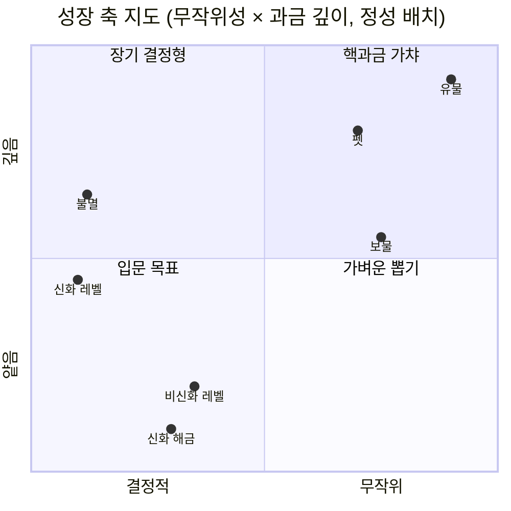
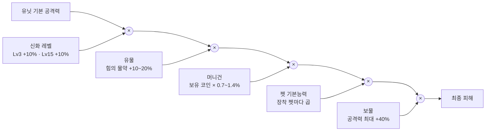
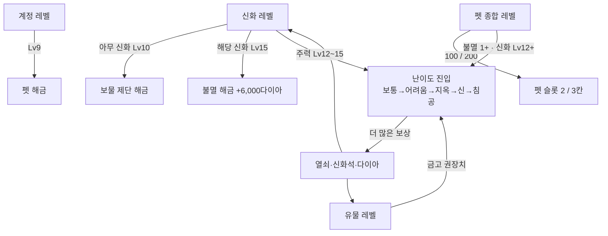

# 08. 종합 분석: 성장 축은 어떻게 맞물리나

## 8.1 성장 축 비교표

| 축 | 도입 | 단위 | 상한 | 성장 방식 | 주 재화 | 무작위성 | 천장 | 과금 깊이 [계산] | 판 안 영향 |
|----|------|------|------|----------|--------|--------|------|---------------|----------|
| 신화 해금 | 출시 | 신화 1기 | 약 25종 | 구매·모집 | 다이아 3,000 / 초대장 | 모집만 | 없음 | 낮음 (기당 0.3만) | 조합 가능한 신화 종류 |
| 신화 레벨 | 출시 | 신화 1기 | Lv15 | 결정적 | 신화석 + 골드 | 없음 | — | 중 (기당 10.8만) | 개별 화력, Lv6·12 고유 강화 |
| 비신화 레벨 | 출시 | 유닛 1종 | Lv15 | 결정적 | 중복 카드 + 골드 | 카드 획득 | — | 낮음 | 일반~전설 화력 |
| 유물 | 출시 | 31종 | Lv11 | **균등 가챠 → 레벨** | 열쇠 → 조각 + 골드 | **높음** | **없음** | **최상** (Lv6만 69만~99만) | 경제·확률·화력 전반 |
| 보물 | 2024-11 | 1슬롯 | Lv11 | 무작위 옵션 + 확률 강화 | 츄르 + 코인 + 레드 티켓 | 높음 | 소프트 천장 | 중상 | 상한 공·공속 40% 등 |
| 펫 | 2025-04 | 3슬롯 + 종합 | Lv50+ | 레벨형 가챠 → 레벨 | 배터리 + 펫 푸드 | 높음 | 뽑기 레벨 | 상 (뽑기 Lv11 86.8만) | **곱연산** 공격력 + 특수능력 |
| 불멸 | 2025-05 | 불멸 1기 | Lv15 → 25 | 결정적 | 다이아 6,000 + 불멸석·돌파석 | 없음 | — | 상 (기당 22.2만+) | 상위 변신, 신화의 2배 비용 |

> 위치는 [7장](07-economy-bm.md)의 계산값과 확률 구조를 바탕으로 한 **정성 배치**입니다.
> **결정적 성장(신화·불멸 레벨)은 '얼마나 걸리는지 보이는' 장기 목표**를, **무작위 성장(유물·펫·보물)은 '언제 끝날지 모르는' 과금 흡수처**를 맡습니다. 두 종류를 섞어서 계획형 유저와 운빨형 유저를 모두 붙잡습니다.

## 8.2 곱연산 구조: 왜 모든 축을 키워야 하나

공격력은 여러 축이 **서로 곱해지는** 구조로 알려져 있습니다. 펫 공격력은 곱연산이고(나무위키), 머니건과 같은 방식입니다.

### 예시: 축별 효과를 곱했을 때 [계산, 단순화]

곱연산이라고 가정하고 대표 수치를 곱해본 값입니다. 실제 공식은 덧셈·곱셈 묶음이 다를 수 있습니다. 머니건은 보유 코인 10만 기준입니다.

| 구성 | 신화 레벨 | 힘의 물약 | 머니건 (10만 코인) | 펫 3칸 | 보물 | 합계 배수 |
|------|---------------:|--------:|---------------:|------:|----:|-------:|
| 입문 (유물 Lv1, 신화 Lv6, 펫 없음) | ×1.10 | ×1.10 | ×8.0 | ×1.00 | ×1.0 | **×9.7** |
| 중급 (유물 Lv6, 신화 Lv12, 신화 펫 Lv10 ×3) | ×1.10 | ×1.15 | ×11.5 | ×1.31 | ×1.2 | **×22.9** |
| 상급 (유물 Lv11, 신화 Lv15, 불멸 펫 Lv10 ×2 + 신화) | ×1.20 | ×1.20 | ×15.0 | ×1.55 | ×1.4 | **×46.9** |

계산 근거:
- 머니건: 1 + 100,000 × 0.7% (Lv1 = ×8.0), 1.05% (Lv6 = ×11.5), 1.4% (Lv11 = ×15.0). 보유 코인의 0.7%를 '공격력 +%'로 읽은 해석입니다.
- 펫: 신화 Lv10 9.5% 세 마리 = 1.095³ ≈ 1.31. 불멸 Lv10 19% 두 마리 × 신화 9.5% 한 마리 = 1.19² × 1.095 ≈ 1.55.
- 보물: 중급 +20%, 상급 +40%(상한) 가정.

> 각 축은 따로 보면 +10~40%로 작지만 **곱하면 입문 대비 약 5배**가 됩니다. 한 축만 키우면 효율이 떨어지므로 **모든 축을 고르게 키우게** 만듭니다. 그중 **머니건(코인 연동)이 가장 큰 배수**라서, 판 안 경제 운영(금고로 코인 불리기)이 곧 화력이 됩니다.

## 8.3 축 사이의 연결 (게이트)

| 게이트 | 조건 | 기획 의도 |
|--------|------|---------|
| 펫 | 계정 Lv9 | 초반에 시스템을 한꺼번에 열지 않고 순차 공개 |
| 보물 제단 | **아무** 신화 Lv10 | 신화 하나만 집중 육성하면 열리는 '첫 번째 큰 목표' |
| 불멸 | **해당** 신화 Lv15 + 6,000다이아 | 주력 신화를 끝까지 키운 유저에게만 주는 상위 목표 |
| 펫 슬롯 | 종합 Lv100 / 200 | 하위 펫도 키우게 만드는 '수집 동기' |
| 난이도 | 금고 레벨 등 권장 스펙 (강제 아님) | 보상이 좋은 난이도를 스펙으로 막아 성장 동기 부여 |

> 게이트는 거의 모두 **"이미 하고 있던 성장을 계속하면 열리는"** 형태입니다. 새 축을 열기 위해 별도의 일을 시키지 않고, 기존 축의 목표 레벨을 다음 축의 입장권으로 씁니다.

## 8.4 판 안 운 × 판 밖 성장의 역할 분담

| 판 안 '운' 요소 | 판 밖에서 보정하는 장치 | 보정 방식 |
|---------------|---------------------|---------|
| 소환 등급 | 빛나는 레버 (희귀 +2~4%) | 확률 상승 |
| 도박 성공 | 나팔·황금 주사위 (확률), 해골석 (환급), 승부사의 손목 (실패 보상) | 확률 상승 + **실패 완화** |
| 행운석 부족 | 행운석·램프·영수증(유물), 우루루(펫), 모노폴리맨(신화) | 재화 추가 |
| 코인 부족 | 금고·지갑·비둘기·곡괭이·망치(유물), 산고기·유령부기(펫) | 재화 추가 |
| 필드 포화 | 고기 (최대 보유 +5~10) | 여유 공간 |
| 몬스터 누수 | 성벽 (카운트 +5~10), 포세이돈(펫) | 패배 유예 |

> **판 밖 성장은 '운을 없애지 않고 운이 나빠도 버티게' 설계되어 있습니다.** 실패 완화(해골석·손목)와 패배 유예(성벽)가 대표적입니다. "운빨"이라는 게임 정체성을 유지하면서도 투자한 만큼 덜 억울하게 만드는 균형입니다.

## 8.5 강점과 약점

| 강점 | 근거 |
|------|------|
| 판 안 과금이 없어 **공정한 판 경험** | 판 안 재화는 판이 끝나면 사라짐 ([7.2](07-economy-bm.md)) |
| 축을 **쌓는 확장** (갈아엎지 않음) | 보물 → 펫 → 불멸 → 불멸 Lv25, 모두 기존 성장 위에 추가 ([1.6](01-overview.md)) |
| 저가 상품의 효율이 커서 **소과금 전환이 쉬움** | 효율 10~30배 ([7.4](07-economy-bm.md)) |
| 2인 협동이라 **사회적 리텐션** | 매칭 게시판, 길드 ([1.5](01-overview.md)) |

| 약점 | 근거 |
|------|------|
| 유물 **균등 가챠 + 천장 없음** | 31종 1/31, 핵심 2종(금고·머니건)을 노리기 어려움 ([5.6](05-relics.md)) |
| 정수형 효과의 **헛레벨 구간** | 램프 6·고기 10·성벽 10이 사실상 만렙 ([5.3](05-relics.md)) |
| **확률 신뢰 리스크** | 2026-02 등급 안 편향 사태 ([6.7](06-pets.md)) |
| 영구 수치 너프 불가 | 금고·머니건 너프 → 롤백 ([5.9](05-relics.md)) |
| 깊은 싱크와 무과금의 격차 | 펫 뽑기 Lv11 무과금 약 4.8년 ([6.6](06-pets.md)) |
