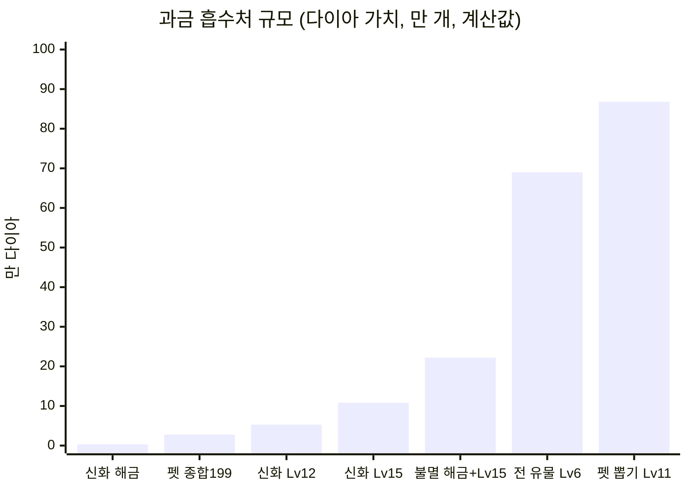

# 운빨존많겜 성장 시스템 분석 보고서

> 벤치마크 대상: **운빨존많겜** (영문 Lucky Defense → OMFG Lucky Me!, 111퍼센트, 2024-05-23 출시)
> 작성 2026-11-23 · 관점: 기획자용 · 형식: Markdown + Mermaid 차트 (GitHub에서 차트가 그려집니다)
> 이 폴더는 CLAUDE.md 예외 조항에 따라 대상 게임의 실명을 씁니다. 여기서 본 이름·캐릭터·그림을 게임 데이터로 옮기지 않습니다.

## 목차

| 장 | 문서 | 내용 |
|----|------|------|
| 0 | [기획안](00-plan.md) | 목적, 결정 사항, 조사 원칙과 제약 |
| 1 | [게임 개요](01-overview.md) | 기본 정보, 성과, 핵심 루프, 모드, 카페 구조, 연혁 |
| 2 | [캐릭터](02-heroes.md) | 등급 사다리, 도박 기대가치, 신화 레시피·목록, 불멸 |
| 3 | [레벨업](03-levelup.md) | 신화 Lv1~15 전 구간 비용, 마일스톤, 불멸, 계정 레벨 |
| 4 | [특성 → 패시브 성장](04-traits.md) | 특성 부재 확인, 보물 제단, 강화 기대 비용 |
| 5 | [유물](05-relics.md) | **31종 × Lv1~11 전 구간 수치표**, 비용, 획득, 권장 레벨 |
| 6 | [펫](06-pets.md) | **6등급 × Lv1~50 기본능력표**, 펫 푸드, 뽑기 레벨 확률, 확률 사태 |
| 7 | [**재화와 BM 흐름**](07-economy-bm.md) | **재화 지도, 획득처 매트릭스, 가격·효율, 광고, 가챠, 싱크 규모, 퍼널** |
| 8 | [종합 분석](08-synthesis.md) | 축 비교, 곱연산 구조, 게이트, 운 보정, 강점·약점 |
| 9 | [기획 시사점](09-implications.md) | Random-TD에 가져갈 점·피할 점, 특성 트리 비교 |
| 부록 | [출처](sources.md) · [`raw/`](raw/) | 핵심 출처, 장별 조사 노트 원본 |

## 핵심 요약

1. **판 안은 운, 판 밖은 성장.** 판 안 재화(코인·행운석)는 판이 끝나면 사라지고, 과금은 판 밖 스펙으로만 영향을 줍니다.
2. **'특성 트리'는 없습니다.** 패시브 성장은 모두 수집·레벨형입니다: 유물 31종(Lv11), 보물 1슬롯, 펫 종합 레벨, 신화 마일스톤.
3. **유물이 핵심 축입니다.** 31종 중 14종이 경제·확률 유물이고, 그중 **금고(복리 이자) × 머니건(코인 → 공격력)**이 난이도 진입 기준이 됩니다. 금고 Lv1과 Lv11의 80웨이브 결과 차이는 **약 41배**입니다.
4. **신화 레벨은 3레벨마다 보상**이 있고, Lv6·12에 영웅별 고유 강화가 있습니다. **마지막 3레벨(12→15)이 전체 비용의 51%**입니다.
5. **펫은 등급이 레벨을 압도합니다.** 불멸 Lv1(10%) = 신화 Lv11. 뽑기는 천장 대신 **누적 사용으로 확률이 오르는 '뽑기 레벨'**(불멸은 Lv8부터)을 씁니다.
6. **BM은 저가 정기 상품의 효율을 10~30배로** 설계해 소과금을 끌어들이고, **유물(천장 없는 1/31 가챠)·펫 뽑기·불멸(상한 25로 확장)**이 깊은 과금을 흡수합니다.
7. **약 6개월마다 새 축이나 상한 확장**(보물 → 펫 → 불멸 → 불멸 Lv25)과 새 난이도(권장 스펙 상승)를 더해 2년 뒤에도 반기 매출 629억 원을 유지합니다.
8. **리스크**: 핵심 유물 너프 → 롤백, 2026-02 펫 뽑기 등급 안 편향 사태.

## 수치 읽는 법

- 모든 표에 출처를 달았습니다. `나무위키(검색요약)`은 나무위키를 직접 열지 못하고 검색 결과 인용으로 확인한 값입니다.
- **계산값**은 출처에 적힌 규칙으로 계산한 값, **비례 추정**은 패턴을 연장한 미검증 값, **미확인**은 찾지 못한 값입니다.
- 대부분의 가격·환산치는 2024-07~2025-11 자료입니다. 현재 값과 다를 수 있습니다.

## 남은 빈칸 (주요)

| 항목 | 장 |
|------|----|
| 유물 Lv6→11 조각 수, 전 구간 골드 비용 | 5 |
| 펫 최대 레벨, 특수능력 중간값, 불멸 펫 푸드, 뽑기 Lv6~8 배터리 | 6 |
| 기본 소환 확률, 등급별 유닛 수, 신화 전체 목록·레시피 | 2 |
| 신화 모집 확률, 광고 16회 배분, 현재 인앱 전체 목록 | 7 |
| 공식 카페 공지·확률 안내 원문 | 전체 |
