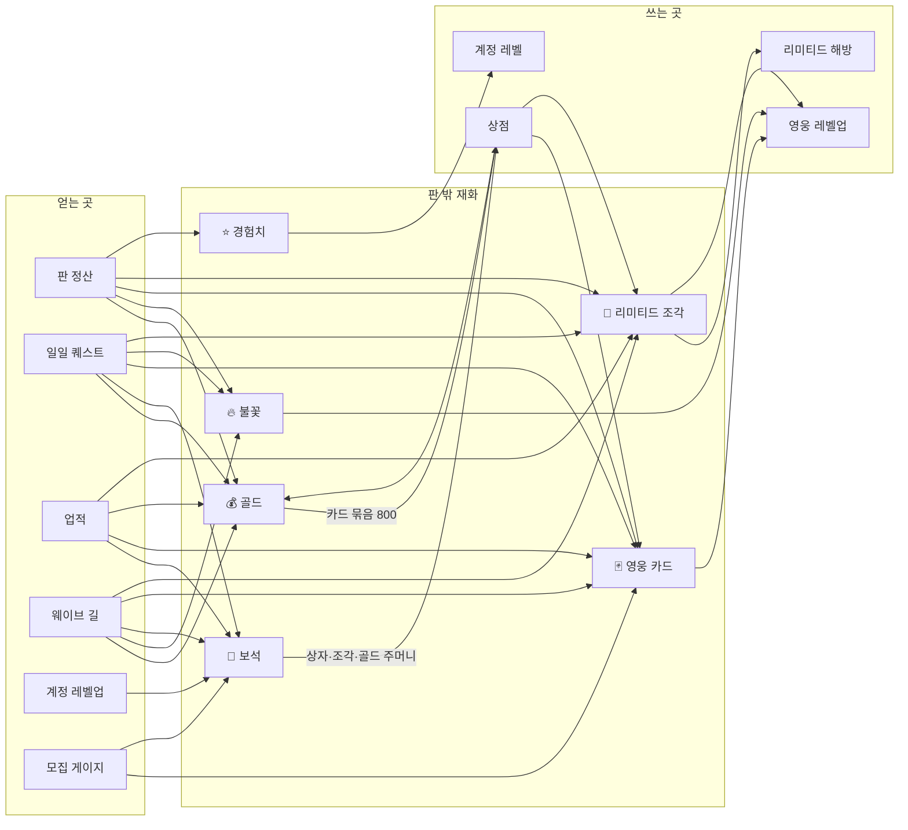
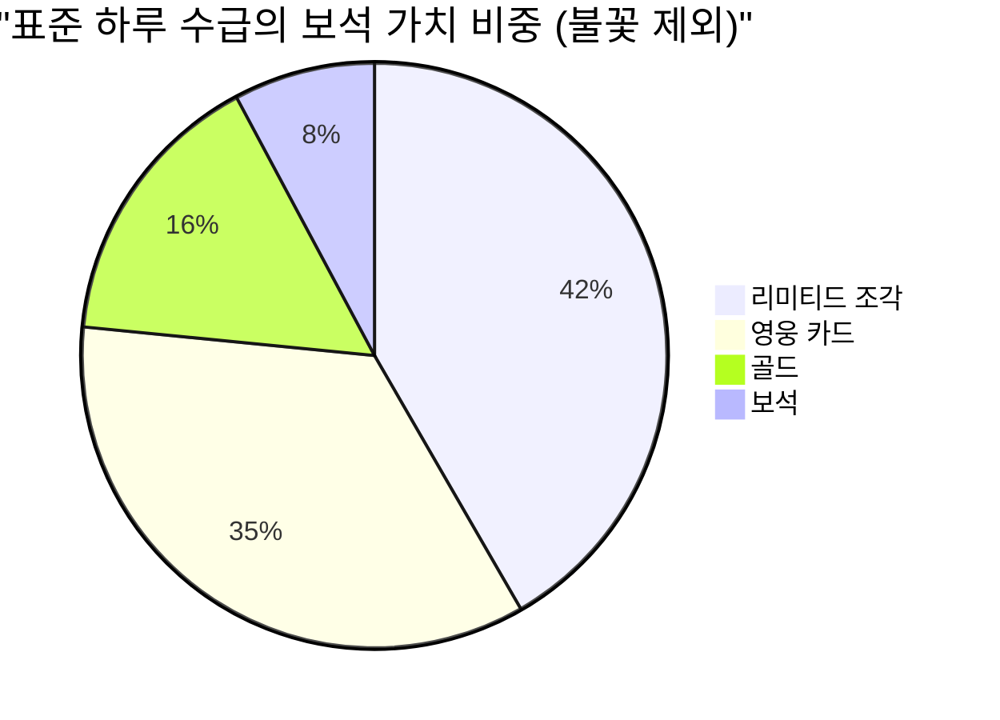
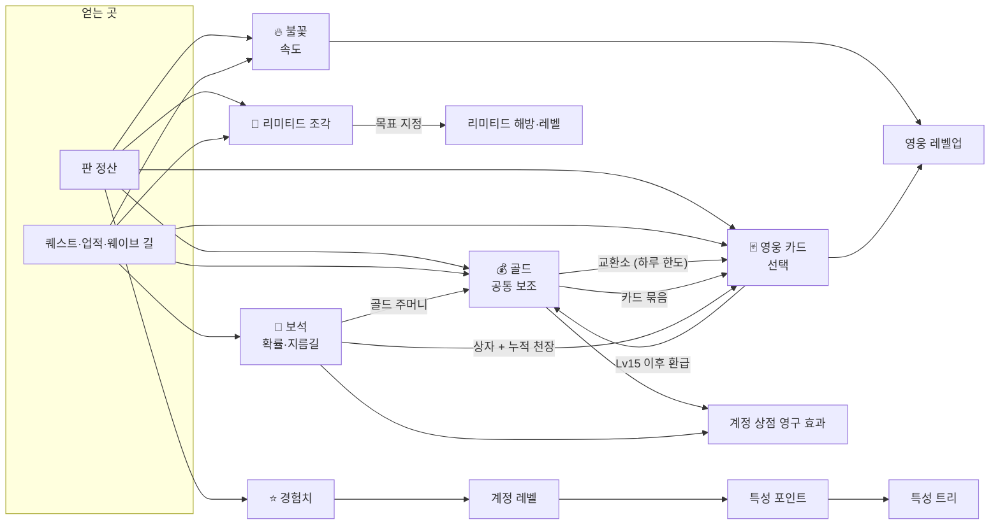
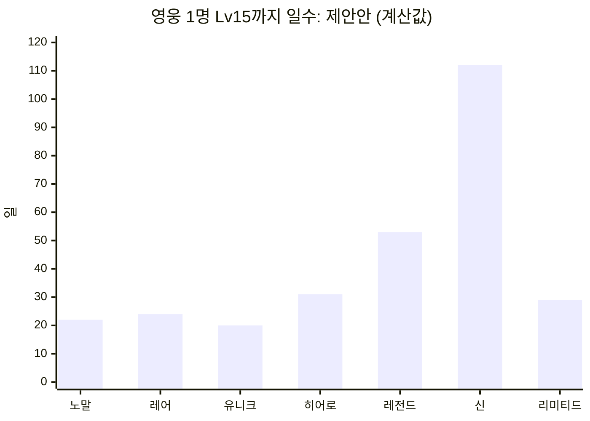
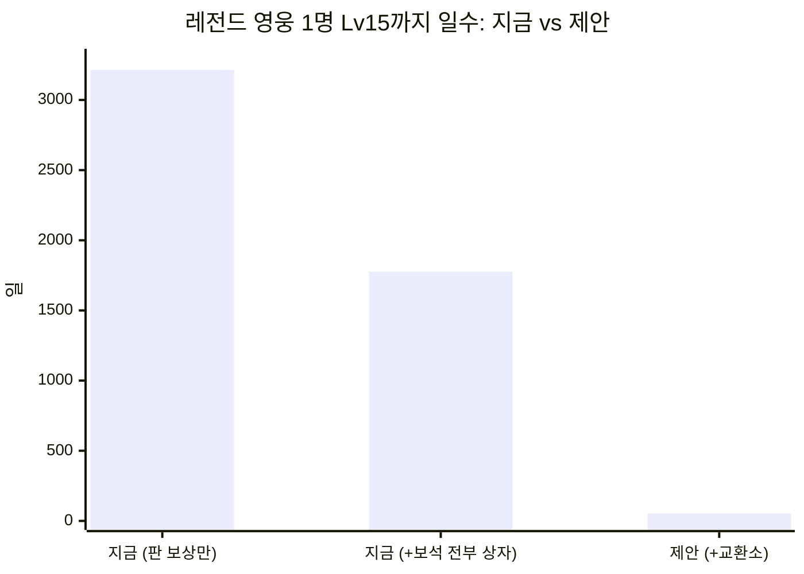

# 판 밖 재화 구조 초안 (V2 메타 경제)

> 상태: **초안 — 사용자 결정 전.** 코드·데이터는 바꾸지 않았다.
> 근거: 벤치마크 보고서(`docs/benchmark/` 아래) 7장 '재화와 BM 흐름'의 분석 + 지금 데이터 `src/data/progression.json`(version 2) + `docs/PROGRESSION.md` 13장(지금 구현) · 0~12장(장기 기획).
> 이 문서의 계산값은 모두 아래 1.3의 **표준 하루 가정**으로 낸 것이다. 실제 플레이 데이터로 다시 맞춰야 한다(7장 검증 계획).

## 0. 한눈에 보기

| 질문 | 답 |
|------|----|
| 새 재화가 필요한가? | **아니다.** 지금 재화 6종(💰골드 · 🔥불꽃 · 💎보석 · 🃏영웅 카드 · 🧩리미티드 조각 · ⭐경험치)을 그대로 두고 **역할과 흐름만 다시 짠다**. 특성 포인트(M8-4 계획)만 더한다 |
| 가장 큰 문제는? | **높은 등급 영웅 카드가 사실상 안 모인다.** 판 보상만으로는 레전드 영웅 하나를 Lv15까지 올리는 데 약 **3,214일**, 신은 사실상 불가능하다. 불꽃은 24일이면 충분하다 → 두 재화가 같은 레벨업을 막는데 **병목이 카드에만** 걸린다 |
| 두 번째 문제는? | 골드는 쓸 곳이 '영웅 카드 묶음' 하나뿐이다(V2.0 PR-A 이후 레벨업에서 빠짐) → 쌓이기만 한다 |
| 핵심 제안 | ① **골드 → 원하는 영웅 카드 교환소**(하루 한도) ② **Lv15 이후 남는 카드 → 골드 환급** ③ **리미티드 조각 '목표 지정'** ④ **상자 누적 천장** |
| 결과 (계산값) | 영웅 1명 Lv15 기간: 노말 127일 → **22일**, 레전드 3,214일 → **53일**, 신 사실상 불가 → **112일**, 리미티드 280일 → **23일** |
| 가져오지 않는 것 | 유료 재화·광고·에너지(체력) 제한·천장 없는 균등 뽑기·수년짜리 과금 싱크 (오프라인 1인 게임이라 필요 없다) |

## 1. 지금 구조 진단

### 1.1 재화 지도 (지금)



| 재화 | 얻는 곳 | 쓰는 곳 | 쓰는 곳 수 |
|------|--------|--------|----------|
| 💰 골드 | 판 정산, 퀘스트, 업적, 웨이브 길, 골드 주머니(보석) | 영웅 카드 묶음(800) | **1** |
| 🔥 불꽃 | 판 정산, 웨이브 길, 오늘 모두 완료 | 영웅 레벨업 | 1 (의도된 전용) |
| 💎 보석 | 계정 레벨업, 퀘스트, 업적, 웨이브 길, 모집 | 고급 카드 묶음, 레전드 상자, 조각 꾸러미, 골드 주머니 | 4 |
| 🃏 영웅 카드 | 판 정산, 퀘스트, 업적, 웨이브 길, 모집, 상점 | 영입(첫 장), 영웅 레벨업 | 1 |
| 🧩 리미티드 조각 | 보스 처치(**잠긴 히든 중 무작위**), 웨이브 길, 일일 보너스, 업적, 상점 | 해방(5개), 레벨업 | 1 |
| ⭐ 경험치 | 판 정산 | 계정 레벨 → 보석, 모드·도박 테이블 해금 | — |

### 1.2 보석 가치 기준 (지금 상점에서 역산)

| 기준 | 값 | 근거 |
|------|----|------|
| 골드 | **1보석 = 50골드** | 골드 주머니: 💎40 → 💰2,000 |
| 기본 카드 1장 | 약 3.2보석 | 카드 묶음 💰800(=16보석) ÷ 5장 |
| 유니크+ 카드 1장 | 10보석 | 고급 묶음 💎60 ÷ 6장 |
| 히어로+ 카드 1장 | 30보석 | 레전드 상자 💎150 ÷ 5장 |
| 리미티드 조각 1개 | 약 26.7보석 | 조각 꾸러미 💎80 ÷ 3개 |
| 불꽃 | 가격 없음 | 상점에서 팔지 않음 (PR-A 결정) |

### 1.3 표준 하루 수급 (계산값)

가정: **하루 5판, 한 판 평균 20웨이브 · 보스 1마리**(PROGRESSION 13.3 예시 판), 일일 퀘스트 전부 완료. 업적·웨이브 길·계정 레벨업·모집은 빼서 **보수적으로** 잡았다.

| 재화 | 판 정산 (5판) | 일일 퀘스트 | 하루 합계 | 보석 가치 |
|------|------------:|----------:|--------:|--------:|
| 💰 골드 | 2,500 | 500 | **3,000** | 60 |
| 🔥 불꽃 | 250 | 20 | **270** | — |
| 💎 보석 | — | 30 | **30** | 30 |
| 🃏 영웅 카드 | 40 | 2 | **42** | 약 134 |
| 🧩 리미티드 조각 | 5 | 1 | **6** | 약 160 |
| ⭐ 경험치 | 1,250 | — | 1,250 | — |



### 1.4 영웅 1명을 Lv15까지 올리는 기간 (지금, 계산값)

필요량은 `progression.json heroes`(카드는 단계마다 올림, 불꽃은 내림)로 계산했다. 카드 수급은 **판 보상 카드를 등급 가중치(노말 50 · 레어 30 · 유니크 14 · 히어로 5 · 레전드 1%)대로 나누고, 그 등급 안 10종에 균등**으로 나눈 값이다.

| 등급 | 필요 카드 | 이 영웅 카드/일 | **카드 기준 일수** | 필요 불꽃 | 불꽃 기준 일수 |
|------|--------:|-------------:|---------------:|--------:|------------:|
| 노말 | 266 | 2.10 | 127 | 1,590 | 5.9 |
| 레어 | 266 | 1.26 | 211 | 2,383 | 8.8 |
| 유니크 | 217 | 0.59 | 369 | 3,180 | 11.8 |
| 히어로 | 163 | 0.21 | 776 | 4,770 | 17.7 |
| 레전드 | 135 | 0.042 | **3,214** | 6,360 | 23.6 |
| 신 (3종) | 112 | 약 0.003¹ | **약 33,900** | 7,950 | 29.4 |
| 리미티드 (12종) | 조각 140² | 0.5 | **280** | 7,950 | 29.4 |

¹ 신 카드는 판 보상에 없고 레전드 상자(신 1%)에서만 나온다. 보석 30/일을 전부 레전드 상자에 쓴다고 가정했다.
² 해방 5 + 레벨업 135. 조각이 잠긴 히든 12종에 무작위로 흩어져서 한 영웅에게는 하루 0.5개꼴이다.

> 레전드는 보석을 전부 레전드 상자에 써도(레전드 카드 하루 0.34장 추가) 약 **1,776일**이다. **불꽃은 어느 등급에서도 병목이 아니다.** 지금 영웅 레벨업의 속도를 정하는 것은 사실상 '그 등급 카드가 얼마나 드물게 나오나'뿐이다.

### 1.5 진단 요약

| # | 문제 | 벤치마크에서 본 같은 문제 | 영향 |
|---|------|----------------------|------|
| D1 | 높은 등급 카드 병목 (레전드 3,214일, 신 불가) | 유물 균등 가챠 1/31, 천장 없음 | 높은 등급을 뽑아도 키울 수 없어 **수집 동기가 꺾인다** |
| D2 | 골드 쓸 곳 1곳 | (벤치마크는 골드를 모든 축이 공유) | 골드가 쌓여 **보상으로서 가치가 사라진다** |
| D3 | 리미티드 조각 무작위 분산 | 균등 가챠 | 원하는 리미티드를 해방하기 어렵다 |
| D4 | 레벨 15 이후 남는 카드가 쓸모없음 | 벤치마크는 중복 → 신화석 전환 | 많이 나오는 낮은 등급 카드가 **버려진다** |
| D5 | 상점 상자에 천장 없음 | 신규 축(보물·펫)에만 천장 → 불신 | 신 카드 1%를 노리는 반복 구매가 막막하다 |

## 2. 설계 원칙

벤치마크 7장에서 가져온 원칙과, 오프라인 1인 게임이라 바꾼 원칙이다.

| # | 원칙 | 출처·이유 |
|---|------|----------|
| P1 | **판 안 / 판 밖 분리 유지** — 판 밖 재화는 판에 `MatchOptions`(레벨·해금)로만 들어간다 | 벤치마크 강점 + 결정성·리플레이 규칙 |
| P2 | **한 재화 = 한 주역할.** 골드만 여러 축이 함께 쓰는 '공통 보조 재화' | 벤치마크의 골드 공유 구조 |
| P3 | **병목은 하나만, 의도해서.** 카드 = 어떤 영웅을 키울지(선택), 불꽃 = 여러 영웅을 동시에 키울 때의 속도 | D1 해결 |
| P4 | **무작위에는 반드시 지정 경로나 누적 천장** | 벤치마크 약점(균등 가챠·확률 불신) |
| P5 | **목표 기간은 주~달 단위.** 수년짜리 싱크를 만들지 않는다. 끝없는 목표는 보상이 아니라 기록(무한 웨이브) | 오프라인·무과금 |
| P6 | **레벨업마다 실효값이 바뀐다** (헛레벨 금지) | 벤치마크 약점(램프·고기 헛레벨) |
| P7 | **영구 수치는 내리지 않는다** — 처음부터 보수적으로 | 벤치마크 너프 → 롤백 사례 |
| P8 | **새 재화를 만들지 않는다** — 지금 재화에 사용처를 더한다 | 재화 수가 늘면 UI·알림(research.md 5d)이 복잡해짐 |

## 3. 제안 구조

### 3.1 재화별 역할 (제안)

| 재화 | 계층 | 주역할 | 얻는 곳 (변경 없음) | 쓰는 곳 (제안, **굵게** = 새로) |
|------|------|--------|-------------------|------------------------------|
| 💰 골드 | 공통 보조 | **선택과 보충** | 판 정산, 퀘스트, 업적, 웨이브 길, **남는 카드 환급** | 카드 묶음, **영웅 카드 교환소**, **계정 상점 영구 효과(일부)** |
| 🔥 불꽃 | 축 전용 | 영웅 레벨 **속도** | 그대로 | 영웅 레벨업 (그대로) |
| 🃏 영웅 카드 | 축 전용 | 어떤 영웅을 키울지 **선택** | 그대로 + **교환소** | 영입, 레벨업, **Lv15 이후 → 골드 환급** |
| 🧩 리미티드 조각 | 축 전용 | 리미티드 **해방·성장** | 그대로, 단 보스 조각은 **목표 영웅에게** | 해방, 레벨업 |
| 💎 보석 | 희소 | **확률 상승과 지름길** | 그대로 | 상자·묶음(**누적 천장**), 조각 꾸러미, 골드 주머니, **계정 상점 영구 효과(일부)** |
| ⭐ 경험치 | 진행 | 계정 레벨 → 해금·보석·**특성 포인트** | 그대로 | 계정 레벨 |
| 특성 포인트 | 진행 (M8-4) | 판 밖 **빌드 선택** | 계정 Lv5부터 레벨업마다 1 | 특성 트리 (무료 초기화) |



### 3.2 제안 A: 영웅 카드 교환소 (골드 → 원하는 영웅 카드)

**D1·D2를 함께 푼다.** 골드에 '선택' 역할을 준다. 벤치마크의 '미보유 유물 지정 구매'와 같은 구실이다.

| 등급 | 카드 1장 가격 | 보석 환산 | 비교 (지금 상점) | 하루 한도 |
|------|-----------:|-------:|---------------|--------:|
| 노말 | 💰100 | 2 | 기본 묶음 평균 3.2보석/장 | 공통 10장 |
| 레어 | 💰150 | 3 | 〃 | 공통 10장 |
| 유니크 | 💰300 | 6 | 고급 묶음 10보석/장(무작위) | 공통 10장 |
| 히어로 | 💰600 | 12 | 레전드 상자 30보석/장(무작위) | 공통 10장 |
| 레전드 | 💰1,200 | 24 | 〃 | 공통 10장 |
| 신 | 💰3,000 | 60 | 레전드 상자 1%만 | **1장** (공통 한도와 별도) |
| 리미티드 | 교환 불가 | — | 조각으로만 (3.4) | — |

- **보유(영입)한 영웅만** 교환할 수 있다 → 첫 영입의 기쁨은 뽑기·판 보상에 남긴다.
- 하루 한도는 기기 날짜 자정에 초기화(퀘스트와 같은 규칙, 시계를 되돌리면 세지 않음).
- 지정이라 무작위가 없으므로 **결정성·계정 시드와 무관**하다.

### 3.3 제안 B: Lv15 이후 남는 카드 → 골드 환급

**D4를 푼다.** 벤치마크의 '중복 → 신화석' 전환과 같은 구실이다.

| 등급 | 남는 카드 1장 → 골드 | 교환가 대비 |
|------|------------------:|---------:|
| 노말 | 💰20 | 20% |
| 레어 | 💰30 | 20% |
| 유니크 | 💰60 | 20% |
| 히어로 | 💰120 | 20% |
| 레전드 | 💰240 | 20% |
| 신 | 💰600 | 20% |
| 리미티드 조각 (Lv15 이후) | 💰240 | — |

- 환급가는 교환가의 **20%** → 교환 → 환급으로 골드를 불릴 수 없다 (되팔기 막기, v2/economy.md의 판매가 원칙과 같은 생각).
- 자동 환급(Lv15 도달 후 들어오는 카드)으로 해서 알림·버튼을 늘리지 않는다.

### 3.4 제안 C: 리미티드 조각 '목표 지정'

**D3를 푼다.** 새 재화 없이 규칙만 바꾼다.

| 항목 | 지금 | 제안 |
|------|------|------|
| 보스 처치 조각 | 잠긴 히든 중 무작위 1명 | **플레이어가 고른 '목표 리미티드'**에게 (안 고르면 지금처럼 무작위) |
| 조각 꾸러미(💎80) | 잠긴 히든 조각 3개 | 목표 리미티드에게 3개 |
| 웨이브 길·업적 조각 | 그대로 | 그대로 (목표에게) |
| 무작위 | 계정 시드 굴림 | 목표가 있으면 굴림 없음 |

- 대안 C′: 조각을 영웅별이 아닌 **공용 조각**으로 바꾸고 해방·레벨업 때 영웅을 고른다. 더 단순하지만 저장 형식 변경이 크다(영웅별 조각 합치기). → 결정 필요(6장 #2).

### 3.5 제안 D: 상점 누적 천장

**D5를 푼다.** 벤치마크의 보물 소프트 천장·펫 뽑기 레벨과 같은 구실이다.

| 상품 | 지금 | 제안 |
|------|------|------|
| 레전드 상자 (💎150, 신 1%) | 천장 없음 | **10번째 구매마다 신 카드 1장 확정** (보유한 신 중 무작위, 없으면 신 1종 영입) |
| 고급 카드 묶음 (💎60, 레전드 10%) | 천장 없음 | **10번째 구매마다 레전드 카드 1장 추가** |
| 영웅 카드 묶음 (💰800) | 천장 없음 | 그대로 (낮은 등급이라 불필요) |

- 누적 횟수는 계정 저장에 기록, 화면에 '천장까지 n번' 표시.
- 상자 내용은 지금처럼 계정 시드 + 굴림 번호로 정하고, 천장 보상만 결정적으로 더한다.

### 3.6 결과: 영웅 1명 Lv15 기간 (계산값)

가정: 1.3 표준 하루 + 골드 3,000을 **그 영웅 교환에만** 쓴다(한도 안에서). 실제로는 여러 영웅에 나눠 쓰므로 하한값이다.

| 등급 | 지금 (카드 기준) | 교환 카드/일 | **제안 (카드 기준)** | 불꽃 기준 | 병목 |
|------|---------------:|-----------:|-----------------:|--------:|------|
| 노말 | 127일 | 10.0 | **22일** | 5.9일 | 카드 |
| 레어 | 211일 | 10.0 | **24일** | 8.8일 | 카드 |
| 유니크 | 369일 | 10.0 | **20일** | 11.8일 | 카드 |
| 히어로 | 776일 | 5.0 | **31일** | 17.7일 | 카드 |
| 레전드 | 3,214일 | 2.5 | **53일** | 23.6일 | 카드 |
| 신 | 약 33,900일 | 1.0 | **112일** (천장 미포함) | 29.4일 | 카드 |
| 리미티드 | 280일 | — | **23일** (목표 지정, 조각 6/일) | 29.4일 | **불꽃** |





> 등급이 높을수록 오래 걸리는 순서(노말 3주 → 레전드 2달 → 신 4달)는 유지하면서, **'영원히 못 키움'을 '몇 달이면 키움'으로** 바꾼다. 리미티드는 조각이 빨라져서 병목이 불꽃으로 넘어간다 → 불꽃의 역할(속도)이 처음으로 드러난다.

### 3.7 전체 완성 목표 (장기)

| 목표 | 필요량 | 표준 하루 기준 | 판단 |
|------|------:|------------:|------|
| 영웅 65종 전부 Lv15 — 불꽃 | 302,080 | 약 **1,119일** (3년) | P5에 비해 길다 → 결정 필요(6장 #5) |
| 영웅 65종 전부 Lv15 — 카드 | 12,426장 (리미티드 조각 포함) | 교환 10장/일 + 판 42장/일로 약 240일+ | 불꽃보다 짧다 |

> 제안대로면 **장기 병목이 카드에서 불꽃으로 옮겨 간다**. '모든 영웅 만렙'을 약 1년 목표로 하려면 불꽃 수급을 약 3배(예: 판 정산 웨이브당 2 → 6)로 올리거나, 등급별 불꽃 배율(노말 100% … 신 500%)을 낮춰야 한다.

## 4. 계획된 성장 축과 재화 연결 (PROGRESSION 0~12장)

| 축 (계획) | 재화 (제안) | 재화 충돌 | 메모 |
|----------|-----------|----------|------|
| 특성 트리 (M8-4) | 특성 포인트 (계정 레벨) | 없음 | 결정적·선택형·무료 초기화 유지. 벤치마크에 없는 **차별점** |
| 계정 상점 영구 효과 (5.1) | 💰골드 + 💎보석 섞어서 | 보석: 상자와 경쟁 | 장기 기획의 '행운석' 가격을 골드 위주로 옮겨 골드 싱크를 넓힌다. 정수형 효과는 레벨마다 값이 바뀌게(P6) |
| 도감 수집 보너스 (8장) | 없음 (보유 영웅 레벨 합으로 자동) | 없음 | **20레벨 합마다 보너스**로 구체화 (벤치마크 '펫 종합 레벨') |
| 도박 숙련도 (9장) | 없음 (도박 횟수) | 없음 | 실패 완화형 효과 추가 검토 |
| 타워 각성 (7장) | 🃏 카드 + 🔥 불꽃 (Lv15 이후) | 3.3 환급과 겹침 | 각성을 넣으면 환급은 '각성 끝난 뒤 남는 카드'로 미룬다 |
| 출석 (11장) | 💎보석 · 🧩조각 · 🃏카드 | 없음 | 7일 주기·월간 누적 그대로 |

## 5. 데이터 초안 (`progression.json` 추가 예시)

```json
{
  "exchange": {
    "dailyLimit": 10,
    "godDailyLimit": 1,
    "goldPerCard": { "normal": 100, "rare": 150, "unique": 300, "hero": 600, "legend": 1200, "god": 3000 },
    "ownedOnly": true
  },
  "overflow": {
    "goldPerCard": { "normal": 20, "rare": 30, "unique": 60, "hero": 120, "legend": 240, "god": 600, "hidden": 240 }
  },
  "hiddenTarget": { "enabled": true },
  "pity": {
    "chest-legend": { "every": 10, "grant": { "grade": "god", "cards": 1 } },
    "pack-fine": { "every": 10, "grant": { "grade": "legend", "cards": 1 } }
  }
}
```

- 저장: 교환 한도(날짜·개수), 천장 누적 횟수, 목표 리미티드 → `rtd.progress` **형식 v3**. v2를 읽을 때 기본값(0, 목표 없음)으로 채운다.
- 검사: `src/meta/progressionData.ts` + `tools/gen_tables.py --check`에 "환급가 < 교환가", "천장 every ≥ 2" 같은 규칙 추가.
- sim과 무관(판 밖 메타 수치) → 게임 데이터 지문·리플레이에 영향 없음.

## 6. 결정이 필요한 항목

| # | 항목 | 선택지 | 추천 |
|---|------|-------|------|
| 1 | 교환소 도입과 가격 | (a) 3.2 표대로 (b) 가격 ×2 (더 느리게) (c) 도입 안 함 | **(a)** — 레전드 약 2달 |
| 2 | 리미티드 조각 | (a) 목표 지정 (3.4) (b) 공용 조각 (C′) (c) 그대로 | **(a)** — 저장 변경이 작다 |
| 3 | 남는 카드 환급 비율 | (a) 교환가의 20% (b) 10% (c) 없음 | **(a)** |
| 4 | 상자 천장 | (a) 10회마다 확정 (b) 연속 실패 시 확률 상승 (c) 없음 | **(a)** — 화면에 남은 횟수를 보여주기 쉽다 |
| 5 | '모든 영웅 만렙' 목표 기간 | (a) 약 3년 그대로 (b) 약 1년 (불꽃 수급 ×3) (c) 따로 정함 | **(b)** |
| 6 | 계정 상점 영구 효과 화폐 | (a) 골드 위주 (b) 보석 위주 (c) 섞음 | **(a)** — 골드 싱크 확대 |

## 7. 검증 계획

| 단계 | 방법 | 통과 기준 |
|------|------|----------|
| 1 | 규칙 함수 Vitest: 교환 한도·날짜 초기화, 환급, 천장 누적, 목표 조각 | 경계값(한도 0·10·자정·시계 되돌림) 포함 |
| 2 | 경제 시뮬레이터(`tools/` 새 스크립트, 계정 시드 고정): 표준 하루 × 180일 | 3.6 표의 일수 ±20% 안 |
| 3 | 실제 판 기록(`BattleRecords`)으로 표준 하루 가정(5판·20웨이브·보스 1) 보정 | 가정과 실측 차이 기록 |
| 4 | 데이터 검사(`gen_tables.py --check`) | 되팔기 불가 규칙 통과 |
